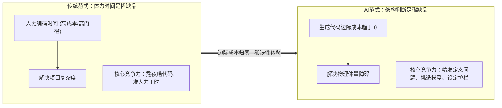
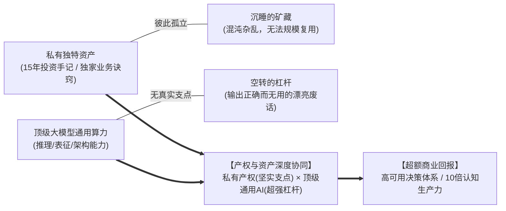

# 开篇：基础公理与Aha时刻

> **本章心法：** AI 时代懂与不懂的差距，不是“效率快慢”，而是“有无杠杆与支点”的结构性差距。稀缺的不再是体力和时间，而是框架与判断力；纯聊天式的 AI 使用价值为零，能撬动你个人产权的 AI 才有超额回报。

---

这本书不从一个生硬的术语表开始。

大多数 AI 入门书的第一页，都在急迫地堆砌名词——Transformer、Token、RAG、Agent——读者还没进入正题，就先被一堵厚重的术语高墙挡在门外。我不打算这么做。

我想从两个真实的故事开始。不是因为故事生动，而是因为这两个故事各自指向一条底层公理——**全书此后的一切推演、一切方法、一切工程实战，都建立在这两条公理之上。** 就像经典的《经济学的思维方式》从一个十字路口的堵车场景引出“所有人在特定约束与激励下做出选择”一样，我希望你读完这两个故事后，不用死记任何定义，就能凭直觉理解：**在 AI 时代，什么变了，什么没变，以及——你的核心立足点究竟在哪里。**

---

## 故事一：Steven的两周

Steven 是一名特许金融分析师（CFA），在香港一家知名家族办公室担任资深股票分析师。如果你在商务宴请或饭局上认识他，你会觉得他是一个极其典型的金融精英——言辞严密，对财务数字极度敏锐，对下行风险抱有一种职业性的本能警觉。

但 Steven 还有不为人知的另一面：他狂热地喜欢编程。不是那种在简历上写“熟练掌握 Python 基础语法”的浅尝辄止，而是真正热爱工程构建——他给家人写过跨平台生活记账 App，给朋友的外贸公司独立开发过一套内部财务报销审批系统，那套系统当年还为他带来了几十万港币的体面外快。所以，当 Steven 后来决定全职转行做软件架构师时，熟悉他的朋友没有一个感到意外。

然而，软件工程的严酷现实很快给了他迎头一记重锤。

入职新公司后，团队交给他的一号任务是重构一个历史遗留系统。那是一个业务逻辑极度混乱、缺乏架构文档、几乎没有像样单元测试的老项目，在程序员圈子里被形象地称为“屎山”。Steven 满怀信心地一头扎了进去——接下来的整整一个月里，他几乎每天在工位和家里熬夜到凌晨两三点，疲惫不堪，却连系统主干调用链的完整时序都没能彻底梳理清楚。代码像是一座没有出口的泥潭迷宫，每拔出一条逻辑，就会牵连出十处隐蔽的全局依赖。他不是工程逻辑不行，而是这座大山的体量实在太沉重了。

转折发生在他正式打开终端，对 Claude Code 说出第一句话的那一刻。

他不再尝试凭借人脑肉身去通读成千上万行混乱代码，而是将核心业务链路的原始上下文分段注入给 AI 终端，要求它首先反向逆推系统的整体架构图与领域状态流转。随后，他让 Claude Code 依照严谨的接口契约对模块逐一执行重构。在整个推进过程中，Steven 只做三件事：**定义各阶段的边界规格、逐行审查 AI 生成的 Diff、核验核心边界测试**。

仅仅用了两周——整整两周时间，他端到端完成了此前耗费一个月都毫无头绪的重构任务，不仅理顺了全部业务闭环，更补齐了完备的自动化测试套件。

Steven 在复盘时的一句话直击要害：  
*“我不是不会写代码，我是被这座屎山的物理体量给活活压垮了。AI 并没有代替我的大脑去思考，它是替我搬掉了物理体量这个看似无法逾越的巨石。”*

这就是 Steven 的 Aha 时刻。

---

## 公理一：稀缺性与极限替代公理

Steven 熬夜一个月焦头烂额，借助 Claude Code 却在两周内优雅破局。这绝非一句简单的“AI 提高了生产效率”所能概括，它揭示了知识工作底层的一场深刻地壳运动：**什么是稀缺的，彻底变了。**

在生成式 AI 席卷之前，软件研发与智力劳动中最稀缺的资源是什么？是**时间**。你愿意投入足够长的时间，啃下足够多的源码，耗费足够的体力，任何复杂的系统总能被一点点磨出来。“熬夜时间 + 身体耐力”，曾经是无数工程师抵御竞争的护城河。

但 Steven 的困境冷酷地证明：当系统复杂度越过某个临界阈值时，纯粹的人力时间不再是致胜的武器，反而会异化为拖垮你的认知负债。你越是企图用肉眼阅读海量代码，就越深陷于局部细节的泥潭中动弹不得。

Claude Code 展现的威力，并不是说它比经验丰富的工程师拥有更高的全局智慧，而是它**彻底替代了“体力型搬砖时间”这一曾经无比昂贵的稀缺要素**。通读语法、推导局部依赖、遵循风格规范逐行重写——这些任务不需要划时代的天才，只需要近乎无限的耐心与极其快速的代码吞吐。而大模型恰恰拥有近乎无限、且边际成本趋近于零的生成能力。

由此，竞争的焦点彻底漂移了。  
在过去，一个问题靠花大把时间就能解决；在今天，纯粹耗费时间已毫无壁垒。真正的胜负手转移到了：**你是否拥有精准拆解复杂问题的框架能力？你是否能挑选出最适配当前场景的技术范式？你是否懂得给生成式系统构建严密的验收护栏？**

> **公理一（稀缺性与极限替代公理）：**  
> **当某项通用智力劳动的边际成本趋近于零时，曾经依赖该劳动时长所建立的专业壁垒将迅速瓦解；真实的稀缺性不可逆地转移至“精准定义问题、构筑规格契约并调度替代资源”的高维判断力上。**

---

## 故事二：十五年的投资笔记

我自己是做电信运营商产品研发出身的，长期从事产业互联网平台规划。在繁忙的产品工作之余，我长达十五年最大的个人志趣是证券投资。

从 2010 年起，我系统研读了经典价值投资、行为金融学、系统动力学等领域的数百部专著，光是在各类记事本和 Markdown 中记录的投资手记、财报研报与复盘心得，就积累了数十万字之巨。十五年的真金白银沉浮，本该是一座专属于我的丰厚私人金矿，但在很长一段时间里，它从未被真正系统性地开采过。我的实际投资战绩也常常如同风中残烛——在顺周期中收益颇丰，在逆周期中又回撤惨烈，逻辑飘忽不定。

在生成式 AI 刚爆发时，我满怀期待地把大批笔记扔进对话框，要求 AI 帮我“总结核心投资哲学”。

结果却令我大失所望。普通 AI 聊天机器人给出的输出千篇一律、浮于表面，通篇充斥着“长期持有、分散风险、注意安全边际”等正确的废话，甚至把我在不同历史阶段特意记录的逆向投资边界条件完全抹去。那感觉，就像你把毕生商业机密交给了一个毫无实战经验的实习生——他打字极快、态度极佳，但由于自身缺乏深度推理的底座，整理出来的材料看似四平八稳，实则把最值钱的精髓彻底阉割了。

后来，我改变了策略。我选用了具备深度推理能力的顶级基座模型，不再下达诸如“帮我写个总结”这种轻浮的指令，而是**以结构化契约为绳，对系统进行角色设定与三层架构约束**——要求它按价值流派深度解构、按胜率赔率的因果链条对齐，并针对极端熊市情境进行规则萃取。

奇迹发生了。

那些尘封了十五年、彼此离散甚至偶尔冲突的笔记散点，在强大推理引擎的贯通下，被整合成了一套层次分明、攻守兼备、具备实操校验清单的完整投资决策体系。如今我每一次面对重大标的买卖，都会打开这套体系逐项自检。它绝非大模型凭空捏造的幻觉，而是**我历经十五年试错沉淀下的独特个人资产，被顶级模型以强大的逻辑重组能力，从混沌的信息废墟中提炼出的绝对秩序。**

这便是我的 Aha 时刻。

---

## 公理二：产权与资产协同公理

对比前后两次尝试：为什么面对同样的原始笔记，前一次得到的是一锅平庸的“文字糊”，后一次却炼成了一座结构严密的决策堡垒？

秘密并不单纯在 AI 模型身上。  
如果退回到源头：假如我脑中空空如也，从未真金白银投资过一天，只是兴冲冲地让大模型“给我写一套能战胜市场的投资圣经”，即使调用全球顶尖的大模型，它吐出来的依然只能是一堆毫无实战杀伤力的漂亮空话。

**根本的支点，在于我拥有那十五年写满得失的私人笔记。**  
这是我的**私有独特产权资产**——它不是开源数据，无法从任何网络爬虫中轻易获取，它是我用漫长的时间成本、无数次在市场风浪中交过学费后淬炼出的真实经验。它是专属的、不可替代的。

当这份高价值的私有资产，与当代顶级的通用推理能力发生化学反应时，真正的超额杠杆才被彻底激活：
$$\text{价值创造} = \text{私有独特资产 (支点)} \times \text{顶级通用大模型 (杠杆)}$$

- **没有独特资产，只有通用 AI**：你与大模型闲聊两小时，产出几乎为零，因为杠杆的底部是悬空的；
- **只有独特资产，不用通用 AI**：你的宝贵经验只能沉睡在硬盘深处，缺乏强大的外力帮你完成从经验到可执行系统的跃迁。

> **公理二（产权与资产协同公理）：**  
> **唯有当独特的私有数据产权与顶级的通用智能引擎发生深度协同与结构化碰撞时，才能产生指数级的超额回报；脱离个人独特资产的纯聊天式 AI 使用价值趋近于零，唯有能够深度撬动你个人与组织私有产权的 AI 编排，才具备真正的战略价值。**

---

## 两条公理给我们的终极启示

将这两条基础公理并置于眼前，整个 AI 时代的生存与跃迁图景便清晰可见：

1. **认知鸿沟远超以往历次工业革命**  
   懂 AI 与不懂 AI 之间的差距，从来不是“你打字每分钟 60 词而他每分钟 120 词”的工作效率差异，而是**“一个人掌握了十倍杠杆且拥有坚实支点，另一个人却连杠杆的概念都未曾建立”**的阶级性断层。在蒸汽时代，拥有蒸汽机的织布厂产量十倍于手工作坊；在智能时代，一个懂得用框架调度 AI 的复合型人才，其认知交付带宽可以百倍于纯体力劳动者。
2. **选择顶级模型不是“锦上添花”，而是“有无支点”的分水岭**  
   同样一份十五年笔记，交给平庸工具得到的是垃圾，交给顶级模型得到的是体系。不同量级的杠杆在面对复杂高维问题时，呈现出断崖式的临界点特性。
3. **为先进工具付费不是消费，而是极具确定性的投资**  
   你支付的 API 费用或订阅费用，购买的是使你个人多年积累的稀缺资产获得最顶级认知杠杆放大的门票。如果几百美元的算力消耗能把你数年积累的沉睡资产激活为自动化流水线，那么这项投资的 ROI 就是无限大的。

---

## 本章小结与思维自检清单

- [ ] **稀缺性发生转移**：体力型时间的边际成本已被 AI 压缩至零，不要再试图通过“堆加班工时”建立职业护城河；真正的壁垒是**定义问题、选择范式与设计护栏**的能力。
- [ ] **守住你的独特产权**：无论身处哪个行业，你的业务第一手 Know-How、踩坑记录与独特洞察，是你手中唯一的“不可替代支点”；AI 负责提供通用杠杆，支点必须由你提供。
- [ ] **建立半人马协作姿态**：人类做判断与价值定义，AI 负责高速执行与边界探测。
