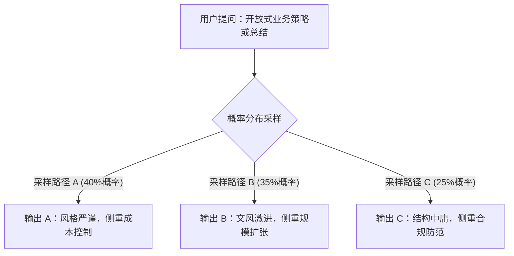
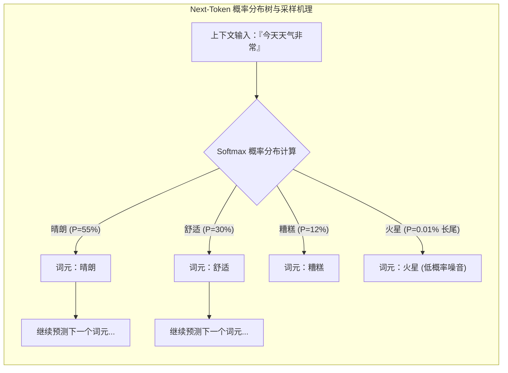
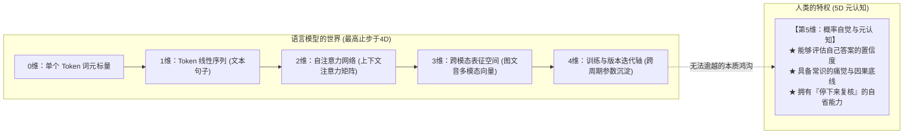
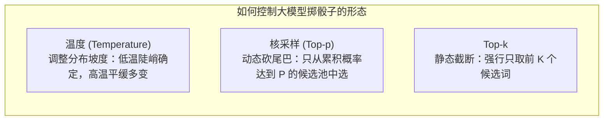
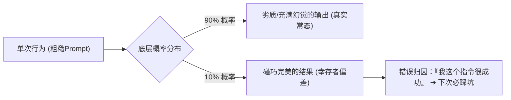

# 第1章 谜题：为什么世界上没有完美的AI？

> **本章心法：** AI 不是严谨执行代码的逻辑计算机，而是一台在海量参数空间中掷骰子的语言概率采样机。理解它的非确定性，不是为了向它妥协，而是为了掌握给它立规矩的先决条件。

---

如果你在日常工作或生活中频繁使用过大模型，你大概率经历过两种极其抓狂的困惑：

第一种困惑是**“反复无常”**：你输入了完全相同的提示词，跑了三次，却得到了三份切入点、语气和内容截然不同但又各自“自圆其说”的答案，你甚至不知道该押注哪一份；  
第二种困惑是**“盲目自信”**：AI 用极其笃定、权威、不容置疑的口吻，向你陈述了一个完全捏造的事实——不是吞吞吐吐地说“我不太确定”，而是言之凿凿地宣称“根据发表在权威期刊上的研究，结论毫无疑问是 X”，而那个 X 纯属凭空臆造。

这两个怪现象不是软件的偶然 Bug。它们是生成式大语言模型底层数学原理的**必然副产品**，就像水往低处流不是水流系统的故障，而是重力物理法则的必然呈现。在看透底层逻辑之前，AI 的一切表现都像一门玄学——有时宛如天降神兵，有时蠢得令人啼笑皆非。而一旦穿透它的本质，这些特性反而会变成你手中可预测、可对齐、可工程化约束的确定性抓手。

---

## 1.1 两个怪现象的解剖

### 怪现象一：图书管理员不会说“不知道”

传统的计算机程序和驯养良好的家犬有相似的确定性：你给猎犬下达“坐下”的指令，只要训练达标，它就会立刻坐下；你在 Python 里写一个税费计算函数 `calculate_tax(income)`，跑一万次，只要入参相同，返回值就绝对恒定。

但 AI 彻底打破了这种确定性预期。

AI 就像一个拥有浩瀚书卷的**机器人图书管理员**。它的训练数据是一座覆盖全人类文明的庞大图书馆，但它的工作机制**根本不是“数据库精准检索”，而是“高维统计概率采样”**。
- 如果你问它一个先验概率极强的收敛问题（例如“唐朝的首都是哪里”），它几乎每次都能答对，因为在百亿级语料中，“唐朝 $\to$ 首都 $\to$ 长安”的条件概率分布形成了绝对的陡峰；
- 但当你抛出一个稍具开放性的问题（例如“为客户投诉撰写一封挽回信”），它是在浩瀚的语言空间中进行概率漫游：每次抽取的词元路径稍有差异，最终涌现出的邮件风格、叙事侧重点便大相径庭。

更致命的是：**这位图书管理员根本不知道自己的图书馆缺少哪些藏书。** 当你问及它知识库范围之外或纯属虚构的内容时，它绝不会像严谨的学者那样躬身致歉“抱歉，此领域暂无权威记载”；相反，它的内部机制驱动着它沿着统计上最通顺、读起来最像真话的词元路径一路狂奔，极度自信地现场编撰出一套看似天衣无缝的说辞。

### 怪现象二：一本正经地胡说八道（幻觉）

工程界为这种现象赋予了一个学名：**幻觉（Hallucination）**。

一个经典的惨痛案例：某法律助理使用 ChatGPT 起草辩护状，询问某项关键抗辩理由的判例支持。AI 在几秒钟内吐出了极其翔实的历史案例——案号、主审法官名字、判决年份、甚至判词核心引文一应俱全。当律师满怀信心地将文书递交法院时，法官却查无此案。所有的判例编号和法官引言，全是大模型在“法律文书风格”这一统计分布下即兴生成的拟真积木。

这里的核心反直觉之处在于：**AI 在说谎时的语气，与它陈述颠扑不破的真理时的语气，完全没有任何区别。**  
它没有心跳加速，没有瞳孔放大，没有“根据现有数据，我的置信度仅有 30%”的心理犹豫。它只管沿着语言统计概率一路生成。

> **核心原则：**  
> **大模型的语言自信程度，与其事实准确程度没有任何数学上的必然联系。** 把它在文本表层展现的从容自信，误当成逻辑底层的真凭实据，是所有 AI 新手踩过的最大陷阱。

---

## 1.2 第一性原理：AI在算概率

绝大多数人之所以会对 AI 产生不切实际的幻灭感，源于心智模型中的初始错误假设：**人们以为 AI 是一个智能搜索引擎或关系型数据库。**

这个假设大错特错。

大语言模型的本质极其简单纯粹，甚至简单到令人难以置信：**给定前面的所有上下文（Context），预测下一个最可能出现的词（Next-Token Prediction）。**

$$\arg\max_{w} P(w_t \mid w_1, w_2, \dots, w_{t-1})$$

它并不“懂得”世界，它只是在数以万亿计的参数网络中建立起了极其复杂的条件概率转移矩阵：
- 它不知道“地球绕着太阳转”是一个客观物理事实，它只知道在“地球”“绕着”出现后，“太阳”这个词元被采样的概率高达 99.8%；
- 它同样不知道什么是《自然》（Nature）期刊的学术道德，它只知道在科研文献的语境下，“发表于”“DOI 号”“实验表明”这些词语经常扎堆出现。当概率采样的长尾被随机命中时，它便把符合学术格式的假作者、假编号像乐高积木一样拼装在了一起。

理解了这层第一性原理，两个怪现象便从“不可思议的玄学”还原成了“冷酷的统计学必然”：
- 你不会因为骰子掷出 1 点而对骰子发火，因为你知道骰子的本质就是六分之一的均匀概率；
- 同理，你永远不该对大模型偶尔的幻觉感到不可思议，因为它的数学底座就是允许长尾概率被抽样的连续函数。

人与 AI 的本质区别不是它懂不懂，而是——骰子的分布是固定的，而**大模型的概率分布形状，是可以被人为塑造和干预的。** 提示词工程（Prompt Engineering）、上下文注入（RAG）以及护栏工程（Harness），本质上都是在做同一件事：**通过约束输入上下文，将正确答案的条件概率峰值无限拉高，将荒谬幻觉的长尾概率压至接近于零。**

---

## 1.3 人类活在五维，AI死在四维

既然大模型能够计算如此复杂的统计规律，为什么它依然无法像一个普通人一样靠谱地工作？

答案是：**它缺乏元认知（Metacognition），它对自己正在计算概率这件事毫无感知。** 让我们用一个多维认知模型来彻底看清人机的分水岭：

- **0 维（点）**：单个 Token 的概率计算；
- **1 维（线）**：词元前后相接构成的单向文本流；
- **2 维（面）**：Transformer 自注意力机制（Self-Attention）编织出的全上下文语义关联网；
- **3 维（体）**：将图像、语音、代码与文本映射到同一向量空间的统一多模态表征；
- **4 维（时间流）**：从预训练、SFT 到 RLHF 的长周期进化轴。

AI 在前四维空间中游刃有余，速度千倍于人类。但它永远跨不进**第五维——概率自觉（元认知）**：
- 人类在回答问题前，大脑会自动衡量：“我对这件事有多大把握？如果我说错了后果会有多严重？我是不是应该先查证一下再开口？”人类拥有对自己知识边界的敬畏与审慎；
- 大模型没有第五维。它不知道自己生成的话会不会误导病人服药，它不知道自己写出的 SQL 会不会抹掉生产数据库，它更不知道自己刚刚捏造的法条会导致一场官司败诉。**在它的四维空间里，只有下一个 Token 的数学相似度，根本不存在“客观对错”与“现实责任”。**

这正是全书倡导“**半人马协作（Centaur Collaboration）**”的哲学基石：
$$\text{半人马协作} = \text{人类在第5维做终局裁判与价值定义} + \text{AI在前4维做超高速执行}$$
不是因为人类的算力比模型强，而是因为我们独占着评估输出靠不靠谱的元认知特权。

---

## 1.4 非确定性的实践含义：如何给概率塑形

既然不能把非确定性消灭至绝对的零，优秀的工程师与产品经理便转向第二条道路：**学会操纵参数，主动塑造概率分布的形状。**

主流模型接口提供了三个控制采样的核心旋钮：

### 1. 温度（Temperature）：调节概率分布的“陡峭度”
- **低温模式（如 $T = 0.0 \sim 0.2$）**：Softmax 的概率分布被急剧拉伸，最高概率的 Token 呈现绝对碾压之势。模型变得极其收敛、保守、严谨。适合代码编写、数据分析、金融报表提取等要求确定性输出的场景；
- **高温模式（如 $T = 0.7 \sim 1.0$）**：概率分布被显著压平，原本概率较低的长尾词元获得了被采样的机会。模型展现出极大的多样性与发散感。适合头脑风暴、剧本创作、营销文案构思。

### 2. Top-p（核采样）：动态“砍掉危险的长尾”
Top-p 设置一个累积概率阈值（如 $0.9$）。系统在采样时，将所有候选词元按概率降序排列，仅在累积概率之和达到 90% 的头部集合内进行抽样，剩下的 10% 稀有长尾词元被直接一刀切除。这是防止模型冷不丁爆出怪诞生僻词与离谱幻觉的最优雅手段。

### 3. Top-k：硬性物理截断
无论概率分布如何，强行只保留概率排名前 $K$ 个的词元（如 $K=40$）。

> **工程心法：**  
> 永远不要奢望调节出一组“能让 AI 100% 保持正确的黄金参数”。**参数只能改变单次采样的倾向，无法抹平随机性本身。** 追求确定性交付的真正终局解法，不是反复微调温度，而是引入外部工程护栏与自动化测试迭代。

---

## 1.5 结果正确 ≠ 行为正确

这是概率思维体系中最具颠覆性的一项认知法则。

请设想一个场景：你随手写了一句极简粗糙的提示词丟给 AI，AI 奇迹般地吐出了一份近乎完美的方案。  
此时多数人的第一反应是：“太神了！这个提示词效果真棒！”

但如果你具备贝叶斯概率思维，你必须冷酷地追问自己：**这个结果的产生，究竟是一个大概率事件，还是一次极小概率的幸存者偏差？**

如果同样的提示词跑 10 次，有 9 次生成的都是废话，只有 1 次碰巧切中了你的需求，那么你这次所谓的“成功行为”本质上极其恶劣——你只是恰好撞上了大运。  
如果你误把运气当成了能力，那么当你把这套指令固化到企业业务流程中时，灾难便不可避免。

- **初学者的死穴**：紧盯单次输出的结果，一旦结果不好就惊慌失措、怨天尤人；
- **架构师的素养**：审视构建指令与护栏的行为本身，追求**“大概率的系统性持续稳健”**，而不是“偶尔一次的惊艳发挥”。

---

## 1.6 概率工具箱与全书核心方程

将以上第一性原理凝练收拢，我们便得到了贯穿全书的**概率工具箱**。这套工具不需要深奥的高等数学证明，你只需要在直觉上彻底内化它：

### 工具一：全书第一核心方程
$$\text{行为 (Prompt / Harness)} \times \text{概率 (Sampling)} = \text{结果 (Output)}$$
- 行为由你全权支配：你的提示词越清晰、4S 约束越严谨、提供给 AI 的上下文和工具越精准，成功概率的底盘就越高；
- 采样交由模型完成：尊重模型内在的概率波动，不用单次成败定义系统优劣。

### 工具二：多轮迭代成功率飞轮公式
$$\text{系统整体成功率} = 1 - \prod_{i=1}^{n} (1 - P_i)$$
单次任务成功率哪怕只有 $P_1 = 60\%$，看似难以用于生产。但只要你设计了闭环的工作流：让 AI 输出初稿，让验证器找出缺陷，基于反馈执行第二轮、第三轮局部自愈修复（假设 $P_2 = 75\%, P_3 = 85\%$）：
$$\text{端到端成功率} = 1 - (1 - 0.6) \times (1 - 0.75) \times (1 - 0.85) = 1 - 0.4 \times 0.25 \times 0.15 = 98.5\%$$
**不要妄想一步登天，用严谨的多步迭代把整体交付成功率强行拉抬至 99% 以上。**

### 工具三：贝叶斯后验直觉
$$\text{后验认知} \propto \text{先验经验} \times \text{最新证据调整因子}$$
每一次阅读 AI 生成的代码或文案，都是在观察一份新的实验证据。用证据动态修正你对模型边界的认知，不迷信，不贬低。

---

## 本章思维习惯与自检清单

- [ ] **养成概率决策习惯**：每当看到满意的 AI 输出，多问一句：“如果换个种子或新建会话再跑三次，它还能大概率保持这个水准吗？如果不能，我的约束还漏掉了什么？”
- [ ] **建立概率自觉**：永远牢记 AI 展现的自信是语言学层面的连贯，而非知识学层面的真理。永远保留人类在第 5 维的最终审校与确认权。
- [ ] **不跟随机性较劲**：在对精确度要求极高的任务中，果断将温度拉低至接近零，并坚决配置结构化输出校验（JSON Schema / 单测验证）。