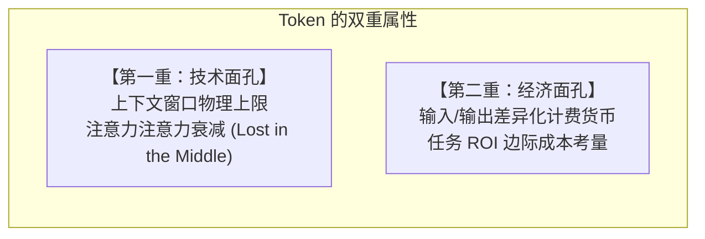
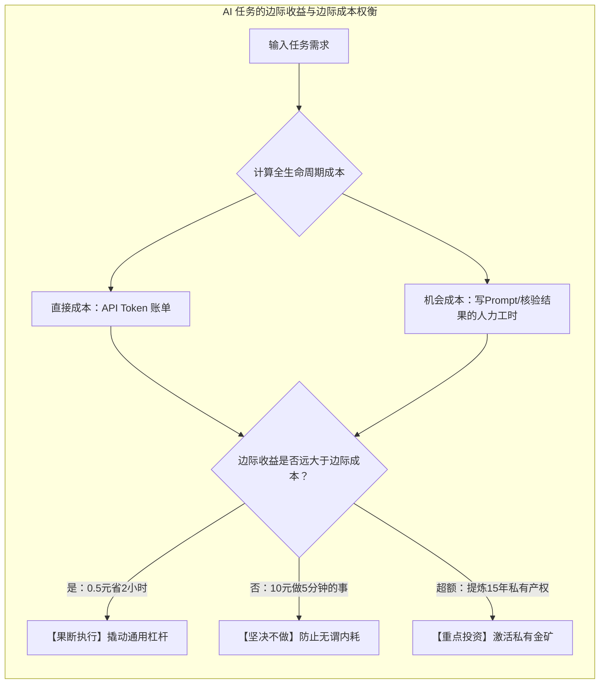
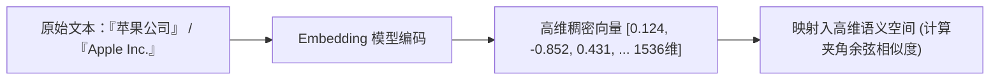
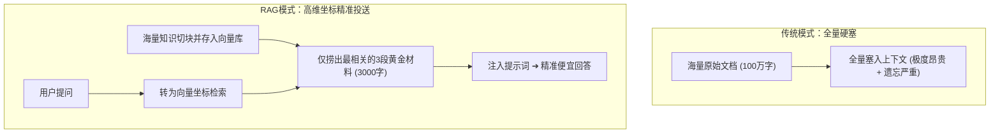

# 第2章 稀缺的硬通货：Token与语义坐标

> **本章心法：** 在 AI 的世界里，Token 是注意力与算力的硬通货（预算约束），Embedding 是高维语义空间的地理经纬度（导航坐标）。理解 Token 让你懂得如何精打细算注意力预算，理解 Embedding 让你看透 AI 检索真实知识的底座引擎。

---

如果你在日常使用大模型时有过以下经历，你其实已经撞上了 AI 世界的经济学边界：

- 你满怀期待地把一份长达 200 页的行业研报整本扔进对话框，然后向 AI 提问核心数据，它却偏偏漏掉了夹在中间最关键的那张附表；
- 或者，你发现同一份材料，换了一个模型或者换了一种提问方式，Token 消耗量竟然相差了数倍，费用账单也跟着大幅跳变。

这两个现象指向了 AI 体系的两个底层基建：**Token（词元）** 与 **Embedding（词嵌入向量）**。它们不是工程师用来炫技的技术术语，而是构筑整个 AI 运行秩序的“经济学基础设施”。搞懂了 Token，你就理解了为什么在提示词设计中“少即是多”；搞懂了 Embedding，你就洞悉了为什么大模型能够跨越词汇表象去感知人类的语义。

---

## 2.1 Token的双重面孔：技术约束与经济货币

Token 是大模型处理信息的最基本颗粒度。对于英文，一个 Token 大约对应 0.75 个单词；对于中文，一个常见汉字通常会被切分成 1 到 2 个 Token。理解 Token，必须同时看清它的两副面孔。

### 第一重面孔：上下文窗口的技术约束

每个大模型在部署时都有一个硬性的物理限制——**上下文窗口（Context Window）**。即使当前前沿模型已经将上下文容量拓展到了 1M 甚至 2M Tokens，技术约束依然无处不在：

1. **长度硬上限**：如果你的文档超出了模型的最大上下文容量，系统会直接报错截断。
2. **注意力衰减与“中间遗忘”（Lost in the Middle）**：  
   这是注意力机制不可忽视的天然物理特性。实验表明，当上下文变得极长时，大模型对位于**开头（首因效应）**和**结尾（近因效应）**的信息记忆深刻、调用准确；而深埋在文本中段（20%~80% 区域）的事实，极易被周围海量的上下文稀释与模糊。  
   > **实战黄金法则：**  
   > **最关键的角色设定、核心约束与输出 Schema 必须放在开头或结尾；中间段只放支撑性的佐证材料。**
3. **计算复杂度与推理延迟**：自注意力机制的理论计算复杂度与输入长度呈二次方或线性伴随增长。输入越长，首字返回时间（TTFT）与端到端耗时越长。

### 第二重面孔：Token 就是真金白银

在商业 API 调用的世界里，Token 就是直接兑换现实货币的唯一等价物。

当前主流大模型的计费呈现极其鲜明的**输入/输出不对称特征**（通常输出 Token 单价是输入 Token 的 3 到 4 倍，因为生成每个新 Token 都需要全量前向计算）：

| 模型代际与层级 | 典型代表 | 输入单价（每百万 Token） | 输出单价（每百万 Token） | 典型适用战场 |
| :--- | :--- | :--- | :--- | :--- |
| **顶级旗舰推理** | Claude Opus 5 / GPT-4o / GPT-5.6 Sol | \$2.50 ~ \$5.00 | \$10.00 ~ \$20.00 | 复杂架构设计、关键决策、代码审查 |
| **高性价比主力** | DeepSeek-V3 / Qwen V3 / Claude Sonnet | \$0.14 ~ \$0.50 | \$0.28 ~ \$1.50 | 企业级日常任务、文档处理、自动化流水线 |
| **轻量级端侧** | Flash / Mini 系列 | < \$0.10 | < \$0.30 | 简单分类、意图路由、关键词提取 |

**一个生动的类比：超市推车**  
使用大模型如同推着购物车去超市采购，你的手推车容量是有限的（上下文预算）。如果你盲目地把一整箱廉价膨化食品（未经清洗的杂乱背景材料）堆满推车，真正昂贵精密的进口食材（核心业务逻辑）就再也没有容身之地。聪明的做法是手持一份精准的采购清单，只将最关键的信息放进推车。

---

## 2.2 值不值？AI任务的经济考量

理解了 Token 是钱，每一个成熟的产品经理和工程师面临的核心命题就变成了：**完成这项业务任务，值得烧掉多少 Token？**

### 边际成本的两个组成部分

1. **直接成本（Token 账单）**：API 消耗的绝对金额，通常只有几毛或几元钱；
2. **机会成本（人类时间）**：**这是整个方程中最昂贵的项。** 撰写提示词、准备测试集、人工逐行 Review AI 输出的时间，其单价远超 Token 本身。

> **经济学心法：**  
> **优化 Token 效率的核心从来不是扣扣搜搜省几分钱，而是最大限度压缩人的迭代轮次。** 花费更多 Token 做长思维链推理，但能一次性把任务跑对，其综合经济效益百倍于省了 Token 却逼得人类反复打回重跑三轮。

### 三种经典经济场景的取舍

- **场景一（大赚）：0.5 元 Token 替代 2 小时繁琐人力**  
  *例*：解析一份 50 页的行业合规审计报告。花费 0.5 元让大模型提炼核心异动并定位风险条款，人类专家花费 10 分钟做最终确认。收益远大于成本，**果断执行**。
- **场景二（亏本）：10 元 Token 做你自己 3 分钟就能敲完的事**  
  *例*：让 AI 构思一封只有两句话的内部请假邮件，反复微调提示词和语气花了 15 分钟。没有任何私有资产支点，**坚决不做**。
- **场景三（战略级投资）：花费几十元 Token 彻底盘活沉睡的私有独特资产**  
  *例*：对应开篇公理二，把团队沉淀五年的几十套项目复盘手记通过大模型进行深度提炼，沉淀为标准 SOP 资产。私有产权与通用杠杆深度共振，**必须全力投入**。

### Token 效率优化三原则

1. **精选上下文（Curate Context）**：5 页精心提炼的高信息密度背景，其表现远胜过 100 页直接复制粘贴的聊天记录；
2. **拆解步骤执行（Decompose into Steps）**：将复杂大任务切分成原子步骤，每一步只给当前需要的输入，既省 Token 又极大降低幻觉概率；
3. **阶梯模型选型（Model Tiering）**：用轻量级便宜模型做前置分类与意图路由，用顶级昂贵模型攻坚最终推理。

---

## 2.3 Embedding：AI世界的“地理坐标”

如果说 Token 是 AI 世界的钞票，那么 **Embedding（词嵌入向量）** 就是 AI 世界的经纬度地图。

### 从关键词匹配到高维向量坐标

传统的计算机检索是**“字面匹对”**：搜索“苹果公司”，如果文章里写的是“Apple Inc.”或“库克的企业”，传统关键词匹配就会空手而归。

Embedding 彻底颠覆了这一切。它通过一个深度神经网络，将每一个词语、句子或长段落，映射成高维空间（例如 1536 维或 3072 维）中的一串浮点数数组（向量）：

在这座高维几何空间里：
- “苹果公司”与“Apple Inc.”虽然字面完全不同，但它们的几何坐标挨得极近；
- “国王”减去“男人”加上“女人”，其空间向量会精确指向“女王”；
- 两个概念越相关，它们向量之间的**余弦相似度（Cosine Similarity）**就越接近 1。

$$\text{Cosine Similarity}(\vec{A}, \vec{B}) = \frac{\vec{A} \cdot \vec{B}}{\|\vec{A}\| \|\vec{B}\|}$$

### 警惕陷阱：“语义相近”不等于“事实对齐”

Embedding 赋予了 AI 强大的语义模糊联想能力，但必须时刻保持清醒：**高维空间中的几何距离相近，只代表它们在统计语料中经常出现在同类语境，绝不代表它们在具体业务事实中绝对相关。**

例如，“胃癌”和“胃炎”在向量空间中由于常与“消化道、幽门螺杆菌、胃镜、疼痛”等词汇共现，它们的余弦距离极其接近；但在医疗临床诊断中，二者有着生与死的本质区别。这就解释了为什么生产级检索系统不能单靠向量检索，必须辅以关键词精确匹配（BM25）与重排（Rerank）机制。

---

## 2.4 RAG的经济学本质：精准置换

将 Token 经济学与 Embedding 坐标系合在一起，我们便能看透 **RAG（检索增强生成，Retrieval-Augmented Generation）** 的本质面目。

在没有 RAG 之前，如果你想让大模型基于企业的十万页规章制度回答问题，你必须将整本手册全量塞入 Prompt——这不仅会直接击穿上下文窗口预算，引发剧烈的“中间遗忘”，还会带来天文数字级的 Token 账单。

RAG 在经济学上完成了一次漂亮的置换：  
**用极低成本的向量空间近邻检索，换取了向大模型注入最少、最精准的黄金上下文。**  
它以最低的 Token 消耗，规避了模型的注意力衰减，同时让模型的输出紧紧锚定在企业私有数据之上。

---

## 本章小结与预算自检清单

- [ ] **理解 Token 的双重性**：上下文窗口不仅是物理上限，中间区域存在显著的注意力衰减；务必把最重要的规则置于首尾。
- [ ] **算清任务的经济账**：不要用高成本模型去跑简单死板的纯规则流程；省 Token 的本质是减少人类返工和迭代的轮次。
- [ ] **建立空间坐标直觉**：Embedding 将人类知识编码为几何经纬度，让语义联想成为可能；但切记统计相关不等于业务必然，检索链路必须配置校验。
- [ ] **掌握 RAG 的经济学逻辑**：善用外部向量库将“大海捞针”转化为“精准投喂”，在控制成本的同时获得极高的回答准确率。