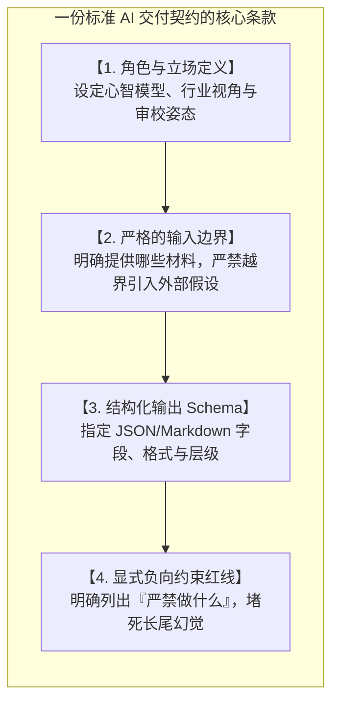
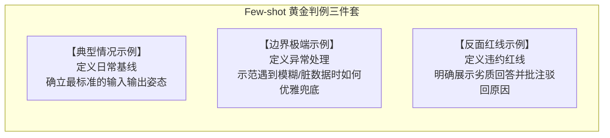
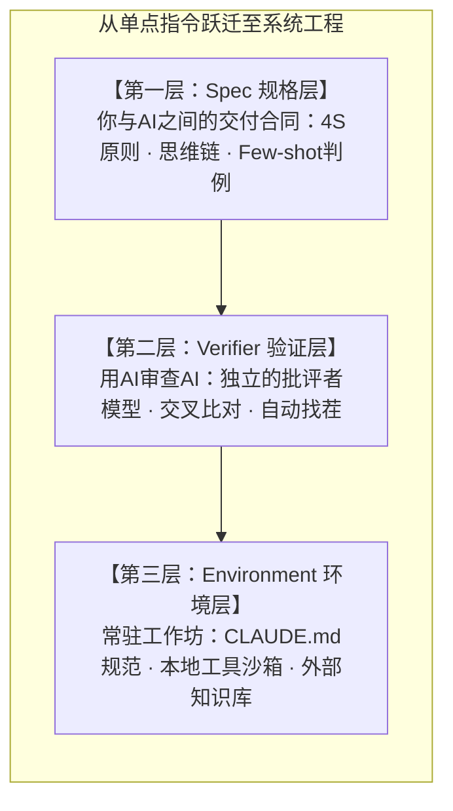

# 第3章 契约精神：如何写一份无法违约的“交付规格书”

> **本章心法：** 提示词不是漫不经心的闲聊指令，而是一份严肃的业务交付合同。写全条款不等于写好合同，用 4S 原则消除歧义，用思维链落实“分期付款”，用 Spec $\to$ Verifier $\to$ Environment 三层架构彻底封死违约空间。

---

许多人在刚接触大模型时，习惯性地把对话框当成了搜索框，或者当成了一个有求必应的随身闲聊搭子。他们敲下一句含糊不清的指令：“帮我写一份营销方案，要专业、生动、有说服力”，然后屏住呼吸等待奇迹发生。

几秒钟后，屏幕上吐出一堆排版整齐、辞藻华丽却空洞无物的车轱辘话。用户皱起眉头，得出结论：“这东西根本不能用在真实业务里，全是玩具。”

问题出在哪里？问题不在于大模型的智商，而在于你与它建立连接的方式。你单方面发出了一段模糊的感性祈求，却期望对方交付一份精密的工业制品。在软件工程与现代商业中，没有任何合格的交付物能够建立在祈求之上——**所有的可靠交付，必须且只能建立在严密的“契约（Contract）”之上。**

---

## 3.1 Prompt 的第一性：从自然语言到软件契约

在传统软件开发中，程序员通过写代码向计算机下达指令。代码的语法是极其残酷而严格的：漏掉一个分号，程序直接抛出异常；变量类型不匹配，编译器坚决拒绝执行。这是**硬性语法契约**。

而在大模型时代，交互界面退化为了极其平易近人的自然语言。但这恰恰是最具欺骗性的陷阱——**自然语言的极度包容性，掩盖了交付逻辑的严密性。**



每一次给大模型下达指令，本质上是在签署一份**劳动委托合同**。合同条款越完整、违约惩罚越明确，AI 交付的结果就越稳定：

1. **角色定义（Role & Standing）**：不要轻浮地写“你是一个专家”，而是赋予具体的责任立场：“你是一名专注于高并发交易系统的资深安全审计师，你对 SQL 注入和越权漏洞保持极高敏感度”；
2. **输入范围（Input Boundary）**：明确界定数据源，“仅基于我提供的日志上下文，严禁脑补我未提及的服务器配置”；
3. **输出规格（Output Schema）**：要求结构化交付，“输出必须严格遵循如下 JSON 格式，包含 `risk_level`、`code_snippet` 和 `fix_suggestion` 三个字段”；
4. **负向约束（Negative Constraints）**：明确划定红线条款，“严禁直接修改原有数据库表结构；严禁引入未经批准的第三方依赖；严禁输出任何礼节性开场白与客套总结”。

---

## 3.2 4S 原则：一份好契约的黄金尺度

条款齐全只是一份合同的及格线。在现实中，一份满是套话、含糊其辞的长篇大论，同样会导致执行变形。**4S 原则**就是检验你的提示词质量的四把精确标尺。


### 1. Single（单一目标）：一份契约只管一件事
最典型的初学者错误是把三件事揉在一个 Prompt 里：“分析这份竞品报告，然后帮我写一封发给销售总监的汇报邮件，顺便帮我列出三条下周行动项。”  
大模型在处理这类多目标指令时，注意力资源会被多重身份无情撕扯。更好的做法是**单兵单任务**：先让 AI 完成报告结构化解剖，人脑核验后，再让它基于结论撰写邮件。

### 2. Specific（具体无歧义）：把形容词彻底换成指标
- **有歧义的废话**：“写得专业生动一点”、“逻辑要紧凑”、“细节要详细”；
- **无歧义的契约**：“每个论点必须附带至少一组具体的百分比数据”、“正文段落严格控制在 3 至 5 句以内”、“严禁使用感叹号与任何修辞反问”。  
*消灭歧义的唯一法则：把主观感受换成客观指标，把抽象形容词换成量化数字。*

### 3. Short（精炼高密度）：每一句话都必须提供约束
长篇大论的 Prompt 往往在稀释模型的注意力。检查自己的提示词，删掉所有的“如果你能帮我完成这个我将不胜感激”、“请务必尽你最大的努力”等无用客套。高品质的 Prompt 应当字字如金，每一行都在施加有效约束。

### 4. Show Context（交代业务背景）：缩小模型的猜测空间
“帮我写一份年度总结”——没有上下文，模型只能输出一套平庸的模板套话；  
“帮我写一份电信政企线云网业务的年度述职总结——受众是省公司分管领导，核心基调是展现技术中台对全省千万级项目的赋能提效，重点突出人效比的改善”——交代了公司、受众、基调与重点指标，AI 的猜测空间被瞬间压缩，输出自然一发中的。

---

## 3.3 思维链（CoT）：合同的“分期付款”机制

如果说 4S 原则是让合同“写得好”，那么**思维链（Chain of Thought，CoT）**则是让合同“执行得稳”。

### 为什么思维链是革命性的？

回到第 1 章的数学底座：大模型是在高维概率空间中采样的系统。要求它直接针对复杂问题给出最终结论，相当于**逼迫它在概率空间中完成一次超长距离的盲目跳跃**——中间哪怕有一个推理微步发生偏航，落地的最终答案便谬以千里。


思维链的核心思想极其质朴：**在输出最终答案前，强制让模型把草稿打在公屏上——“Let's think step by step”（请一步步深度推理）。**  
它把一次跨越深渊的豪赌，拆解为了多步微小的台阶式跳跃。每一次小跳跃都在上一步已锁定的确定性上下文之上进行，使得每一步的局部成功率都维持在 90% 以上的高位。

### 思维链落地的三种战术形态

1. **零样本思维链（Zero-shot CoT）**：在指令尾部显式追加“请按逻辑步骤逐步推导”，以零成本激活模型的慢思考机制；
2. **少样本思维链（Few-shot CoT）**：在提示词中提供 2~3 个完整的“问题 $\to$ 推理草稿 $\to$ 最终结论”的标准判例，让 AI 精准模仿特定领域的推导范式（如法律责任链分析、复杂的财务折旧拆解）；
3. **分步任务链（Chained Prompts）**：人类架构师主动介入，将宏观业务目标拆解为独立会话或多轮交互：“第一步，先列出系统内所有的状态机异常迁移；第二步，基于第一步的列表，给出每个状态的熔断策略”。

---

## 3.4 Few-shot 示例驱动：附上历史判例

在普通合同里，无论法务条文写得多细密，具体到特定纠纷时依然存在语义缝隙。在英美法系中，填补这些缝隙的终极武器是**判例法（Case Law）**——翻阅法官在过去真实类似案件中是如何裁决的。

**Few-shot（少样本示例）就是你提供给大模型的“历史判例”。**  
在自然语言中，你自以为写清楚的抽象规则，在模型的理解中往往留有广阔的解释漏洞。2~3 个极其鲜活的输入与输出范例，胜过一千字反复强调的抽象说教。



- **示范典型用例**：确立常规场景的标准模版；
- **示范边界用例**：告诉模型当面临缺失字段或极端长尾时，应当返回空值还是执行降级；
- **示范反面用例**：告诉模型什么样的废话或推测是被严格禁止的。

> **警惕陷阱：**  
> **错误的示例远比没有示例更具破坏力。** 如果你随意从历史记录中粘贴了带有格式缺陷或逻辑瑕疵的 Demo 给 AI，模型会迅速将这些瑕疵默认为你的偏好准则，导致输出质量出现断崖式下跌。宁缺毋滥，是设计 Few-shot 的第一铁律。

---

## 3.5 三层架构：Spec $\to$ Verifier $\to$ Environment

提示词写得再好，如果仅仅停留在“单次指令调优”的视角，你依然处于前沿 AI 工程的最底层。前 OpenAI 核心架构师 Andrej Karpathy 曾系统性地提炼过一套 AI 交付的**三层架构模型**：



### 第一层：Spec（规格设计层）
这是人与 AI 对齐的核心：明确任务的边界条件与验收标准。在动手写代码或产出方案前，不是直接让 AI 干活，而是先让 AI 通过反问（Interview）把业务规格彻底梳理成文（横向呼应第 9 章的“六要素任务书”）。

### 第二层：Verifier（验证器层：用 AI 审查 AI）
人类的时间极其昂贵。如果你让 AI 节省了 1 小时的写作时间，却要花 2 小时用肉眼核验它的逻辑，杠杆效应就会大打折扣。  
**生产级架构必须引入 Verifier：让第二个模型扮演冷酷的批评者。**  
例如：让 Model-A 生成业务代码，将代码与原始 Spec 丢给 Model-B，命令其专挑边界漏洞、性能隐患与格式违约。两个不同架构的模型在同一个隐蔽盲点同时犯错的联合概率极低。

### 第三层：Environment（环境基础设施层）
不要每次都在一片空白的聊天框里重复交代“我是谁、系统用什么技术栈”。通过在项目根目录常驻规范文件（如 `CLAUDE.md`）、配置本地执行沙箱与外挂知识库，模型一启动便自带企业级上下文与工具调用权限（横向呼应第 9 章的双主代理与研发云底座）。

---

## 本章小结与标准契约模板库

```markdown
# 业务交付契约模板 (Standard Contract Prompt)

[ROLE & STANDING]
你是一名【特定专业领域的资深专家角色】，具有【特定行业背景与风控意识】。

[OBJECTIVE & SCOPE]
本次任务的单一核心目标是【一句话明确目标】。仅限于处理【范围说明】，不涉及【边界之外事项】。

[INPUT DATA]
以下是本次任务的唯一输入参考材料（严禁引入外部未验证假设）：
"""
{INPUT_CONTEXT}
"""

[EXECUTION INSTRUCTIONS]
1. 请一步步深度思考（Think step by step），先在草稿中推导出核心因果逻辑。
2. 严格核验边界条件，重点排除【常见业务风险项】。

[OUTPUT SCHEMA]
输出必须严格遵循如下 Markdown / JSON 格式规范：
- 【字段1】：...
- 【字段2】：...

[NEGATIVE CONSTRAINTS]
- 严禁包含任何礼节性开场白或自我说明。
- 严禁出现未经验证的猜测性数据。
- 严禁违反【特定格式/技术栈限制】。
```

- [ ] **坚守契约思维**：永远不发模糊指令，用“角色、输入、格式、红线”四要素封死语义漏洞。
- [ ] **践行 4S 标准**：Single（单任务）、Specific（量化具体）、Short（高密度精炼）、Show Context（交代背景）。
- [ ] **激活思维链与黄金判例**：复杂推理必须让模型打草稿；精选正向、边界与反面三类典型判例做概率锚定。
- [ ] **升维至三层架构**：不要停留在单点提问，建立起包含 Spec 规格、Verifier 自动审查与 Environment 常驻环境的企业级系统。
