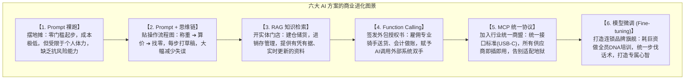
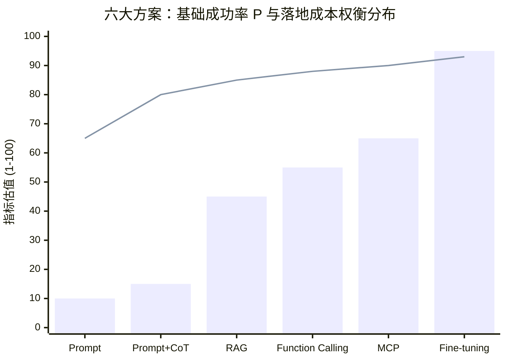
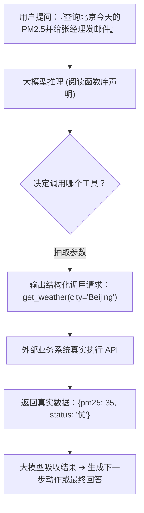
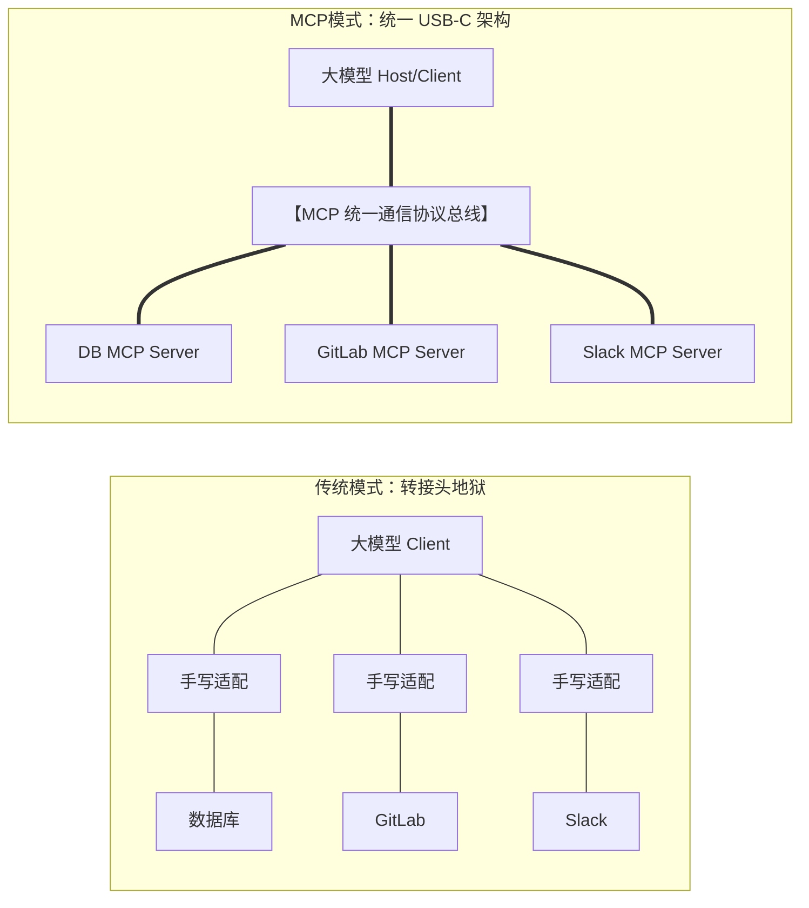
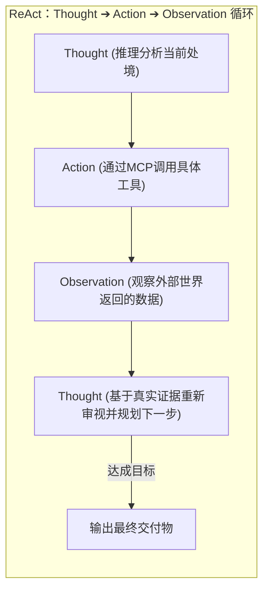
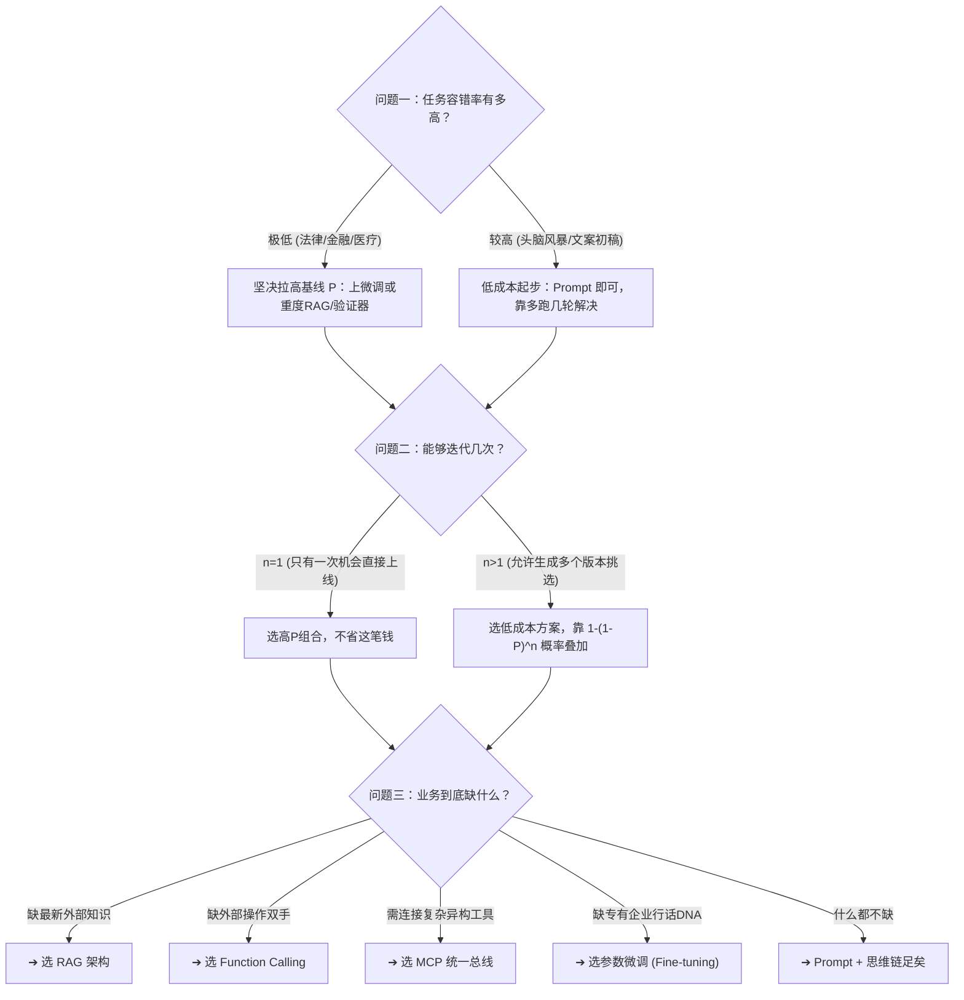

# 第4章 市场的进化：从赤手空拳到工具外挂

> **本章心法：** 你选的不是技术方案，是不同的基础成功率 $P$ 与成本/风险组合。就像做生意——摆地摊、开门店、招外包、建商盟、还是做连锁品牌——各有各的投入产出比。没有最好的方案，只有特定约束下最匹配的杠杆。

---

如果你一路读到这里，你已经掌握了三件基础武器：
1. 理解了 AI 的概率采样本质（第1章）；
2. 懂得了上下文窗口与 Token 经济学预算（第2章）；
3. 学会了用 4S 原则写一份无法违约的交付规格书（第3章）。

但即使合同写得无懈可击，现实中仍有三道天堑是纯文本 Prompt 永远跨不过去的：
- **缺少最新知识**：客户询问“今天各营业厅排队状况如何”，大模型的参数知识停留在训练截止日；
- **缺少执行能力**：同事请求“帮我把这笔订单在系统里执行退款并核销库存”，纯语言模型连互联网都连不上，根本没有操作系统的双手；
- **缺少独特 DNA**：老板要求“严格按照我们企业内部三十年沉淀的特定行文暗号与审计格式输出”，通用模型由于欠缺深度对齐，只能靠猜。

这三大瓶颈指向三项缺失：**缺最新数据、缺执行双手、缺私有风格。**  
于是，整个 AI 市场开始了一场波澜壮阔的工程进化——从最初赤手空拳的单条 Prompt，到思维链、RAG、Function Calling、MCP 协议与参数微调。每一种外挂都在攻克特定的死角，每一种方案都对应着不同的基础成功率 $P$ 与工程门槛。

---

## 4.1 六个方案的能力对比：一场商业生意的演进

理解这六大方案，最直观的方式是观察一门商业零售生意的升级之路：

| 方案模式 | 商业比喻 | 基础成功率 $P$ | 工程落地成本 | 核心主要风险 | 最佳适用战场 |
| :--- | :--- | :--- | :--- | :--- | :--- |
| **Prompt 裸跑** | 摆地摊 | 中（60% ~ 75%） | 几乎为零 | 知识过时、逻辑跳跃、易出幻觉 | 通用任务、轻量验证、草稿构思 |
| **Prompt + 思维链** | 贴流程图 | 较高（75% ~ 88%） | 极低（多耗少量Token） | 超长多步推理仍存在上限 | 复杂逻辑推导、数学计算、深度研报 |
| **RAG 检索增强** | 租店建仓 | 较高（80% ~ 90%） | 中等（需向量库与检索工程） | 检索噪声、切块不当、跨段割裂 | 专有知识库、最新动态政策、需溯源引用 |
| **Function Calling** | 签发委托书 | 较高（80% ~ 92%） | 中等（需封装标准化 API） | API 超时、入参校验失败、异常重试 | 查库操作、触发业务动作、连接现有中台 |
| **MCP 统一总线** | 接入统一商盟 | 较高（82% ~ 93%） | 中高（需维护 Host/Server 协议） | 协议演进中、生态仍需扩展 | 复杂多工具编排、跨系统资产集成 |
| **参数微调 (Fine-tuning)** | 连锁品牌培训 | 极高（88% ~ 96%） | 极高（需精标数据集与GPU训练） | 灾难性遗忘、过拟合、更新迭代昂贵 | 极度固定格式、专有领域行话、低时延高频调用 |

*(注：柱状图代表工程落地与维护成本，折线代表单次基础成功率 $P$)*

---

## 4.2 Function Calling：给AI签发授权委托书

纯语言模型最大的尴尬是“**有脑无手**”——它可以写出极具洞见的退款话术，但它无法替你在后台点击“退款”按钮。

**Function Calling（函数调用）**从根本上打破了这道墙。它的核心机制不是让模型直接在它的环境里执行代码，而是**让模型充当一名精准的调度员**：

1. **注册工具清单**：你向大模型提供一份由 JSON Schema 严格定义的函数清单（包含函数名、描述、参数类型）；
2. **决策与参数抽取**：当用户的提问需要外部能力时，大模型不再直接吐出一段文本，而是**返回一段标准的 JSON 调用指令**，精准提取出入参；
3. **真实环境执行**：你的业务后端捕获这个 JSON 指令，在安全的内网环境中代为调用真实 API，并将运行结果回传给大模型做后续总结。

> **心法：** Function Calling 就像法官签署的搜查令。法官（AI）负责裁定是否需要使用这项权力并列明搜查范围（参数），但真正踹开房门的，必须是法警（受控的后端执行程序）。

---

## 4.3 MCP（Model Context Protocol）：AI世界的统一总线

Function Calling 赋予了 AI 调动工具的可能，但随着连接工具数量的激增，团队很快陷入了新的梦魇——**接口碎片化与“转接头地狱”**。

设想一下：你的系统需要对接飞书文档、企业数据库、GitLab 代码仓、Salesforce 客户系统以及私有知识库。每个服务都有自己的认证体系、自己的 SDK 格式与错误码标准。你的工程师不得不为每一个工具单独手写胶水代码；一旦换了一个底层大模型，整套连接可能又要推倒重来。

由 Anthropic 开源并在 2025~2026 年迅速成为行业共识的 **MCP（模型上下文协议）**，正是为了彻底终结这种混乱。

### MCP 的三大支柱

1. **统一协议标准（AI 世界的 USB-C）**：  
   就像 USB-C 终结了五花八门的手机充电线一样，MCP 规范了工具描述、数据资源（Resources）与提示词模板（Prompts）的交互契约。所有接入 MCP 的工具，对外使用完全同构的语言。
2. **Client-Host-Server 三层解耦架构**：  
   - **MCP Client**：大模型本体；
   - **MCP Host**：运行时环境（如 Claude Desktop、Cursor、VS Code 或自研 Agent 容器）；
   - **MCP Server**：轻量级服务代理，负责将具体数据库或三方系统的能力封装并暴露出来。
3. **即插即用（Plug & Play）**：  
   接入一个新数据源，只需在配置文件中声明对应 MCP Server 的启动命令与密钥，大模型即可在运行时动态发现该工具的所有功能，免去所有重复胶水代码的编写。

---

## 4.4 延伸深潜：MCP vs CLI 工具链的演进博弈

在企业级工程落地中，常常伴随着一道架构选型讨论：**究竟应该用 MCP，还是直接让 AI 在受限终端里执行 CLI（命令行工具）？**

| 对比维度 | CLI 命令行模式（如 bash / curl / git） | MCP 标准协议模式 |
| :--- | :--- | :--- |
| **通用灵活性** | **极高**：几乎能操作服务器上的一切二进制程序 | **受控**：只能操作预先显式声明的 Tool 接口 |
| **结构化与治理** | **较弱**：输出是非结构化控制台文本，易解析失败 | **极高**：强类型 JSON Schema，输入输出严格校验 |
| **安全审计门禁** | 较难防范恶意拼接与高危 rm/kill 指令 | 接口级细粒度权限控制，天然具备合规隔离性 |
| **上下文消耗** | 命令输出往往包含大量无用控制台日志，浪费 Token | 经过 Server 结构化清洗，精准投喂有效载荷 |

> **架构结论：**  
> 一次性本地探索与灵巧编程任务，CLI 具备极致的敏捷度；而面向生产级企业系统、跨团队资产复用以及强安全审计场景，**MCP 是绝对的主流与终局之选**。

---

## 4.5 ReAct 与 PAL：Agent的两大底层动力学

有了 Function Calling 与 MCP，大模型既有了大脑，又有了双手。但如何协调大脑与双手？什么时候该深思、什么时候该出手、什么时候该根据现场反馈回头修正？这就是智能体（Agent）要解决的核心动力学。

### 1. ReAct（Reasoning + Acting）：动态试错与闭环感知
ReAct 拒绝盲目的一次性全量规划。它像一个探险家走迷宫：
- 观察当前分岔路 $\to$ 决定走左边（Action） $\to$ 发现撞墙了（Observation） $\to$ 记录教训并在草稿中修正（Thought） $\to$ 改走右边。  
这种每走一步就吸收一次真实世界“证据”的闭环机制，从数学上不断执行贝叶斯后验更新，使得复杂长程任务的稳定性成倍提升（具体落地见第 8 章与第 9 章）。

### 2. PAL（Program-Aided Language Models）：把确定性算术交还给编译器
大语言模型虽然擅长高阶逻辑推演，但让它心算 `387 * 492 / 1.7` 往往会得出荒诞的近似值——因为它是概率模型，不是算盘。  
**PAL 的智慧在于：让 AI 写出一段 Python 代码，然后扔进本地解释器运行。**  
AI 负责将自然语言需求编译为严谨代码，解释器负责确定性地执行数学计算。把 AI 不擅长的事交给确定性引擎，这也是构建生产级 Agent 的基石。

---

## 4.6 概率选型决策树与速记口诀

面对五花八门的概念，产品经理和架构师在做技术选型时，无需在复杂的参数间纠结，只需回答三个灵魂考问：

> **选型速记黄金口诀：**  
> **Prompt起步，思维链强化；要新知识上RAG，要动手上Function Calling；多工具集成挂MCP，固定DNA做微调。**

---

## 本章小结与投资决策思维检查清单

- [ ] **摆脱单一工具崇拜**：没有任何一种方案是万能钥匙；方案选型的本质是**“用多少工程成本，买多少基础成功率 $P$”**的投资决策。
- [ ] **善用授权委托书**：Function Calling 彻底解决了有脑无手的问题；让模型输出 JSON 意图，让受控代码执行真实动作。
- [ ] **拥抱 MCP 统一标准**：面对多工具生态，果断采用 MCP 架构进行解耦与治理，杜绝为每个 API 手写重复的转接头胶水代码。
- [ ] **理解 Agent 的动力学双核**：ReAct 负责在试错中闭环演进，PAL 负责将计算交还给确定性编译器。
- [ ] **践行决策三问**：每次立项前审视容错率、迭代次数与真实瓶颈，永远从最小可行方案（MVP）出发逐步叠加武器。