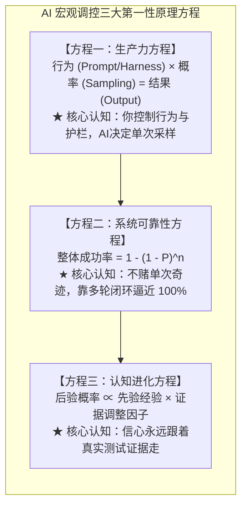
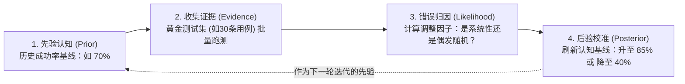
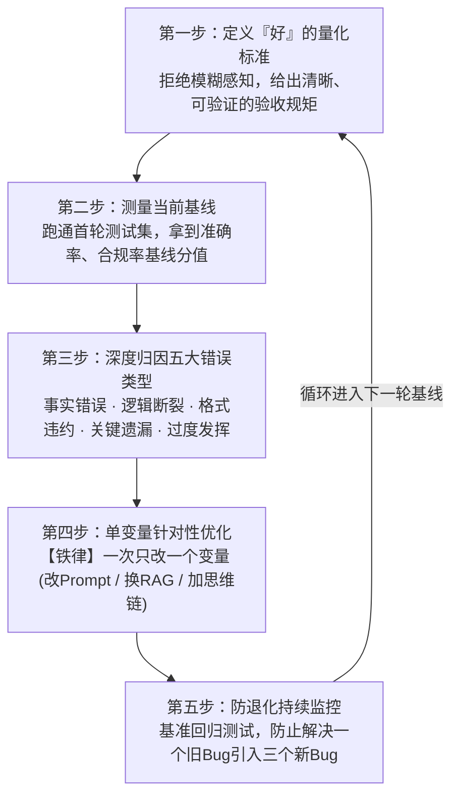
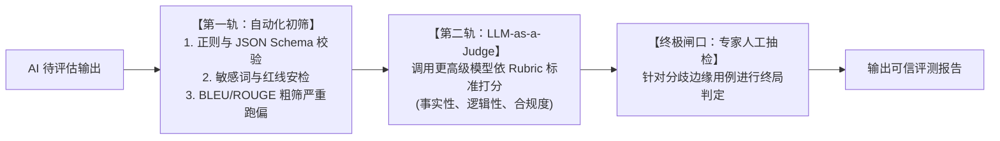

# 第5章 技术世界的宏观调控：如何成为合格的贝叶斯裁判

> **本章心法：** 面对 AI，不要凭初次惊艳盲目迷信，也不要因偶发失误全盘否定。评估不是随手打个分，而是用真实证据完成贝叶斯更新。掌握了评估与迭代闭环，你才算真正握紧了驾驭 AI 的宏观调控权。

---

在企业和个人应用 AI 的过程中，最常见的一种灾难性循环往往长这样：

团队兴冲冲地搭好了一套智能助手，找了两个人随手试了三道题，感觉“回答得非常惊艳”，于是立即推向上线；  
三天后，真实用户在业务现场遇到几处翻车，投诉纷至沓来，管理层勃然大怒，得出结论“大模型根本不可靠”，随即把项目全盘下马。

从盲目吹捧到全面封杀，中间往往只隔了两次偶发报错。

为什么会出现这种闹剧？因为绝大多数人从未建立起科学的**评估与调控心智**。他们把对待传统确定性软件的二元论（“要么能跑，要么有 Bug”），生搬硬套在了一台概率机器身上。在 AI 的世界里，单次测试的好坏说明不了任何问题。**你需要的不是“凭感觉打分”，而是一套科学、严谨、闭环的评估与治理工程体系——成为一名合格的“贝叶斯裁判”。**

---

## 5.1 概率思维的核心方程体系

要对 AI 进行宏观调控，无需复杂的纯数学推导，你只需要在直觉上彻底掌握支撑全书的三大核心方程：

1. **生产力方程**：$\text{行为} \times \text{概率} = \text{结果}$。  
   每次结果不尽如人意，不要归咎于 AI“今天心情不好”；回到方程左边，检查你的 4S 契约是否留有漏洞、给定的上下文是否含有噪声。
2. **系统可靠性方程**：$\text{整体成功率} = 1 - \prod (1 - P_i)$。  
   单次任务成功率哪怕只有 70%，只要设计了自动检测与自愈重试机制，三次迭代后的系统可用度便飙升至 $1 - (0.3)^3 = 97.3\%$。可靠性来自流程编排，而非单次运气。
3. **认知进化方程**：$\text{后验} \propto \text{先验} \times \text{调整因子}$。  
   对模型能力的信任度不是非黑即白，它是随证据动态刷新的浮点数。

---

## 5.2 评估的本质：贝叶斯更新

很多团队所谓的“效果评估”，通常是一个人坐在屏幕前看了看输出，皱皱眉头说“感觉不够高级”，或者点点头说“挺好的”。

**这种凭直觉的打分等于没有评估。** 它只产生了一种无法复现的瞬时情绪，没有留下任何可以工程化改进的数据资产。真正的评估，是一个严格的**贝叶斯后验更新过程**：

1. **确立先验（Prior）**：在开跑前，基于历史经验对该场景设定初始成功率预期（例如：无 RAG 辅助下，该复杂合同生成的先验预期为 60%）；
2. **收集证据（Evidence）**：拒绝单次偶遇，准备一组精心设计的**黄金测试集（Test Cases）**进行全量批处理压测；
3. **计算调整因子（Likelihood）**：统计错误不是粗暴地数几个勾几个叉，而是深入分析**“错误是结构性必然，还是统计长尾偶发”**；
4. **形成后验（Posterior）**：依据测试数据校准预期。这个后验不是终点，而是下一轮工程优化的起点。

---

## 5.3 迭代改进的五步闭环

评估不是为了给系统判死刑，评估的唯一目的是**指导下一轮针对性修改**。工业级应用必须建立五步闭环工程纪律：

### 深度归因：大模型的五大错误类型与精准解法

| 错误类型 | 典型表象与危害 | 根因诊断 | 精准工程解法 |
| :--- | :--- | :--- | :--- |
| **事实错误** | 把金额算错、日期搞混、生造不存在的数据 | 参数知识过期或缺失 | **挂载 RAG**，强制要求模型只从检索材料中引用 |
| **逻辑错误** | 结论与前提矛盾、因果倒置、伪推理 | 概率长距离跳跃脱轨 | **引入思维链 (CoT)** 或将大任务拆分为子会话 |
| **格式错误** | 要求返回纯 JSON 却夹杂了 Markdown 或废话 | 格式约束强度不足 | **强化输出 Schema**，给出 Bad-case 负向示例 |
| **关键遗漏** | 问了三个问题只答了两个、关键免责条款丢失 | 注意力被前面内容稀释 | **追加自查检查清单 (Checklist)**，要求先审再吐 |
| **过度发挥** | 自作主张修改了不该动的内容、文风过于冗余 | 缺乏行为边界锁定 | **施加严格负向约束**，明确列出“严禁包含的内容” |

> **工程铁律：一次只改一个变量。**  
> 如果你在这一轮迭代中，同时重写了 Prompt、替换了向量检索模型、又微调了系统温度——测试集得分即使提高了，你根本不知道究竟是哪项举措产生了正向价值；如果得分下降了，你更不知道该回滚哪一部分。控制变量法，是 AI 工程化的第一铁律。

---

## 5.4 自动指标与人评的正确用法（Eval 工程化体系）

在系统评测领域，长期存在两派争执：一派崇尚 BLEU、ROUGE 等全自动算法指标，另一派坚持全人工逐条审查。盲信任何一端都会踩坑。

### 自动指标的致命死穴：测的是“像不像”，不是“好不好”

BLEU 和 ROUGE 起源于传统机器翻译时代，它们的底层逻辑是：**计算 AI 输出文本与人类标准答案之间的字词重合度（N-gram Overlap）。**

这在现代智能应用中带来了巨大的误导：
1. **死穴一：字面极其相似，逻辑完全颠倒**  
   - 标准答案：“合同签署后 **30天内** 必须支付尾款”；  
   - AI 输出：“合同签署后 **30个工作日内** 必须支付尾款”。  
   BLEU 算法会给出一个接近 0.95 的高分（因为大部分字词完全重叠），但在法律与商业财务上，这多出来的十几天可能引发严重的违约争议。
2. **死穴二：标准答案绝非唯一**  
   面对一份代码重构或营销文案，优秀的解决方案可以有十种全然不同的行文组织。自动算法会粗暴地把所有不符合它死板范文的创新表达全打低分。

### 企业级双轨评测流水线

- **第一轨（自动化初筛）**：用最便宜的代码规则做第一道门禁——检查 JSON 格式合不合规、必填字段在不在、响应是否超时；
- **第二轨（LLM-as-a-Judge）**：使用更顶级的模型（如 GPT-4o 或 Claude Opus），根据详尽的**评分细则（Rubric）**，充当虚拟专家进行打分和批注；
- **第三轨（专家终审抽检）**：人类专家只需要把精力集中在评分产生分歧的临界用例上。

> **经验法则：**  
> **一套精心提炼的 30 条黄金用例集 + 结构化打分表，其工程诊断价值百倍于盲目跑 1000 条无意义的 BLEU 统计。**

---

## 5.5 延伸深潜：贝叶斯推断的日常生活形态

为了彻底抹平对贝叶斯的陌生感，请设想你踏入一家从未来过的新餐馆：
1. 推门进店，闻到扑鼻的刺鼻油烟味——你心中咯噔一下，对这家店卫生水平的初始判断（先验）降到了 40%；
2. 往里走了两步，看到餐桌擦得锃亮，后厨明档一尘不染——这一强有力的新证据瞬间修正了印象，你的信心升回了 75%；
3. 菜品端上桌，食材新鲜、火候极佳、服务员态度温和专业——综合所有新证据，你的最终评价（后验）锁定在了 95%。

你没有拿草稿纸写下贝叶斯公式，但你的大脑在全自动运行贝叶斯算法。**你没有在闻到油烟的第一秒就砸门而去，也没有在看到明档的瞬间就盲目狂热。你让信心始终跟随新的证据平滑流动。**

对待 AI 同样如此。  
每一个新版本的基座模型、每一套新写就的提示词系统，都只是一个带着初始先验的“候选者”。不要用一次出彩就把它吹上天，不要用一次翻车就将它打入地狱。带着你的黄金测试集，用证据做理性裁判。

---

## 本章小结与裁判自检清单

- [ ] **摆脱情绪化打分**：评估是严谨的证据收集与归因，拒绝“感觉还行”这种毫无操作空间的模糊反馈。
- [ ] **区分五大错误类型**：事实错误靠 RAG，逻辑错误靠思维链，格式错误靠 Schema，遗漏靠 Checklist，越界靠负向约束。
- [ ] **严守单变量控制铁律**：一轮迭代只改动一个因素，测出明确因果再推进下一步。
- [ ] **看透自动指标的局限**：明白 BLEU/ROUGE 测的仅仅是“长得像不像”；构建包含规则初筛、LLM 打分与专家抽检的双轨评测体系。
- [ ] **践行终身贝叶斯姿态**：把上一轮的后验当作下一轮的先验，用数据支撑每一次业务决策，做理智的系统治理者。
