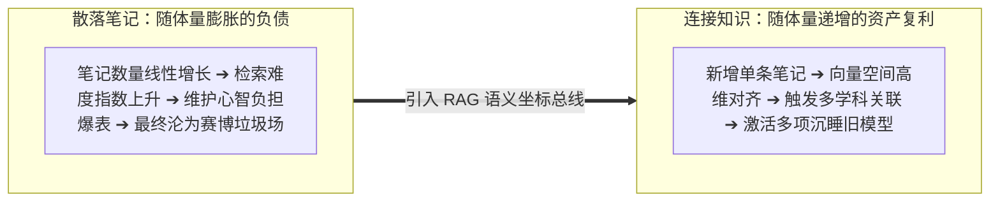
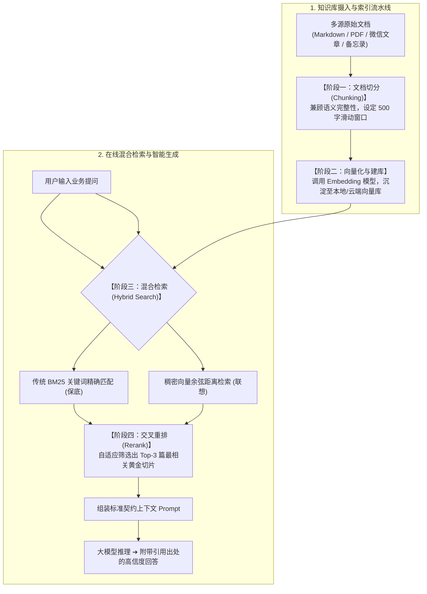
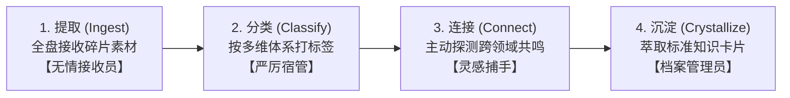

# 第6章 实践1：告别“记得看过但找不到”——零代码搭一个AI知识库，让笔记自己来找你

> **本章心法：** 知识不连接就没有复利。散落的笔记是典型的“规模不经济”——越存越累，越累越不想翻；连接的知识才是“规模经济”——越存越聪明，每次新增一条笔记，都能激活整座旧知识矿藏的潜在价值。AI 不是替代你做笔记，而是让沉睡的笔记主动来找你。

---

“我的笔记散落在各个角落——微信收藏夹里存了上百篇好文链接，Obsidian 里躺着上千篇 Markdown，浏览器书签栏已经拉不到底，手机备忘录里还夹杂着深夜灵光一闪的只言片语……每次想在关键方案中引用一个观点，翻箱倒柜找半天也找不着，最后只能无奈放弃。AI 真的能帮我把这些知识管起来吗？”

如果你在日常学习中也有这种深深的无力感——别焦虑，你绝非孤例。这是几乎所有重度知识工作者在数字时代共同面临的系统性困境：**知识越攒越多，能够随时被调用的有效经验反而越来越少。** 就像一座藏书十万册的私人图书馆，如果所有的书籍都杂乱无章地堆在水泥地上，没有编目、没有索引、没有书架，那么藏书越多，你在找书时就越绝望。

更遗憾的是，绝大多数人尝试用 AI 解决这个痛点的方式全走错了：直接把上万字原始材料一股脑喂给公共聊天框，要求它“帮我做个总结”。结果拿回来的要么是浮于表面的正确废话，要么是断章取义的严重幻觉。

这一章将带你走出误区，跑通一条全新的路径：**零代码搭建专属于你的第二大脑（RAG 知识库），让你的笔记不仅能在几毫秒内被精准检索，更能跨越学科边界，主动为你提示连接灵感。**

---

## 6.1 为什么散落的知识没有复利？

### 真实痛点：我的 121 个思维模型“复活记”

我是一个典型的重度学习者。多年以来，我系统研读了经典商业理论与基础学科，并效仿查理·芒格的“多元思维模型”理念，在个人知识库中梳理了整整 121 个跨学科思维模型。这原本应该是我在产品架构与投资决策中最坚实的认知军火库。

然而在很长一段时间里，这座军火库几乎是处于脑死亡状态的。

我最初使用本地 Markdown 工具进行管理。起初几十个文件尚且能够靠人脑记忆应付；但当文件量迅速膨胀至上百个之后，知识库不可逆地退化成了一座“赛博垃圾场”：
- “临界点思维.md”被归档在物理化学文件夹；
- “安全边际.md”被存放在商业投资分类；
- “认知误判心理学.md”被深埋在心理学目录中。

文件夹成了知识之间的物理高墙，切断了本该交织的因果关联。每当撰写复杂战略方案或进行重大投资决策时，我脑海中能调用的模型永远超不过最熟悉的那 3 到 5 个，剩下的 90% 以上全在硬盘深处沉睡。

芒格曾反复强调：**格栅理论的真正威力在于不同模型的“排列组合与化学反应”，而不是单点模型的静态背诵。** 但人类肉身的大脑记忆容量有限，传统关键词检索只能搜出“文字字面一致”的内容，根本无法回答“有哪些心理学模型可以用来解释这次投资失误中的沉没成本效应？”



这揭示了一个残酷的知识经济学事实：  
**未被结构化连接的笔记是负债，唯有在语义空间中相互对齐的笔记才是资产。**

---

## 6.2 RAG 的零代码与低代码搭建全景拆解

回顾第 2 章关于 Embedding 的论述：将文本转化为数学向量，本质上是在高维空间中为每个概念标记 GPS 经纬度。RAG（检索增强生成）正是将这一能力工程化落地的标准范式。

一个生产级的现代 RAG 流水线并不神秘，其核心逻辑由四个环环相扣的标准阶段构成：



### 关键细节的实战取舍

1. **切块策略（Chunking）的艺术**：  
   切块太碎（如每 50 字一块），模型会丧失上下文逻辑；切块过大（如每 3000 字一块），不仅极易触发第 2 章提到的注意力衰减，更会混入大量无关噪声。**实战推荐：300~600 字符为一块，并设置 10%~15% 的重叠滑窗（Overlap）**，确保跨段落的因果句式不被物理切断。
2. **为什么必须是“混合检索（Hybrid Search）”？**  
   纯向量检索擅长处理“语义相近”（如搜索“高管离职”，能找到“CEO 辞职”）；但在专业领域，如果用户查询的是一个精确的规格型号（如 `iPhone 16 Pro Max 256G` 或特定的法律案号），向量模型往往会产生模糊漂移。**混合检索将 BM25 的精确字面匹配与向量的语义理解以 5:5 权重融合，构筑起双重保险。**
3. **重排模型（Reranker）的画龙点睛**：  
   初筛可能会召回 15 个候选切片。直接全塞进上下文既费钱又容易干扰模型。通过轻量级 Rerank 跨编码器模型进行二次精细打分，仅挑出前 3 条置信度最高的切片喂给大模型，实现极高精度输出。

> **工具选型落地指南：**  
> 你完全不需要从零手写 Python 代码。在 2026 年的今天，市面上有极其成熟的零代码/开箱即用平台：
> - **个人本地隐私优先**：推荐使用 Obsidian + 本地向量插件，或通过 OpenClaw / Desktop Agent 本地运行；
> - **团队协同与流程编排**：推荐使用 Dify、Coze 或飞书多维表格知识库，拖拽节点即可在 15 分钟内完成端到端 RAG 搭建。

---

## 6.3 知识连接 × AI：跨学科的顿悟时刻

当 121 个思维模型全部完成高维向量化建库后，神奇的事情发生了。

以往写商业分析，面临一个新赛道的竞争格局，我通常只能想到波特五力模型。而在 AI 知识库中，我输入了这样一段提示：  
*“检索知识库：当前新赛道面临巨头补贴压制，从生态学与进化生物学视角，我的模型库里有哪些概念可以提供差异化破局策略？”*

系统在数秒之内跨越了商业学科的传统分类，从生物学和复杂性科学库中精准捞出了两条我多年前记录的笔记：
1. **《生态位分离原理（Niche Differentiation）》**：自然界中两种食性相同的鸟类，之所以能在一棵树上共存，是因为一只专吃树顶嫩叶，另一只专吃树根缝隙中的昆虫——在巨头不屑于做的极端边缘深耕，避开正面对抗；
2. **《外来物种入侵的 r/K 选择理论》**：巨头是典型的 K-策略者（体量大、周期长、容错低），初创团队应当采取 r-策略（极速繁殖、高频试错、低成本迭代）。

这两个模型原本沉睡在完全不同的子目录中，在人脑疲惫时几乎不可能自发关联。而大模型依托底层高维向量坐标的联想机制，瞬间跨越了人类分类法的巴别塔，将看似孤立的概念在底层逻辑上重新缝合在了一起。

这就是**跨学科知识连接带来的超额复利**。

---

## 6.4 每周知识整理工作流（SOP：提取 $\to$ 分类 $\to$ 连接 $\to$ 沉淀）

知识库的建设绝非一次性的大干快上，而是一种可持续的微习惯。  
我将个人与团队知识沉淀固化为了清晰的**四步闭环工作流**，每周固定运行一次（通常在周日晚间）：



| 阶段 | 人类的动作 | AI 扮演的角色 | 交付产出物 |
| :--- | :--- | :--- | :--- |
| **1. 提取** | 微信收藏、网页截屏、会议纪要全部拖入“待处理（Inbox）”目录 | **无情接收员**：不挑格式，全盘吸收 | 原始素材蓄水池 |
| **2. 分类** | 运行知识整理指令，让 AI 遍历读取 Inbox 新增材料 | **严厉宿管**：按既定知识树体系自动打多重标签 | 结构化分类索引 |
| **3. 连接** | 向 AI 发出灵魂提问：“本周新增素材与库里哪些旧模型存在意想不到的同构？” | **灵感捕手**：高维语义比对，提示跨界关联 | 意料之外的认知火花 |
| **4. 沉淀** | 挑选经过人脑确认的深刻见解，写入核心体系 | **档案管理员**：格式化排版，归入终极资产库 | 永久高可用资产卡片 |

### 实操心法：第一阶段“绝不挑拣”
许多人在整理笔记时过早陷入内耗：“这条碎碎念值得记吗？这句话以后有用吗？”挑拣十分钟，热情全耗尽。  
**真正的秘诀是：收集阶段彻底放手，一股脑扔进待处理池。** 一条当下看似无关紧要的碎片感悟，三个月后可能正是补齐某项重大业务架构拼图的关键锁扣。把筛选与排版的苦力，全权托付给 AI。

---

## 6.5 经济账本与 ROI 测算

搭建一套个人或小微团队的 AI 知识库，到底需要多少成本？

| 方案路径 | 适用人群 | 初始搭建投入 | 月度运行开销 | 核心优势 |
| :--- | :--- | :--- | :--- | :--- |
| **全本地离线方案**<br>(Obsidian + 本地Ollama/Embedding) | 对数据隐私极度敏感、极客折腾型用户 | ~4 小时环境调试 | **\$0 (纯本地算力)** | 物理级数据隔离，完全离线可用 |
| **混合云端 API 方案**<br>(Dify / 开源前端 + 商业API) | 绝大多数知识工作者、产品经理、独立顾问 | ~1 小时流程配置 | **< \$3 / 月 (按量Token)** | 极佳的语义理解能力，维护成本极低 |
| **商业交钥匙方案**<br>(各类企业级 SaaS 知识库) | 团队多人协同、注重权限与审批审计的企业 | ~15 分钟开箱即用 | \$15 ~ \$30 / 人月 | 完备的多人协作与多端权限管控 |

从投资回报率来看：  
每个月几块钱的 Token 消耗，换来的是每年省去 **70~100 小时** 茫然翻找文档的垃圾时间。更重要的是，它将知识遗忘率降低了 80% 以上，让经验的积累第一次具备了复利曲线。

---

## 6.6 开箱即用模板库

### 模板一：「知识卡片」精炼标准契约 Prompt

```markdown
[ROLE & CONTEXT]
你是我个人第二大脑知识库的资深档案主管，深谙第一性原理与查理·芒格多元思维模型。

[TASK]
请将我所提供的非结构化原始素材，精炼并输出为一张标准化的【知识卡片】。

[OUTPUT SCHEMA]
严格输出如下 Markdown 结构：
### 【概念名称】：（用大白话提炼出精准定名）
1. **一句话底层第一性原理**：用不超过 50 字阐述其底层物理/经济/逻辑本质。
2. **适用边界与解决痛点**：它在什么具体场景下能发挥超常威力？
3. **潜在失效场景（反向约束）**：在何种极端或边界条件下，该模型会产生误导或彻底失效？
4. **跨领域同构联想**：结合广泛常识，该模型与自然科学或商业史中的哪一个经典现象高度同构？（给出简要推导）

[RAW INPUT DATA]
"""
{PASTE_YOUR_RAW_NOTE_HERE}
"""
```

### 模板二：「每周知识回顾与连接」Prompt

```markdown
[ROLE]
你是一名专注于洞察知识底层同构性的跨学科思维大师。

[INPUT]
- 【本周新增知识片段】：见附件或文本
- 【现有知识核心分类索引】：投资学 / 心理学 / 复杂系统 / 软件工程 / 商业战略

[GOAL]
1. 自动为新增片段补充 2~3 个精准标签并归类。
2. 重点任务：深入扫描新旧笔记，找出最令你感到意外的一处“隐蔽连接点”，详细论证为什么这两个看似无关的现象在底层逻辑上是同构的。
3. 基于上述连接，为我下周的工作或投资决策提出 1 条极具操作性的落地启发建议。
```

---

## 本章小结与实战自检清单

- [ ] **打破信息孤岛思维**：认清散落笔记是负债的真相；用高维向量坐标将个人沉睡经验转化为可检索资产。
- [ ] **掌握 RAG 工业级四步**：Chunking 兼顾语义完整度，坚持 BM25 与向量的混合检索（Hybrid Search），用 Rerank 锁定最终黄金材料。
- [ ] **养成四步闭环整理习惯**：每周坚持“提取（不挑拣） $\to$ 分类（自动打标） $\to$ 连接（激发顿悟） $\to$ 沉淀（标准卡片）”。
- [ ] **激活跨领域连接**：用 AI 的概率漫游弥补人类联想狭隘的缺陷，让第二大脑成为源源不断输出创新方案的活水。
