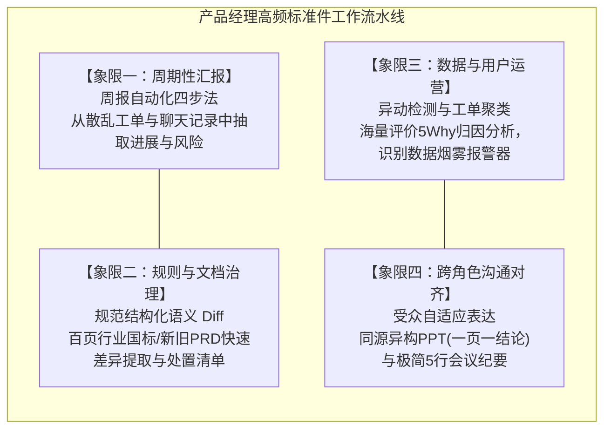
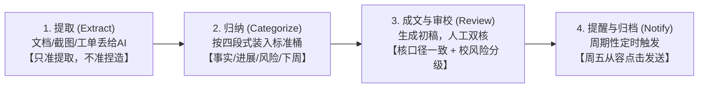
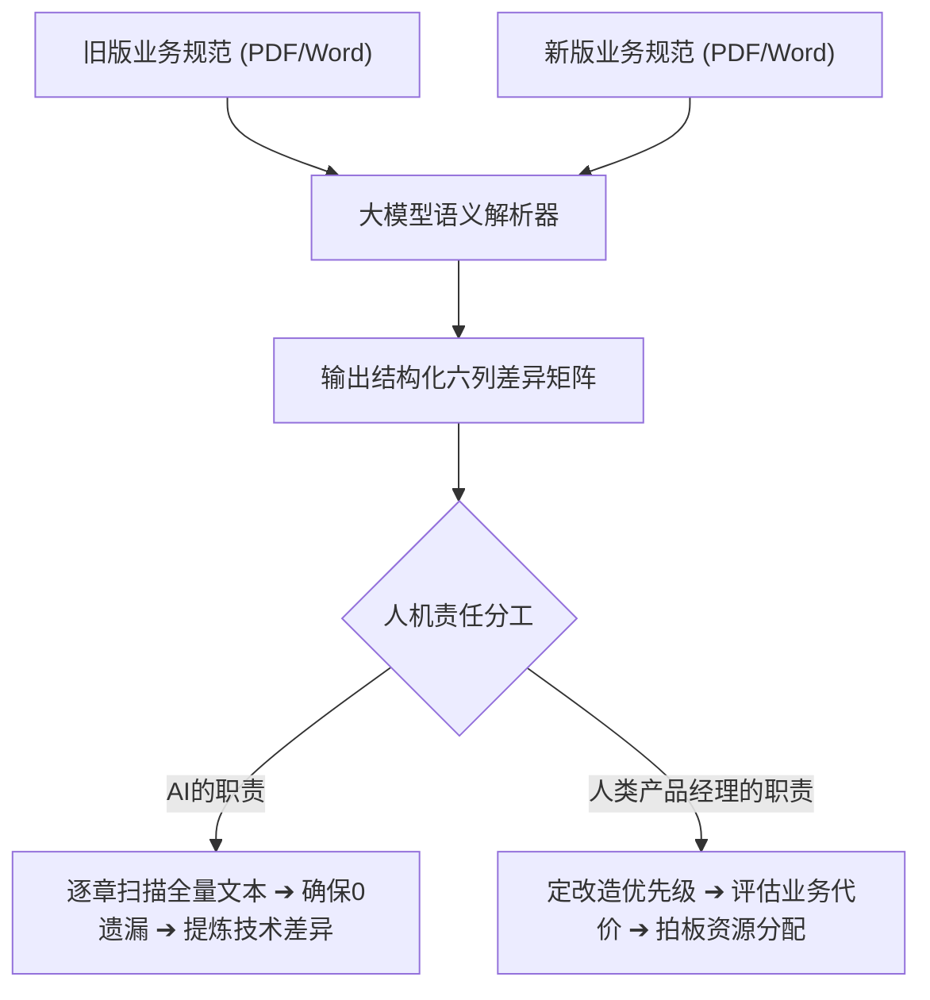
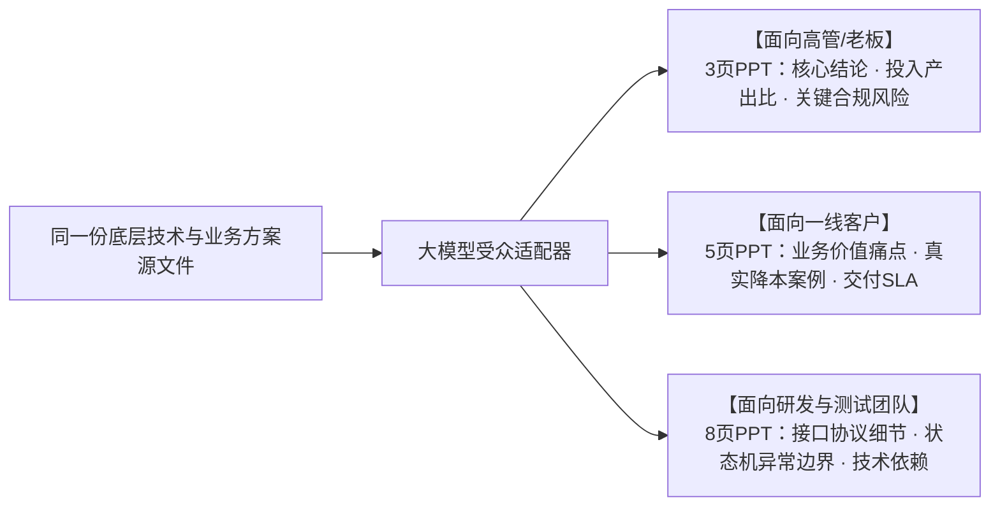

# 第7章 实践2：用AI赋能产品工作——周报、规范、分析与日常提效

> **本章心法：** 优秀的 AI 产品经理绝不应该被琐碎繁重的重复材料淹没。把日常例行公事彻底重构为“可组装的标准件”，你才能把最宝贵的心智带宽留给最稀缺的事——定义价值与开拓市场。

---

在很多传统研发团队中，产品经理的真实日常往往非常戏剧化：

名义上是“产品的首席舵手”，实际上却沦为了“材料的搬运工与缝合怪”——周一上午被催着写会议纪要，周三下午逐字逐句人工比对上百页新旧行业标准，周五傍晚一边焦头烂额地找各研发小组催收进展，一边战战兢兢地把相互冲突的统计数据攒成一份向上汇报的周报。

如果一个人一周有超过 60% 的精力都在应付这些低容错、强格式、高重复的杂务，那么他根本不可能有余力去“深入一线识别伪需求”，更奢谈“看清产业格局与技术趋势”。

本章的目的极其纯粹：**将产品经理日常最消耗精力的四大高频场景——周报汇报、规范差分比对、数据异动归因、跨团队沟通对齐——全面改造成由 AI 驱动的标准件流水线。** 你不再需要从零挥毫写作，你的角色转变为流水线的设计者与质量审查员。

---

## 7.1 产品经理的高频日常武器库矩阵

将产品经理的高频工作进行结构化解剖，可以清晰地划分为四大标准件象限：



这些工作有一个高度共性：**输入信息源相对确定，输出格式高度标准化，但中间的提炼、比对与转换极其耗费人工脑力。** 这正是大模型大显身手的黄金主场。

---

## 7.2 周报自动化的四步法：提取 $\to$ 归纳 $\to$ 成文 $\to$ 提醒

周报是每个产品经理每周都要渡的一次劫。以我此前负责的电信运营商“VPN 云专线”业务为例，每周涉及上百条专线开通进度、十几个割接故障与跨省协调。通过引入四步流水线，这一原本需要两三个小时的痛苦差事被压缩到了 20 分钟的审校。



### 第一步：提取（只准提取，严禁脑补）
将本周的项目看板截图（OCR 处理）、变更通知邮件、核心研发的群聊总结全量喂给大模型。  
**核心红线约束**：要求模型充当严格的“事实抽取器”。凡是原始输入中没有提到的进度或数字，绝对严禁自作主张润色补全。

### 第二步：归纳（固定结构化四段式桶）
要求模型严格按照四段式结构，将碎片信息清洗分类归入四个指定的标准容器中：
1. **本周核心事实**：客观交付的 Milestone（如某节点完成割接）；
2. **业务进展指标**：量化数据（新增开通数、网络延迟改善幅度）；
3. **阻塞与风险预警**：跨部门依赖卡点、物料延期；
4. **下周行动项**：负责人与明确 Deadline。

### 第三步：成文与人工重点审校
大模型根据模板生成正式汇报文案。此时人类产品经理介入，**重点核验两个致命隐患**：
1. **数据统计口径是否一致**：我曾吃过大亏——AI 一度把“已完成开通数”和“已签单待开通数”混为一谈，看似都是数字，但在领导层决策时含义截然不同；
2. **风险程度词的审慎校准**：大模型极易夸大或淡化风险。人类必须精准把控分寸：当前问题属于“日常关注”、“业务预警”还是“紧急升级”？一字之差，会引发完全不同的跨团队反应。

### 第四步：提醒与常态化触发
通过配置定时 Cron 任务，在每周五下午自动生成待审草稿，彻底终结周五临下班前的慌乱赶工。

> **概率工具箱效果**：  
> 凭空从零手写周报，成功率（无差错、无遗漏、无口径争议）通常仅有 40%；而走通“提取 $\to$ 归纳 $\to$ 模板成文”后，基线成功率直接提升至 **85% 以上**。

---

## 7.3 规范对比的结构化方法：语义级 Diff

在企业级研发中，另一个令人头皮发麻的任务是**比对新旧两套上百页的业务规范或国家标准**。人肉眼扫读容易发生跳行遗漏，而纯文本 Diff 工具（如 git diff）面对排版微调与段落重组时又会产生海量无效报警。

解决之道是让大模型执行**“语义级 Diff”并输出六列结构化表格**：

```markdown
| 章节序号 | 旧规范核心要求 | 新规范最新条款 | 核心差异实质 | 建议产品应对动作 | 风险与改造优先级 |
| :--- | :--- | :--- | :--- | :--- | :--- |
| **3.2 准入条件** | 仅核验企业三证 | 强制要求具备二级等保 | 准入门槛大幅收紧 | 评估现有存量客户影响面 | **高 (涉及存量合规)** |
| **5.1 计费模式** | 仅支持按月保底预付 | 新增按峰值带宽弹性计费 | 扩展计费逻辑分支 | 协调计费中台评估二开工期 | **中 (属于功能增强)** |
| **7.3 SLA 协议** | 网络可用性承诺 99.9%| 可用性承诺提升至 99.95% | 赔偿触发阈值严苛 | 联合运维部门评估物理冗余 | **高 (涉及法律赔偿)** |
```



**人机分工的核心分水岭：AI 负责找出所有差异，人类负责裁定商业优先级。**  
判断哪个差异最影响核心客户、哪个差异可以申请特批延后，依赖的是深植于产品经理脑海中的行业经验（公理二中的独特私有产权），这是冰冷文档中所不包含的信息。

---

## 7.4 运营与用户反馈的自动化归因分析

产品上线后，海量的数据指标与用户评价扑面而来。产品经理面对数字往往会陷入两极：要么面对十几条折线图茫然无措，要么仅凭单个极端差评被牵着鼻子走。

大模型在数据运营场景中充当着你的**“数据烟雾报警器”**：

1. **趋势识别（宏观感知）**：大模型可以毫无疲倦感地并发监控几十个细分指标，从长期波动中捕捉人眼极易忽略的缓慢滑坡；
2. **异常检测（微观报警）**：依据历史均值与方差，一旦某一指标偏离置信区间，立刻高亮报警；
3. **多维因果拆解（深潜归因）**：  
   当你输入“本月云网专线续约率环比下滑 12%”时，让模型调用 5Why 框架联动用户反馈进行交叉分析：
   $$\text{整体下滑 12\%} \longrightarrow \text{集中在华东中小客户群 (贡献80\%跌幅)} \longrightarrow \text{集中反映开通审核周期长} \longrightarrow \text{根因是某审核中台版本升级致使接口阻塞}$$

> **铁律原则：AI 负责找模式（Pattern），人类负责定因果（Causality）。**  
> 模型指出“A 指标与 B 现象在时间序列上高度重合”，这是它的统计优势；但“A 是否真的是导致 B 的根本原因”，必须由懂得业务全貌的产品经理做最终定性。

---

## 7.5 向上沟通与横向对齐的提效框架

产品经理的核心价值不仅在于把事情想透，更在于把方案**针对不同受众精准推销出去**。同一套技术方案，汇报给不同利益相关方，需要完全不同的表达密度：

### PPT 沟通原则：一页一结论

拒绝把 PPT 变成密密麻麻的 Word 搬家。指导 AI 遵循**黄金四步递进结构**重构幻灯片：

$$\text{核心结论 (Headline)} \longrightarrow \text{事实与证据 (Evidence)} \longrightarrow \text{业务影响 (Impact)} \longrightarrow \text{下一步决策 (Next Steps)}$$



大模型极其擅长这种**“同源异构”的自适应重构**——原始方案只有一套，你只需在提示词中切换受众角色，它就能自动裁剪出最恰当的表达深度。

### 邮件沟通：极简“5行版”会议纪要模板

超过一屏的会议纪要几乎没人会完整阅读。使用如下结构化模板驱动 AI 自动生成：
1. **【达成共识】**：本次会议敲定的核心结论（不超过 2 句）；
2. **【待办事项】**：拆解出的行动项列表；
3. **【责任主体】**：每个事项明确对应的唯一 Owner（严禁多人共担）；
4. **【交付时限】**：具体的完成时间节点（精确到具体日期）；
5. **【下次会期】**：后续跟踪与复盘会议安排。

---

## 7.6 经济账本分析：边际成本趋于0与隐性风险降低

把产品工作流全面改造成标准件，其背后的经济收益远不止表面上省下的工时：

| 评估维度 | 传统纯手工模式 | AI 标准件流水线模式 | 显性与隐性收益 |
| :--- | :--- | :--- | :--- |
| **周报编撰耗时** | 2 ~ 3 小时 / 周 | 20 ~ 30 分钟审校 / 周 | **每年直接释放 80 ~ 100 小时** 黄金生产力 |
| **百页规范比对** | 1 ~ 2 天，极易眼花遗漏 | 10 分钟生成全量六列矩阵 | 效率提升 10 倍以上，彻底消灭比对盲区 |
| **合规与失误代价** | 口径混乱导致领导误判，漏项引发返工 | 结构化强制卡点，口径统一核验 | **规避潜在数十万元级的业务合规违约风险** |

一次性花费 3 小时调试好提示词契约与工作流，后续数年每一次调用的边际成本趋近于零。腾出的上百小时，正是你用来深入一线跑客户、琢磨行业未来商业模式的资本。

---

## 本章小结与产品经理专属 Prompt 套件

### 套件一：规范语义级 Diff 专家 Prompt
```markdown
[ROLE]
你是一名精通行业标准与系统架构的高级资深产品专家，具有极致的文字比对与合规敏锐度。

[TASK]
逐章深度比对以下【旧版规范】与【新版规范】，输出结构化对比分析矩阵。

[OUTPUT SCHEMA]
严格使用 Markdown 表格输出，包含以下字段：
| 章节序号 | 旧规范要求 | 新规范最新条款 | 核心差异实质 | 建议产品应对动作 | 改造优先级(高/中/低) |

[RULES]
- 重点标注对现有系统架构、计费规则、数据合规产生实质影响的条款。
- 严禁忽略任何细微数字、时限或程度副词的变化。
```

- [ ] **建立标准件心智**：坚决拒绝在周报、会议纪要、规范比对等例行事务上耗费大量人工体力；
- [ ] **严守人机分工铁律**：让 AI 负责全量事实提取、差异扫描与格式成文；人类聚焦于**核验数据口径、界定风险等级、裁定业务优先级**；
- [ ] **推行同源异构沟通**：一份底层材料，依据老板、客户、研发的不同认知诉求，驱动 AI 自动生成适配深度的汇报载体。
