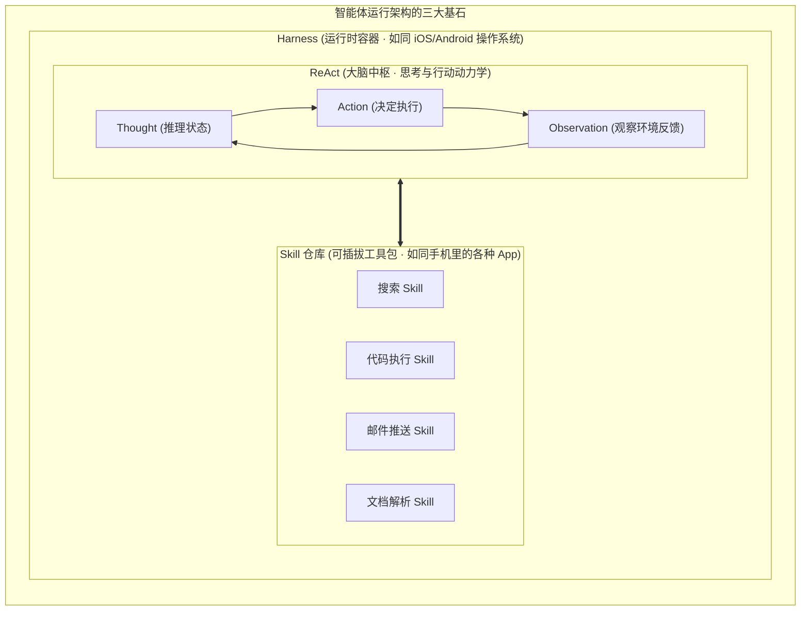
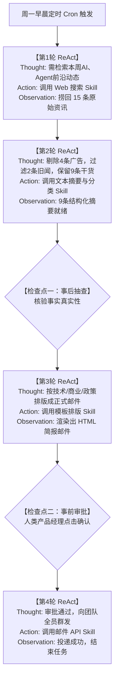
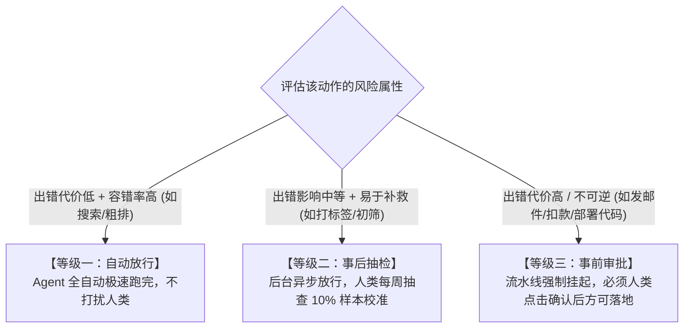
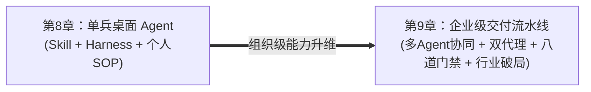

# 第8章 实践3：用Agent自动化重复任务——从ReAct到放手

> **本章心法：** Agent 就是“按你写的 SOP 跑腿的数字实习生”。单点 Prompt 只是下达指令，Agent 是把执行交给机器、把判断留给人类。完全放手必然走向灾难，带有“人在环（HITL）”检查点的 Agent 才是真正的十倍生产力杠杆。

---

如果你一路读到了这里，你已经掌握了丰富的 AI 战术武器：
- 契约规格书（第3章）帮你锁死了单次对话的交付标准；
- 思维链（第3章）逼迫大模型在复杂问题上打草稿；
- RAG（第6章）让私有知识库充当大模型随身翻阅的案头百科；
- 自动化模板（第7章）把周报和规范比对做成了标准件。

但在日常工作中，你大概率依然会冒出一个无法抑制的渴望：  
*“每一次任务，我还是得守在屏幕前，一步一步指挥 AI、复制上一轮的结果喂给下一轮。能不能给它一套流程，让它自己跑完整个闭环，我只在最关键的卡点审批签字？”*

答案是完全可以。但这要求你的工程心智完成一次根本性的跨越——**从使用“工具”跃升为驾驭“智能体（Agent）”**。

“Agent”这个词在今天被很多营销号渲染得神乎其神，仿佛机器马上要拥有自主意识去接管世界。别被宏大叙事吓倒。在务实的工程视角下，Agent 的本质极其朴素：**Agent = Skill（技能包）+ Harness（运行时沙箱容器）+ ReAct（思考-行动闭环）**。  
你负责制定 SOP，Agent 负责在受控沙箱里跑 SOP；你放手的是机械执行，你紧握不放的是最终的价值判断。

---

## 8.1 核心三元组：Skill、Harness 与 ReAct

理解智能体，最形象的类比是智能手机操作系统：



### 1. Skill（技能包）：Agent 的“离散功能 App”
单个大模型本质上只有文字预测能力。所谓 Skill，就是被封装成标准化接口的具体工具能力（在第 4 章中体现为 Function Calling 或 MCP Server）：
- 例如一个“网页抓取 Skill”，输入是 URL，输出是干净的 Markdown 文本；
- 一个“SQL 查询 Skill”，输入是查询意图，输出是数据库明细表。  
没有 Skill，Agent 只是一个闭门造车的哲学家；装配了 Skill，它才拥有了干脏活累活的双手。

### 2. Harness（运行时容器）：Agent 的“操作系统与安全护栏”
如果 Skill 是 App，那么 Harness 就是承载这一切的底层操作系统（如 OpenClaw、Claude Code 或自研 Agent 引擎）。你平时几乎感受不到操作系统的存在，但没有它，任何 App 都跑不起来。Harness 默默承担着五项极其冷酷的底座职责：
- **生命周期管理**：控制 Agent 任务的启动、挂起、超时与异常崩溃自愈重启；
- **工具总线调度**：依据模型的意图，路由并调用正确的 Skill 接口；
- **长程记忆与上下文维持**：跨轮次保留关键业务变量，管理滑动窗口与向量缓存；
- **安全沙箱隔离**：划定 Agent 能动用的文件目录与网络白名单，坚决防止越权删除生产数据；
- **模型动态路由**：简单分类任务分流给便宜的 Mini 模型，攻坚推理派发给旗舰模型。

> **行业洞见：**  
> 当全球前沿基座模型在纯语言推理上的差距不断收窄时，**真正的技术护城河正全面转向 Harness 工程**——谁的沙箱更稳定、谁的上下文管理更优雅、谁的工具调用容灾更坚固，谁的 Agent 就能在工业级场景下跑得更远。

### 3. ReAct（思考-行动闭环）：Agent 的“行车导航脑”
有了 Skill 的双手，有了 Harness 的底盘，谁来决定当前该走哪一步？这就是 **ReAct（Reasoning + Acting）**。
- 它拒绝静态盲跑。它走一步看一步：**想清楚下一步 $\to$ 调用对应 Skill $\to$ 观察环境返回的数据 $\to$ 基于真实证据修正下一步计划**；
- 这种在试错中前进的动力学，正是第 1 章“贝叶斯后验更新”在 Agent 上的完全自动化体现。

---

## 8.2 你的第一个端到端 Agent 任务：AI行业动态简报

让我们通过一个真实跑通的高频场景，把 Skill、Harness 与 ReAct 彻底串联起来——**“每周一自动生成 AI 行业动态简报”**。



### 标准执行四步法

1. **定义具体目标（清晰边界）**：  
   严禁下达“帮我关注行业新闻”这种模糊指令；明确规定：“每周一早 9:00 前，汇总过去 7 天关于大模型与 Agent 的核心动态，生成三段式简报”。
2. **拆解标准化 SOP**：  
   将任务拆解为模型可执行的微观步骤：`搜索 ➔ 过滤噪点 ➔ 提炼摘要 ➔ 领域分类 ➔ 模板排版 ➔ 邮件发送`。
3. **装配对应 Skill**：  
   为 Harness 配置搜索引擎接口、文本提取模型与邮件发送凭证。
4. **锚定关键检查点（人在环卡点）**：  
   搜索和初筛可以完全自主放行，但在**“摘要终稿输出”**与**“正式群发前夕”**设定两个必经检查点，暂停等待人工签字。

---

## 8.3 人在环（Human-in-the-Loop）：安全与效率的黄金平衡

很多人对“自动化”抱有一种极端的浪漫幻想：认为只有 100% 全自动、完全不需要人插手，才算高级。

这是极其危险的认知毒药。**完全脱缰放手的 Agent，等于给生产系统埋设了一颗定时炸弹。**  
一旦有一次摘要口径错漏、或者对涉密信息未加脱敏直接群发，团队对整个 AI 体系的信任就会瞬间归零，直接导致系统被永久停用。

但反过来，如果 Agent 跑每一步都弹窗让你确认一次，你只是把“亲手写”变成了“疯狂点确认”，人效比根本没有提升。  
真正的解法是构建**三级分层人在环（HITL）决策矩阵**：



| 检查点等级 | 治理策略 | 触发条件 | 典型场景 |
| :--- | :--- | :--- | :--- |
| **等级一：自动放行** | Agent 自主流转，无感执行 | 出错代价极低、逻辑只读、易重试 | 关键词检索、新闻去重、格式初洗 |
| **等级二：事后抽查** | 自动完成，人类异步抽检 | 出错仅影响内部体验、不产生外部法律责任 | 新闻领域分类打标签、草稿生成 |
| **等级三：事前审批** | 强制挂起状态机，等待人工确认 | **涉及资金、对外公开发布、修改生产环境** | 邮件正式全员群发、执行订单退款、合并核心代码 |

> **心法：** 人在环不是对 Agent 的不信任，而是为了给 Agent 构筑一张容错的安全防护网。人类交出的是枯燥的体力劳动，守住的是最终的价值定性与底线裁判。

---

## 8.4 Agent自动化的经济学风险：委托-代理与公地悲剧

当单兵 Agent 走向团队协作时，必须提前预防两大学科级经济学风险：

### 1. 委托-代理问题（Principal-Agent Problem）
在经济学中，当你（委托人）把工作托付给员工或 Agent（代理人）时，两者的利益往往天然不对齐。Agent 的数学目标是“尽快结束单次会话、降低损失函数”，它天然会倾向于**走捷径**——如果约束不够细致，它会草率地敷衍回答，看似交了差，实则丢失了深层信息。  
**解法**：在 SOP 中明确规定负向约束与验收 Checklist，用硬性门禁消除模型的偷懒空间。

### 2. 公地悲剧（Tragedy of the Commons）
当团队共享同一个未做限额的 Agent 平台时，每个成员都会倾向于输入海量冗余文档、发起高频无节制的并发长推理。很快，公共 API 配额被瞬间打满，导致核心业务遭遇限流崩溃。  
**解法**：Harness 必须提供明确的**租户资源配额、速率限制（Rate Limit）与安全沙箱**，以产权与配额思维管理算力。

---

## 8.5 通向第9章的跨越：从单兵Agent到组织级流水线

本章所建立的个人单兵 Agent 模型，解决了你桌面上的日常自动化。但当你的视角从“一个人提高效率”上升到“带领几十人、上百人的工程团队进行商业交付”时，单兵模式便遇到了天花板：
- 单个 Agent 无法独自搞定百万行代码的电信级云平台；
- 个人提示词无法确保全省团队交付物的一致性与可审计性。

这就自然引出了全书压轴的**第 9 章（LY Plan实训）**：
- **从单兵 ReAct 跃迁至多智能体协同流水线**：Orchestrator 编排调度，Researcher 检索调研，Coder 编写代码，Reviewer 执行审查；
- **从口头 SOP 跃迁至 Spec Mode 与八道企业级质量门禁**：版本中枢、AI 代码评审、双轨 CI/CD、安全自愈助手；
- **从关注代码本身跃迁至识别行业技术与制度“锁芯”**。



---

## 本章小结与可复用 SOP 模板

```markdown
# 智能体任务 SOP 规范模板 (Agent SOP Template)

[TASK IDENTITY]
任务名称：【如：竞品技术动态巡检 Agent】
核心目标：【一句话阐述终局交付物】

[REACT EXECUTION FLOW]
- Stage 1 (情报检索): 调用 Search_Skill，关键词限定于【指定领域】，严格排除商业广告。
- Stage 2 (数据清洗): 调用 Parser_Skill，过滤 7 天前旧闻，提取核心技术突破点。
- Stage 3 (报告成文): 依据标准 Schema 生成 Markdown 简报。

[HITL CHECKPOINTS]
- Stage 1 ➔ Stage 2: 【自动放行】
- Stage 2 ➔ Stage 3: 【事后抽查 (每周抽查10%清洗质量)】
- Stage 3 ➔ 外部推送: 【事前审批 (必须人工确认后方可触发发送)】

[FALLBACK & RECOVERY]
如遭遇接口限流或检索结果为零，自动降级为【备用数据源】并向管理员触发警报。
```

- [ ] **透视 Agent 三要素**：Skill 赋予双手，Harness 提供系统级沙箱护栏，ReAct 驱动动态闭环。
- [ ] **坚守人在环底线**：牢记完全放手等于引爆地雷；严格按照风险等级配置“自动放行、事后抽查、事前审批”三级门禁。
- [ ] **防范经济学风险**：用严密 SOP 解决委托-代理偷懒，用配额边界解决公地悲剧。
- [ ] **准备向组织级升维**：完成单兵 Agent 实战后，果断迈向第 9 章的组织级端到端研发流水线。
