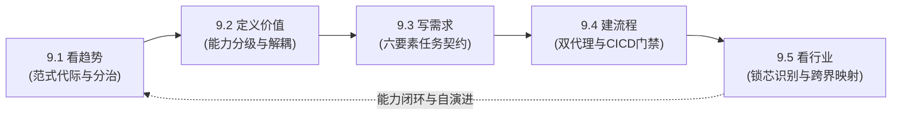
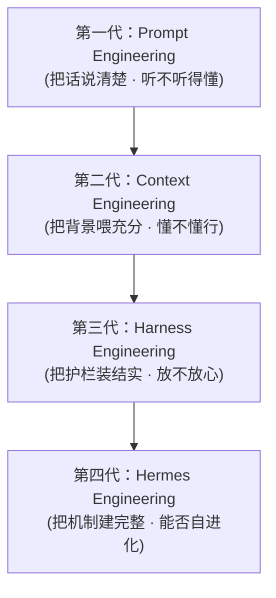
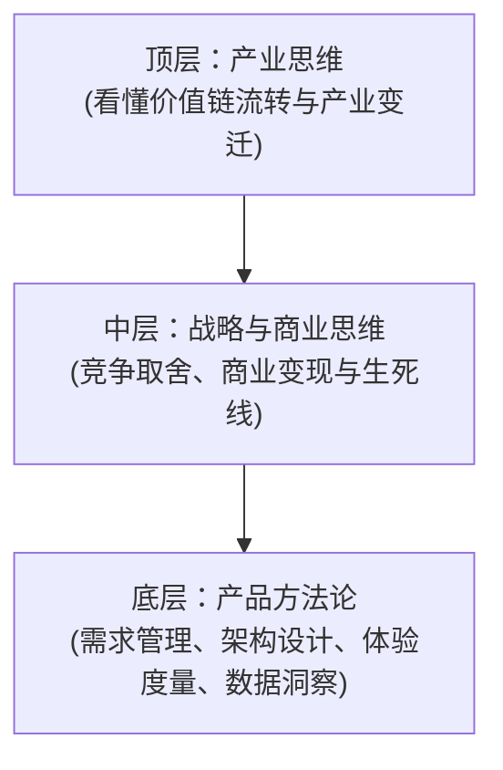
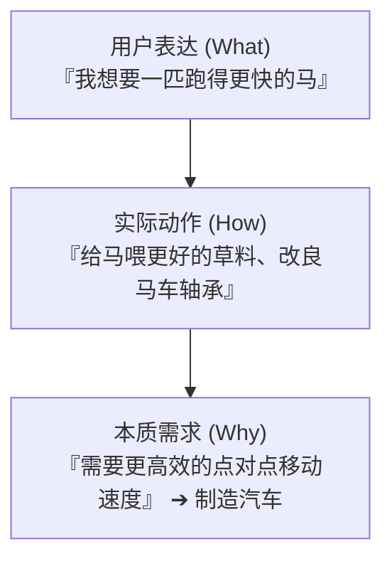
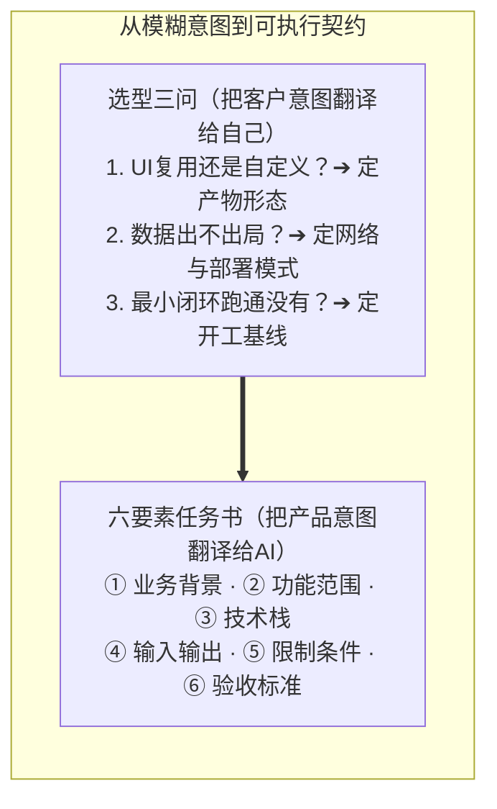
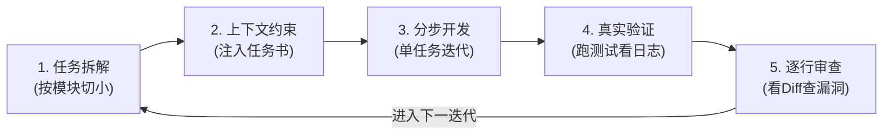
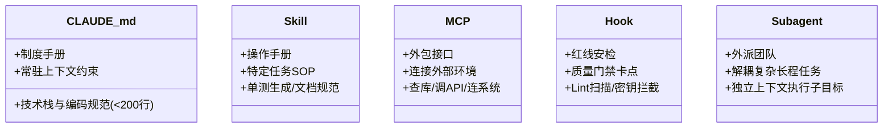
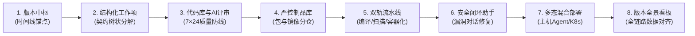
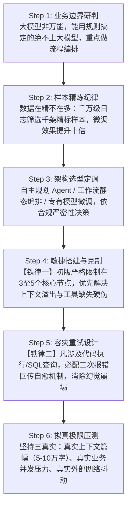
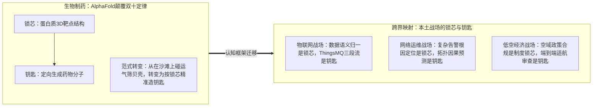

# 第9章 实践4：LY Plan实训——从会用AI到让AI替你干活

> **本章心法：** AI产品经理不是会用AI的产品经理，而是能用产品思维驾驭AI的经理。会用AI是多一把锤子，驾驭AI是建一条流水线——锤子换谁来挥都一样，流水线的设计者才不可替代。

早上九点，一位AI产品经理打开电脑：先扫一遍行业趋势快报，判断哪些技术成熟到可以产品化；十点开需求评审，用KANO模型把「必须做」和「做了加分的」拆清楚；中午写一份六要素任务书丢给Claude Code，让AI先把代码骨架搭出来；下午盯交付流水线——AI评审过了没有、安全扫描亮没亮红灯、制品上了没；傍晚换个频道，翻一篇AI重塑生物医药的长文，琢磨自己行业的「锁芯」在哪里。看趋势、定义价值、写需求、盯交付、跨界找机会——这不是五天日程表，这是一个AI产品经理的能力闭环。

2026年8月到9月，某DX运营商的LY Plan实训分四个星期走完了这条闭环。前半程讲方法论——看趋势、定义价值、写需求、建流程、看行业，五块能力拼图；后半程上战场——物联网感知云、量子加密通信、智能体平台、低空经济，四大领域轮番实战，最后回到D校收束价值与方法。最妙的不是课程多全，而是后半程每打完一仗回头看，都是前半程某块拼图的实战注脚——**方法论在不同战场被反复验证，教学顺序反过来也成立，这是「学会了」最硬的证据。** 本章按五块拼图组织，把四个战场的案例织进各自归属的拼图里。

企业不缺AI工具，缺的是把AI变成生产力的方法论。产品经理就是那个把方法论落地的人。一个人学会用AI，只是多了一把好锤子；一个组织学会用AI，才是建起了整条流水线。

---

## 9.1 看趋势：产品经理的宏观视野

产品经理为什么要懂AI趋势？三个字：**判得准**。
- **判断技术成熟度**：什么能产品化、什么还在实验室里；
- **选择技术栈**：第四代范式选型选哪一代，决定你的产品能走多远；
- **预判产品形态**：L1规则驱动做出的是工具，L2预测生成做出的是助手，L3 Agent做出来的是同事，产品形态随范式升级而演进。

不懂趋势的产品经理，要么押早了做出一堆没人用的Demo，要么押晚了眼睁睁看别人把市场占完。

### 三次浪潮，三种信仰

AI的三次浪潮，对应三种信仰：
1. **第一次浪潮：符号主义（逻辑学家）**  
   相信所有知识都能写成规则，智能就是规则推演。你告诉它「如果下雨，带伞」，它永远不会忘带。问题是现实世界太复杂，规则表很快就组合爆炸了，专家系统最终困死在自己的规则迷宫里。
2. **第二次浪潮：联结主义（经验工匠）**  
   不在乎显式规则是什么，只管从海量数据里提炼特征模式。给它看一万张猫的照片，它就能认出第一万零一只猫。但工匠只会认、不会想——它能告诉你「这是猫」，却无法解释「猫为什么喜欢纸箱」。
3. **第三次浪潮：生成式AI（博学者）**  
   把海量人类知识压缩进高维参数，在统一表征空间中建立常识世界模型，然后按需生成。写诗、写代码、画画、解微积分、分析财报，它都能接招。

三次浪潮背后是一次根本性的范式转移：
- **从碎片化专才走向全域通才**：同一个大模型能写诗、写代码、做UI设计，而在过去这需要三个完全独立的专用系统；
- **从像素级标签分类走向常识级语义对齐**：不再靠标注数据教机器「这是猫耳朵、那是猫尾巴」，而是让它在统一语义空间中自然理解「猫」的实体概念；
- **物理世界常识通过多模态统一表征建立**：文字、图像、语音、视频映射到同一个空间，模型终于理解了「杯子掉在地上会碎」这类物理常识。

### 从萌芽到深水区

回顾大模型的演进脉络：
- **2018—2019年（萌芽期）**：BERT开创双向语义理解，GPT-1/2证明了自回归语言模型的扩展潜力；
- **2020—2022年（爆发前夜）**：GPT-3以1750亿参数打破涌现门槛，思维链（CoT）让模型学会「先想再说」；
- **2023—2024年（百花齐放）**：GPT-4/4o实现原生多模态，Llama点燃全球开源生态，Gemini将上下文窗口推高到百万Token级别；
- **2025—2026年（深水区）**：GPT-5.6 Sol、Claude Opus 5相继登场，国产DeepSeek、Qwen V3紧追不舍。参数堆砌竞赛退场，能力密度、长程规划与企业级工程化落地成了主战场。

### 三层核心能力与快慢思考

大模型为什么具备通用能力？归根结底是三层底层机制的叠加：
1. **统一表示**：文本、图像、音频、视频在统一向量空间对齐。过去的多语言与跨模态转换需要逐级搭桥（如英语语音→英语文字→中文文字→中文语音），现在端到端直接映射，一步到位。
2. **规模压缩**：数万亿参数对整个互联网的人类知识做了高维有损压缩。它就像把大英百科全书背进了脑子——细节偶尔模糊，但骨架常识都在。
3. **推理增强**：从早期的直觉式预测，走向先拆解、再搜索、再验证、最后自我修正，大模型从「拍脑袋」进化到了「打草稿」。

这对应认知心理学中的快慢思考体系：
- **快思考（System 1）**：条件反射式生成，速度极快，适合日常闲聊、文字润色、快速问答；
- **慢思考（System 2）**：先深思再计算再审查，适合复杂代码编写、数学证明、长程业务规划。思维链（CoT）、思维树（ToT）与自我反思（Self-Reflection）皆是激活慢思考的机制。

未来生产级AI系统一定是快慢协同：简单任务秒回，复杂长程任务深思。

### 从L1到L3：能力三级跳

| 级别 | 核心特征 | 技术本质 | 对应产品形态 | 价值定位 |
|:---|:---|:---|:---|:---|
| **L1** | 规则驱动（If-Then） | 确定性逻辑 | 规则引擎 / 流程自动化 | 替代重复人工 |
| **L2** | 预测生成（Next-Token） | 概率性推理 | 智能助手（你问它答） | 辅助人脑创作 |
| **L3** | 目标导向（Agent） | 自主性闭环 | AI同事（你定目标它交付） | 协同完成端到端任务 |

当前产业正处于从 L2 向 L3 迈进的交替窗口期。支撑 Agent 落地的底层四大支柱包括：
- **长上下文**：128K 至 2M Tokens 的全量业务背景注入；
- **工具调用（Tool Use / MCP）**：集成终端、浏览器、数据库与企业 API，让模型具备双手；
- **记忆系统**：会话级短期上下文与外部向量/文件长期记忆分层架构；
- **多Agent协作**：Orchestrator 编排调度，Researcher 检索调研，Coder 编写代码，Reviewer 执行代码审查，分工协作。

四大能力由一条 **Agent Loop（智能体闭环）** 统一驱动：
$$\text{观察 (Observe)} \longrightarrow \text{规划 (Plan)} \longrightarrow \text{行动 (Act)} \longrightarrow \text{反思 (Reflect)} \longrightarrow \text{记忆更新 (Memory)} \longrightarrow \text{重返观察}$$
四大能力是零部件，Agent Loop 才是运转起来的整机。

### 四代范式：从听不听懂到能不能进化

| 代际 | 核心问题 | 一句话心法 | 产品选型定位 |
|:---|:---|:---|:---|
| **Prompt Engineering** | 听不听得懂？ | 把话说清楚 | 门槛低，但能力下限与上限受限 |
| **Context Engineering** | 懂不懂行？ | 把背景喂充分 | 决定模型理解业务深度的天花板 |
| **Harness Engineering** | 放不放心？ | 把护栏装结实 | 离生产力最近，决定交付的安全与可用边界 |
| **Hermes Engineering** | 能不能自进化？ | 把机制建完整 | 架构设计终局，实现运行期持续自省优化 |

**判断原则**：评估一条 AI 技术路线，先看它落在第几代范式。代际越高，离真实生产力越近，但对工程环境（Harness）的复杂度要求也越高。

### 2026年范式分治：工作流与自主式

如果四代演进是纵向技术轴，2026年的产业落地则在横向切出了分水岭——**工作流智能体（软件控制AI）与自主式智能体（AI控制软件）**：

| 维度 | 工作流智能体（Dify / Coze） | 自主式智能体（Manus / OpenClaw） |
|:---|:---|:---|
| **控制主体** | 确定性代码与状态机编排 | 大模型自主推理与动态规划 |
| **任务性质** | 步骤明确、SLA 严格的核心业务流程 | 开放式、需动态探索的研究/创新任务 |
| **成本控制** | Token 消耗可精确预估 | Token 消耗动态波动，需充足算力预算 |
| **合规审计** | 具备全链路确定性执行审计痕迹 | 执行轨迹具有概率性，适合非敏感场景 |
| **失败代价** | 极高（涉及金钱交易、核心资产安全） | 较低（支持人工回滚或重试） |

工程界的一个真实注脚：裸跑 Claude Code 20分钟、消耗 9 美元，容易把工程搞乱；而给它配置完整的测试护栏与规范 Harness 后，即便运行数小时、消耗上百美元，却能端到端产出可直接交付的商用级系统——**决定成败的关键不在于模型本身，而在于包裹模型的工程环境（Harness）。**

**产品经理的双副眼镜（以 OpenClaw 为例）**：
- **用户视角眼镜**：依靠本地长期记忆、定时 Cron 任务、7×24 驻留及 IM 渠道接入，在自动巡检、舆情盯哨与客服响应场景下呈现出「有灵魂、会来事」的贴心管家体验；
- **建设者视角眼镜**：深度配置门槛高、Token 开销不可控、单项推理没有技术护城河，当前更多处于市场概念普及期。  
两副眼镜轮流戴，才能既看清用户情绪价值，又摸准工程商业现实。

---

## 9.2 定义价值：产品思维是第一性原理

AI 时代，产品经理的核心护城河不是「会写提示词」或「会调工具」——这些工具性操作 AI 自己都能做得更好。核心壁垒永远是**定义价值**。

### 项目思维 vs 产品思维

| 维度 | 项目思维 | 产品思维 |
|:---|:---|:---|
| **需求来源** | 满足特定业务线定制，局部具体 | 面向市场公约数，从模糊中抽离通用标准 |
| **客户关系** | 被动承接内部派单 | 主动进行客户分层与需求筛选 |
| **竞争环境** | 组织内部壁垒，缺乏危机感 | 市场充分竞争，不创新即出局 |
| **衡量指标** | 项目工期、短期交付成本 | 长期客户 LTV、ROI 与商业壁垒 |
| **组织变革** | 随波逐流，跟在业务屁股后面改 | 洞察痛点，以产品倒逼组织效率革新 |
| **目标导向** | 争取预算、扩大人员编制 | 提升市场份额、放大单位人效 |

> **心法：** 项目思维是管好交付，产品思维是开拓市场。在「接需求→做交付」的流水线上，AI 最终能完全接管；而在「定义价值→验证假设」的飞轮中，AI 只是你的杠杆。

### 七大修炼方向

1. **抬头看路**：持续研判产业链生态位与前沿技术演进拐点；
2. **市场意识**：时刻反问自己：“用户真的愿意为这个增量功能付费吗？”；
3. **深入一线**：绕过中间传话人，直面真实用户操作现场，辨别真伪痛点；
4. **成为行业专家**：把离散的项目做成知识网络，十个散点项目必须连成一条标准化能力线；
5. **跨界迁移**：跳出本行看他山之石，将异业成熟范式迁移为本行创新；
6. **理解决策心理**：洞悉客户采购决策链背后的权力与人性平衡；
7. **数据思维**：用指标和数据闭环验证业务假设，而非主观臆断。

### 需求验证漏斗与伪需求三标准

识别伪需求的三道铁律：
- **对象不普遍**：仅满足极个别特殊客户的偶发畸形诉求；
- **价值不显著**：看起来很酷但无法带来十倍效率提升，客户不愿买单；
- **替换成本过高**：使用复杂度超过解决问题本身的收益，落地即遭抵制。

### 需求与竞争方法论在 AI 时代的重塑

- **5Why 深度追问**：连续追问表象背后的制度与架构根因，直至定位到底层机制；
- **KANO 模型排序**：
  - **必备因素**：没有则产品不可用（如通信的连通率、模型的安全性）；
  - **期望因素**：做得越好越满意（如响应延迟从 2s 降到 200ms）；
  - **魅力因素**：超出预期的惊喜（如模型主动识别意图并生成图表）。  
  *切记：必备做满、拉高期望、点缀魅力，顺序颠倒必然翻车。*
- **波特竞争战略与蓝海重构**：
  - 以某电信级**虚拟数字专家**为例：将顶级资深网络架构师的行业知识与决策逻辑做双维蒸馏，实现 7×24 小时高可用。支撑单日 10,000+ 次方案评审，获取专家决策的周期从过去的 48 小时直接压缩至 1 分钟，这正是通过“剔除人工时滞、创造即时知识供给”建立起的蓝海优势。

### 价值落地的两只手：能力分级与能力解耦

培训后半程的两大战役案例，生动诠释了产品经理定义价值的手法：

1. **第一只手：能力分级（用户分层驱动架构分层）**  
   在物联网感知云平台建设中，平台将二次开发能力垂直划分为三级坡道：
   - **拖拽级**：面向业务人员，通过可视化组装大屏；
   - **配置级**：面向实施人员，基于规则模板搭建业务场景；
   - **编码级**：面向专业研发，开放底层 API 进行复杂逻辑定制。  
   *战果：一天出 Demo，一周通业务，一月交项目，交付成本直降 80%。能力分级的本质，是让不同技术梯度的用户都能找到适合自己的交互坡道。*
2. **第二只手：能力解耦（从交付产品到交付能力）**  
   LZ密信最初是一个完整的端到端加密通信 App，但政企大客户普遍反馈：“我们不需要多装一个 App，我们需要将你的量子加密能力装进我们自己的办公门户中”。  
   产品线随即执行彻底解耦，演进出三种产物形态：
   - **核心版（SDK）**：纯逻辑引擎，封装底层 IM/RTC 与加解密协议；
   - **Lib版**：开放业务逻辑接口，UI 完全由客户自研；
   - **UI Kit版**：开箱即用的官方 UI 组件包，集成速度最快。  
   *选型总纲：UI Kit 与 Lib 的抉择，本质是在「接入效率」与「定制空间」之间做商业取舍。把一体化产品解构为乐高积木，是平台化思维的第一课。*

---

## 9.3 写需求：把产品意图变成AI听得懂的契约

传统编程如同**手写家书**，一行行代码全凭手打，内容完全可控；AI 编程时代则如同**口述秘书**，你说意图，秘书落成文字。这并不意味着人变得轻松，反而对需求表达的严密性与审稿验收能力提出了前所未有的要求。

### 岗位更迭中，变与不变的底层逻辑

- **改变的表象**：前端界限模糊，全栈成为标配；写代码的时间被极大压缩，但排查隐蔽 Bug、架构调优的时间反而变长（从「能跑」到「跑得稳」的沟壑拉大）；
- **不变的内核**：
  1. **方向感**：清楚知道系统要达成什么业务目标；
  2. **品味（Taste）**：能一眼辨别生成的架构是否健壮、体验是否优雅；
  3. **方法论**：掌控拆解复杂业务、构建异常保护的思维框架。

### 六要素任务书：PRD的AI版本

每次向 AI 下达研发任务，本质上是在签署一份**工程交付契约**。契约越周密，交付越靠谱。

一份高标准的六要素任务书模板：
1. **业务背景**：说明需求起因及痛点（例：“为客服系统研发工单自动归类，解决人工分拣时效慢且差错率高的问题”）；
2. **功能范围**：圈定边界，明确做什么与不做什么（例：“仅处理文本工单，不涉及语音转写与图片识别”）；
3. **技术栈约定**：指定框架版本与关键库（例：“Python 3.11 + FastAPI + SQLite”）；
4. **输入输出格式**：给出数据 Schema 与契约范例（例：“入参为工单 JSON 文本，出参为预设分类 Label 及 Float 置信度”）；
5. **限制条件**：划定红线（例：“禁止调用外部公网 API，单条接口处理时延 < 200ms”）；
6. **验收标准**：可量化验证指标（例：“准确率 ≥ 90%，单测覆盖率 ≥ 80%，异常入参返回规范错误码”）。

### 同一套方法论的两种方言

六要素任务书的底层逻辑具备跨场景通用性：
- **桌面级办公 Agent（XC超级智能体）**：任务输入提炼为五大要素——**明确目标、提供材料、划定范围、指定处理方式、严格输出格式**。材料与范围即是功能边界，处理方式与格式即是输入输出与验收标准。
- **专业场景（合同风险智能审查）**：任务指令要求——“不直接修改原文，仅通过批注标识；每条批注必须包含【问题类型】、【法律风险】、【整改建议】三项”。三要素一出，AI 输出的结果就能用尺子精准衡量。

### Vibe Coding 的五步工程闭环

Vibe Coding 绝非无脑碰运气，必须遵循严谨的五步闭环：

1. **任务拆解**：严禁把大象一口吞下。将复杂需求切分为“数据预处理→分类引擎核心→RESTful接口对接→异常集成测试”四段；
2. **上下文约束**：将六要素任务书和核心规范精准注入提示词；
3. **分步开发**：严格让 AI 单步单交付，验证通过后再进行下一步；
4. **真实验证**：绝不相信“看代码感觉没问题”，必须构建真实测试用例跑通执行；
5. **逐行审查**：核验边界条件、异常分支与资源释放逻辑，确保无逻辑硬伤。

### 工程化五件套工具箱

在终端智能编程（以 Claude Code / Agent IDE 为例）中，支撑工程化交付的核心是五件套组件：

- **CLAUDE.md（制度手册）**：全局常驻项目记忆，约束技术选型、目录结构和代码规范，建议精简在 200 行以内，避免上下文污染；
- **Skill（操作手册）**：固化特定任务的标准作业流（如自动化测试编写套路、代码评审规范）；
- **MCP（外包接口）**：充当 AI 调取外部世界工具的协议线（连接企业数据库、调用内部 DevOps 接口）；
- **Hook（红线安检）**：在关键动作触发前进行强制安全校验（提交前格式格式化、敏感密钥泄漏检查）；
- **Subagent（外派员工）**：遇到深度子任务时动态派生子代理，上下文隔离，避免主会话发散崩溃。

### 交付铁律与安全防线

AI 生成代码必须严防五大隐患：**业务逻辑漏洞、过度越权改动、明文凭证泄露、虚构错误依赖包、测试用例自圆其说式失效**。  
企业级交付执行唯一铁律：
$$\texttt{git diff} \longrightarrow \text{人工/AI规范 Review} \longrightarrow \text{自动化单元测试} \longrightarrow \texttt{git commit} \longrightarrow \text{同步更新规范与文档}$$

---

## 9.4 建流程：企业级AI研发的产品化交付

需求拆清之后，产品经理的核心战场转移到了交付流水线。AI Coding 从单点实验走向组织级生产力，靠的是**制度在先、规矩立牢、流水线自动流转**。

### 心法：规矩在先，机器在后

- **演进三阶段**：2023—2024年单点代码补全（提效 0.5x）；2024—2026年任务级协同生成（提效 1~2x）；2026年起进入多 Agent 端到端自主协同（提效 5~10x）。
- **双主代理（Plan 与 Build 的权力分立）**：在企业级研发云（如 srdCloud CF）中，采用架构解耦设计：
  - **Plan 代理（只读规划者）**：负责全局上下文调研与执行计划制定，不授予文件写权限；
  - **Build 代理（构建执行者）**：依据既定契约执行代码修改与测试，受环境护栏严格管控。  
  *定契约的人与执行契约的人分离，契约才具备真正的约束力。*
- **Spec Mode（规格驱动）vs Vibe Coding（直觉编码）**：

| 维度 | Vibe Coding | Spec Mode |
|:---|:---|:---|
| **核心驱动** | 对话驱动，先跑出效果再看 | 规范驱动，先固化设计规格再动工 |
| **推进节奏** | 边试边调，高频试错 | 依循规范分解，按阶段制品严格验收 |
| **交付物链条** | 最终输出运行代码 | 严格产出：$\text{Requirement} \to \text{Design} \to \text{Task}$ 三大规格资产 |
| **最佳战场** | 前期原型刺探、灵感验证、快速试错 | 企业核心业务、高可靠系统、跨团队协同研发 |

### 企业级交付流水线：八道质量门禁的设计逻辑

企业级研发绝不是程序员本地把代码跑通就大功告成，必须依托严密的流水线将需求、代码、安全与部署牢牢锚定在一起。以下是企业级研发平台中不可或缺的八道质量门禁：

1. **版本中枢（时间线锚点）**：一切业务变更必须挂在版本上。版本是需求的母体——工作项挂在版本下，代码合并指向版本，构建产物归属版本，部署回滚依赖版本。没有版本锚点，研发资产就是一团乱麻。
2. **结构化工作项（契约层级化）**：严禁需求无序堆积。长篇故事拆解为业务特性，特性再拆解为开发任务与 Bug 工单，自上而下形成树状追溯体系。
3. **代码库与AI评审（第一道质量闸口）**：分支合并必须强制开启自动化 AI 审查助手。它不仅能跨越人情面子客观指出代码缺陷与规范异味，更将审查标准固化为 7×24 小时在线防线。
4. **制品库管理（交付物唯一可信源）**：严格区分 Generic 通用制品（存放前端部署包）与 Docker 镜像仓库（存放容器化后端制品），杜绝直接拿本地编译物上线。
5. **双轨自动化流水线（装配自动化）**：
   - **前端流水线**：代码拉取 $\to$ NodeJS 编译 $\to$ 制品打包 $\to$ 归档入库；
   - **后端流水线**：代码拉取 $\to$ Maven 构建 $\to$ SonarQube 质量分析 $\to$ Docker 镜像封装 $\to$ 镜像验签推送。
6. **安全卫士（对话式安全自愈）**：静态扫描告警后，通过内置安全助手直接在控制台定位漏洞并输出修复补丁，将修复效率提升数倍。
7. **多态资源部署（环境标准化交付）**：支持私有主机轻量 Agent 托管与标准 K8s 容器集群发布，保障测试与生产环境的一致性。
8. **版本全景验收（数据链路闭环）**：在版本发布看板上，工作项进度、代码 Commit、静态质量分、安全漏洞、制品 Digest 与部署集群全部统一归档，达成企业级端到端追溯。

### 智能体开发的工程纪律：六步 SOP 交付链

如果说研发云管的是“代码流水线”，智能体平台管的则是“认知与决策的流水线”。实战中必须建立标准化的六步交付链：

### 智能体趋势工程深潜（以 OpenClaw 为例）

承接 9.1 节对自主式智能体的探讨，在工程落地层面，它将「长期驻留与持续感」拆解为了极具启发性的实现机制：
- **分层记忆机制**：摒弃沉重的向量数据库全量检索，采用轻量本地文件架构——按日记录明细流水，后台异步抽象凝练为长期知识框架，模拟人类日记与心智沉淀；
- **定时心跳与主动交互**：智能体不再是被动等待敲击的静态终端，而是拥有自身调度主线的实体，能够主动巡检状态、主动发起汇总、主动汇报风险；
- **产品心理学体感**：用户认知从“使用枯燥软件”转变为“培育长效数字搭档”。这种产品维度的设计取舍，让它在 7×24 小时情报抓取和系统守候场景中建立了独特的壁垒。

### 低空经济实战：FDE 驱动的二开落地

在低空感知与飞行控制等高门槛场景中，AI Coding 从代码生成深入到了全流程二次开发：
- **痛点诊断**：飞控涉及复杂物理边界与合规约束，代码规模庞大，传统上游原型设计与下游集成测试高度割裂。
- **解法构建**：采用 **FDE（前线部署工程师）驱动的低空智能体**，构建“AI-Ready 规范文档 $\to$ 低空领域知识库 $\to$ Skill/MCP 插件集成 $\to$ 低空数字工程师 $\to$ 真实场景回放 $\to$ 集团云资产沉淀”的六步链路。
- **实测战果**：
  - 上海低空态势感知大屏：研发人员上手周期缩短至 2 天内，交付人效提升 60%，单场景开发人力从 10人/日锐减至 4人/日；
  - 江苏警航定制项目：前后端重构效率分别提升 40% 与 50%，交付周期整体压缩 40%。

> **数据洞见**：某运营商通过研发云智能体系累计提效 30%，折合等效节省人力 **700+人年**。当头部智能体产品生成代码比例突破 85% 时，产品经理的工作不再是画框写字，而是充当这套生成体系的首席总体验收师。

---

## 9.5 看行业：跨界视野与行业映射

优秀的产品经理不仅能看清本赛道，更能穿透陌生行业的底层范式变迁，提炼出可复用的认知模型，映射回自己的产品中。

### 陌生行业的范式跃迁：AlphaFold 击穿双十定律

传统新药研发受困于**双十定律**：平均耗时10年、耗资10亿美元、研发成功率不足10%。核心痛点在于找靶点——过去依靠冷冻电镜解析一个蛋白质的三维折叠结构需要耗费半年甚至数年。

而 AlphaFold 的到来将解析周期缩短至 **1小时**：
- **蛋白质 = 疾病开关 = 精密锁芯**；
- **药物分子 = 匹配开关的特异性分子 = 钥匙**。

以往药物研发是**“有什么筛什么”**（像在广袤海滩上盲目捡贝壳试锁）；AlphaFold 出现后，演变成了**“要什么造什么”**（先由 AI 给出精密锁芯模型，再针对性设计钥匙）。

### 身边的巴别塔：物联网战场的锁芯寻找

看行业不必舍近求远，物联网领域的协议壁垒就是身边的生动案例：
- **痛点**：通信层虽有 MQTT、HTTP 作为通用标准，但往下存在数十种工业方言（Modbus、HJ212、JT/T808、IEC104 等）。更为致命的锁芯是：**传输协议规定了报文通信格式，但数据载荷（Data Payload）的业务字段定义完全割裂**。
- **解题钥匙（ThingsMQ）**：将数据链路解耦为三段式架构：
  $$\text{接入层（多协议插件）} \longrightarrow \text{规则引擎（统一翻译、清洗、归一）} \longrightarrow \text{桥接层（标准化投递）}$$
  通过将混乱的业务方言做标准化语义归一，破解了跨行业集成的核心痛点。

### 跨界映射与两类锁芯辨析

| 业务领域 | 传统模式（有什么筛什么） | AI/产品化新范式（要什么造什么） | 核心锁芯本质 |
|:---|:---|:---|:---|
| **网络故障排查** | 告警风暴后靠运维专家人肉比对排查 | 基于拓扑与因果图自动反推根因并生成自愈预案 | 复杂网络事件因果链识别 |
| **客户体验管理** | 等待投诉工单进线后被动处理 | 依据多维交互旅程主动预测不满并提前介入 | 用户潜在流失动机洞察 |
| **低空经济拓展** | 盲目编写代码跑飞控 Demo | 锚定适航认证、三色空域申请等政策前置条件 | **制度性锁芯**（合规决定让不让飞） |

> **法则**：行业的瓶颈通常分为两类——**技术性锁芯**与**制度性锁芯**。AlphaFold 攻克的是技术性锁芯，低空经济面对的则是制度性锁芯。唯有看清行业真正的卡点所在，才能配出能开锁的钥匙。

---

## 本章小结

看趋势 $\to$ 定义价值 $\to$ 写需求 $\to$ 建流程 $\to$ 看行业，五块拼图相扣，构成了 AI 产品经理的能力闭环：
- **看趋势**：通过范式代际判断技术成熟度，避免过早成为先烈或过晚错失红利；
- **定义价值**：以用户分层为基石拆解能力，善用能力分级与能力解耦构建平台化优势；
- **写需求**：用六要素任务书替代模糊描述，以契约精神约束并调度智能体；
- **建流程**：建立版本锚点、AI 评审门禁与 SOP 链路，让单兵实践跃升为组织级自动化流水线；
- **看行业**：穿透表象识别行业底层的锁芯与钥匙，在技术与合规的边界内寻找确定性破局点。

产品经理的终极基本功是**内化与布道**。借用实训中的教学心法（TTT三部曲）：**开场激发兴趣、中场分层互动、结尾收拢行动**。能够把自己沉淀的方法论结构化地赋能团队，才算完成了能力的彻底内化。

---

## 落地行动清单

1. **写一份六要素任务书**：选取手头一个实际功能需求，严格按照“背景、范围、技术栈、输入输出、限制、验收标准”草拟一份标准契约，自查模糊地带。
2. **开展产品思维自测**：对照“项目思维 vs 产品思维”对照表逐项打分，梳理自己在交付习惯上的改进空间。
3. **识别业务的“锁芯”**：梳理所在业务链条中成本最高、耗时最长的一个核心痛点，定位它是技术性锁芯还是制度性锁芯。
4. **固化高频提示词资产**：盘点团队中重复使用超过 3 次的提示词，提炼结构化变量，固化为团队标准的上下文模板或 Skill。
5. **走通一次 Vibe Coding 五步闭环**：按“任务拆解 $\to$ 上下文约束 $\to$ 分步开发 $\to$ 真实验证 $\to$ 逐行审查”完整交付一个小型功能模块。
6. **模糊需求的三问翻译**：在接手外部需求时，先过三问：“UI复用还是自定义？”、“数据出不出局？”、“最小闭环跑通没有？”，直接圈定交付框架。
7. **给智能体立下两条工程铁律**：搭建首版智能体流程时，强行克制在 3~5 个节点以内；并在最脆弱的 API/SQL 节点后追加错误自愈重试逻辑。
8. **组织一次内部转训（TTT）**：运用“激发兴趣 $\to$ 分层剖析 $\to$ 交付行动”三部曲，向团队开展一次 AI 研发工程化方法论的分享。

---

*一个人掌握 AI，手中多了一把好锤子；一个组织掌握 AI，平地建起了一条流水线。产品经理，就是那个为组织装配整条流水线的人。*
