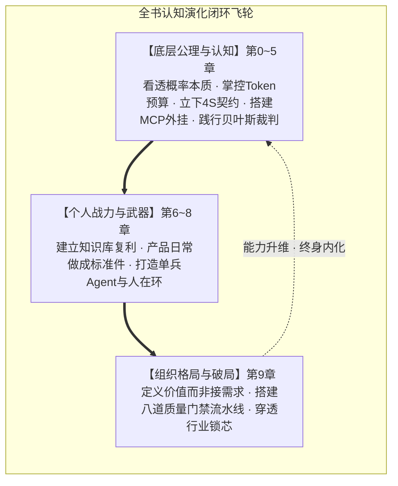

# 后记：焦虑消失之后，你的新起点

读到这里，你和翻开这本书第一页时的自己，已经是两个人了。

那时候你可能还在焦虑——AI 到底是什么？自己会不会被时代无情替代？面对铺天盖地的模型和术语，究竟该从哪里建立防线？

现在，你的焦虑消失了。不是因为有人灌输了廉价的心灵鸡汤，而是因为你拥有了穿透迷雾的底层逻辑：

### 焦虑消失的三重认知跃迁

**第一，你看透 AI 的本质了（认知跃迁）。**  
它是一个高维参数空间的概率采样系统——强大但不稳定，像幽灵不像忠犬（$\to$ 见第1章）。你不再被它“自信满满的幻觉”唬住，也不再因它偶尔算错简单算术而全盘否定。你懂得用 Token 经济学做预算（$\to$ 见第2章），用 4S 原则和三层规格书给它立规矩（$\to$ 见第3章），用 MCP 统一接口给它接通工具双手（$\to$ 见第4章），用证据做贝叶斯更新（$\to$ 见第5章）。

**第二，你掌握落地的实战武器了（能力跃迁）。**  
你不是“会套两句提示词模板”，而是拥有了一整套武器库。从散落经验到 RAG 知识复利（$\to$ 见第6章），从周报与规范比对的产品标准件（$\to$ 见第7章），到让 AI 在 Harness 护栏中自主跑流程的 ReAct Agent（$\to$ 见第8章）。你懂得了在什么时候放手让 AI 狂奔，在什么关键卡点必须由人类保留人在环（HITL）的最终裁判权。

**第三，你升维到组织与产业格局了（格局跃迁）。**  
你明白了“会用 AI 只是多了一把锤子，驾驭 AI 是建一条流水线”（$\to$ 见第9章）。在「接需求 $\to$ 做交付」的死胡同里，AI 终将替代执行工具；但在「定义价值 $\to$ 验证假设」的高维战场上，AI 是业务专家不可替代的十倍放大器。你学会了能力分级与解耦，建立起了由双代理、Spec Mode 和八道质量门禁支撑的企业级研发底座，更能在面对生物医药、物联网、低空经济时，一眼辨识出卡住行业的“技术性锁芯”与“制度性锁芯”。

---

### 全书核心心法收拢

$$\text{行为 (Prompt/Harness)} \times \text{概率 (Sampling)} = \text{结果 (Output)}$$

你控制行为，AI 控制概率。你每次写下严密的任务书，每次配齐健壮的测试护栏，每次对齐真实的业务证据，都是在把正确的概率向上拉抬一个刻度。循环往复，系统的成功率必将无限逼近 100%。

**AI 是你的幽灵伙伴。**  
**概率思维是你的航海罗盘。**  
**半人马协作是你的终身姿态。**  

一个人学会用 AI，只是多了一把称手的锤子；一个组织学会用 AI，平地立起了一条现代化的流水线。

愿你在狂飙突进的 AI 时代——**不做被流水线淘汰的螺丝钉，做那个执笔设计流水线的人。**
