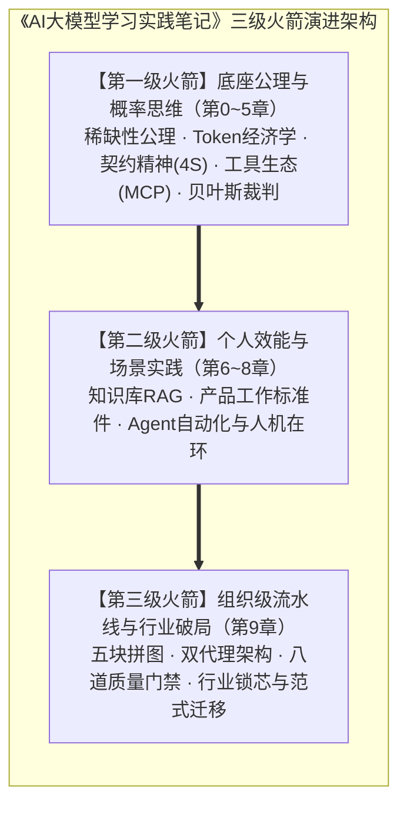
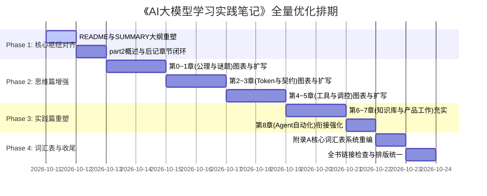

# 《AI大模型学习实践笔记》全书全量优化 PRD 方案

> **文档版本**：v1.0.0  
> **制定日期**：2026-10-11  
> **项目代号**：AI-First-Note-Full-Refactor  
> **关联仓库**：[terryhk/ai-first-note](https://github.com/terryhk/ai-first-note)  
> **文档定位**：全书内容重构、图表工程化、章节对齐与体验升级的设计规范与实施方案  

---

## 1. 项目背景与全书愿景

### 1.1 现状与痛点
《AI大模型学习实践笔记》是一部建立在**第一性原理（概率思维）**之上的深度技术与产品专著。它成功避开了浮躁的“提示词速成”和生硬的“算法公式堆砌”，确立了以**“行为 × 概率 = 结果”**为核心方程的认知体系。

然而，随着近期高质量实训章节（第9章 燎原计划实训）的引入，全书呈现出明显的**“发展不平衡”**：
1. **架构断层**：全局枢纽文档（`README.md`、`part2_practice/README.md`、`10_epilogue/README.md`）仍然停留在“第6~8章”的旧规划中，全书压轴的第9章在导读、路线图和后记中全面“失联”；
2. **胖瘦不均（章节切片碎片化）**：第1~8章被机械切割为大量 15~30 行的极短小文件，频繁翻页且缺乏论述纵深，而第9章是一气呵成、图文并茂的 460+ 行长篇实战；
3. **视觉呈现反差极大**：第9章已具备 8 处现代化 Mermaid 架构图，而第1~8章完全依赖纯文本与极简表格，认知负荷高；
4. **文件工程命名规范割裂**：章节小节文件名在下划线（`1.1_two_weird_phenomena.md`）与连字符（`4.1-six-solutions-comparison.md`）之间混杂；
5. **附录严重萎缩**：核心词汇表（`appendix_glossary`）仅剩 25 行，诸多核心概念（Token、Embedding、MCP、ReAct、Spec Mode、Harness等）未收录。

### 1.2 升级愿景（Vision）
将本书从目前的**“个人学习笔记集合”**全面升级为**“企业级/行业级 AI 思考与实践标准手册”**。  
全书统一贯穿**“概率思维认知 $\to$ 个人实践落地 $\to$ 组织级流水线交付”**三级火箭模型，保持高水准的文风质感、图表密度与工业级落地性。

---

## 2. 优化目标与衡量指标（Goals & Metrics）

| 目标维度 | 现状 | 目标状态（Target） | 衡量指标 |
| :--- | :--- | :--- | :--- |
| **全书脉络一致性** | 目录、导读、后记遗漏第9章；引言存在旧文案 | 全书所有导航、路线图、后记完全对齐最新十个篇章 | 0处破损引用或遗漏 |
| **小节内容丰满度** | 存在 18 个不足 30 行的“骨架子章节” | 扩充案例、推导过程与反思，消除碎片感 | 核心小节平均行数 $\ge 60$ 行 |
| **视觉与图表化** | 第1~8章 0 个架构图，第9章 8 个图 | 为前8章及开篇补充 **15+ 处高清 Mermaid 流程图与架构图** | 全书图表覆盖率 100% |
| **词汇表完备度** | 词汇表仅 25 行 | 补充 50+ 个全书高频核心术语与对应章节反向索引 | 覆盖全书所有术语 |
| **工程规范度** | 文件名混用 `_` 与 `-` | 全量统一为 GitBook / Markdown 最佳实践规范 | 规范检查脚本 100% 通过 |

---

## 3. 详细优化方案与模块工作拆解（WBS）

### 模块一：全局枢纽对齐与主线贯通（Global Hub Alignment）

#### 1. `README.md`（首页大纲重塑）
- **修复结构清单**：将“第二部分（第6-8章 + 后记 + 附录）”修正为“第二部分（第6-9章 + 后记 + 附录）”，补齐第6章、第9章的核心概要：
  - *第6章 零代码搭建AI知识库：让笔记找你，形成个人经验复利*
  - *第9章 LY Plan实训——从会用AI到让AI替你干活：五块能力拼图打通组织级研发交付流水线*
- **更新学习路线图**：
  - **产品经理/架构师路线**：开篇 $\to$ 第3章（契约） $\to$ 第7章（产品工作） $\to$ 第9章（组织级实训流水线）；
  - **研发与技术路线**：第1~2章（底层概率与Token） $\to$ 第4章（MCP与工具外挂） $\to$ 第8章（Agent自动化） $\to$ 第9章（Spec Mode与质量门禁）。

#### 2. `SUMMARY.md`（全书导航优化）
- 为第9章扩充二级目录索引（与前8章保持结构对齐）：
  - 9.1 看趋势：产品经理的宏观视野
  - 9.2 定义价值：产品思维是第一性原理
  - 9.3 写需求：把产品意图变成AI听得懂的契约
  - 9.4 建流程：企业级AI研发的产品化交付
  - 9.5 看行业：跨界视野与行业映射
  - 9.6 本章小结与落地行动清单

#### 3. `part2_practice/README.md`（第二部分概述修正）
- 删除“苏格拉底私教”等遗留过时文案；
- 建立从个人实践（第6~8章）递进到组织实践（第9章）的导读脉络。

#### 4. `10_epilogue/README.md`（后记总结闭环）
- 在后记核心总结中正式纳入第9章的“组织视角”：从个人掌握一把好锤子，到组织构建一条流水线。

---

### 模块二：第一部分（思维篇）内容深度充实与图表化

#### 第0章 基础公理与Aha时刻（`00_axioms`）
- **补充图表**：
  - 绘制“稀缺性转移曲线”（体力编码成本趋近于0 vs 框架定义能力价值陡增）；
  - 绘制“私有产权资产与通用大模型杠杆效应图”。
- **充实小节**：
  - 展开 `0.1_steven_aha.md` 与 `0.2_my_aha.md`，增加更具体的代码/笔记重构前后对比细节，避免几句话带过。

#### 第1章 谜题：为什么世界上没有完美的AI？（`01_puzzle`）
- **补充图表**：
  - `1.2` 绘制“Next-Token 概率分布采样树（Top-p / Temperature 调控机理）”；
  - `1.3` 绘制“人类五维世界（物理/情感/因果/历史/交互）vs 语言模型四维文本空间”的投影示意图。
- **内容加固**：
  - 充实 `1.5_result_vs_behavior.md`（目前仅15行），补充“死扣结果的伪敏捷 vs 优化行为的概率对齐”真实案例。

#### 第2章 稀缺的硬通货：Token与语义坐标（`02_token`）
- **补充图表**：
  - `2.1` 绘制“上下文窗口作为稀缺预算的分配漏斗”；
  - `2.3` 绘制“高维向量空间中的语义坐标聚类与 Cosine 相似度检索原理图”。
- **内容加固**：
  - 扩充 `2.2_economic_consideration.md`，给出真实企业任务中输入/输出 Token 成本测算与上下文压缩 ROI 模型。

#### 第3章 契约精神：如何写一份无法违约的交付规格书（`03_contract`）
- **补充图表**：
  - `3.2` 绘制“4S 原则（Single, Specific, Short, Structured）结构脑图”；
  - `3.5` 绘制“三层架构：Spec（规格） $\to$ Verifier（验证器） $\to$ Environment（执行环境）”交互时序图。
- **与第9章呼应**：
  - 建立第3章的“三层架构/4S原则”与第9章“六要素任务书/双主代理”的跨章节超链接与概念呼应。

#### 第4章 市场的进化：从赤手空拳到工具外挂（`04_market`）
- **补充图表**：
  - `4.1` 绘制“六大方案（Prompt / CoT / RAG / Function Calling / MCP / Fine-tuning）成功率 P vs 成本坐标系”；
  - `4.3` 绘制“MCP Client-Host-Server 架构标准协议通信流”；
  - `4.4` 绘制“ReAct（Thought-Action-Observation）与 PAL（程序辅助语言）双流对比”。
- **统一命名**：
  - 将小节文件名中的连字符 `-` 统一为规范格式。

#### 第5章 技术世界的宏观调控：如何成为合格的贝叶斯裁判（`05_governance`）
- **补充图表**：
  - `5.1` 绘制“先验概率 $\to$ 观察证据 $\to$ 后验概率更新的飞轮图”；
  - `5.3` 绘制“LLM-as-a-Judge 与自动化 Eval 流水线”。
- **内容加固**：
  - 提供具体的自动化评测 Prompt 与指标设计标准（BLEU/ROUGE局限性 vs LLM 打分一致性）。

---

### 模块三：第二部分（实践篇）内容重构与标准件化

#### 第6章 实践1：零代码搭一个AI知识库（`06_personal_knowledge_base`）
- **补充图表**：
  - 绘制“Chunking 分块策略 $\to$ 向量化 $\to$ Hybrid Search（混合检索） $\to$ 重排（Rerank）全流程图”；
  - 绘制“个人笔记复利增长模型”。
- **模板强化**：
  - 充实 `6.6-templates.md`，提供开箱即用的 Dify / Obsidian / 飞书知识库落地方案。

#### 第7章 实践2：用AI赋能产品工作（`07_product_work`）
- **充实单薄章节**：
  - `7.1`（仅19行）扩展为“产品经理日常高频场景矩阵（文档生成、竞品分析、PRD拆解、用户反馈聚类）”；
  - `7.4`（仅17行）扩展为“基于大模型做埋点事件分析与运营异动归因的完整工作流”。
- **补充图表**：
  - 绘制“从非结构化群聊/工单到标准周报的萃取流水线”。

#### 第8章 实践3：用Agent自动化重复任务（`08_agent_automation`）
- **补充图表**：
  - 绘制“Skill 技能包生命周期”；
  - 绘制“Harness 运行时沙箱护栏架构图”；
  - 绘制“Human-in-the-loop 人在环审批与升级机制图”。
- **与第9章无缝衔接**：
  - 将单兵 Agent（第8章）平滑过渡到第9章的企业级多 Agent 协作与研发云流水线。

---

### 模块四：附录与全书工具箱完善

#### 1. 附录A 核心词汇表（`appendix_glossary`）全面重构
从当前的 25 行扩充至 120+ 行，分类构建“AI-First 词典”：
- **认知概念**：幻觉、Next-Token、概率采样、Temperature、Top-p、System 1/2；
- **Prompt与工程**：思维链（CoT）、思维树（ToT）、Few-Shot、4S原则、Spec Mode、Vibe Coding；
- **系统与架构**：RAG、Embedding、Cosine 相似度、Function Calling、MCP、ReAct、Harness、Subagent；
- **组织与度量**：双主代理、六要素任务书、KANO模型、贝叶斯更新、Eval。
每个词条包含：**通俗解释、一句话心法、对应全书章节链接**。

#### 2. 附录B AWS AIF 知识速查映射
- 在现有优质内容基础上，增设“全书章节与 AWS AIF 知识领域对应表”，方便读者备考与实践双向查阅。

---

## 4. 执行计划与分阶段路线图

### 分阶段交付策略（分批推进，随时可验）
1. **第一阶段（P0 紧急）**：**修补骨架断层**。立即更新 `README.md`、`SUMMARY.md`、`part2_practice/README.md`、`10_epilogue/README.md`，使整本书在逻辑与目录上完全统一。
2. **第二阶段（P1 重要）**：**充实前8章中严重单薄的小节（<30行的章节）并引入核心 Mermaid 架构图**，使前置理论篇的厚度配得上第9章的高度。
3. **第三阶段（P2 完善）**：**重写附录A核心词汇表**，统一全书文件命名与内部超链接。

---

## 5. 待用户确认事项（Checklist for User Approval）

在正式动笔批量修改前，请您确认以下关键事项：

1. **章节文件组织形式确认**：
   - **选项 A（推荐）**：保持当前的子目录细粒度小文件结构（便于 GitBook / 知识库阅读），重点是充实每个短小文件的深度并补全 Mermaid 图，同时将第9章也细化拆分出小节文件；
   - **选项 B**：将每一章合并为一个完整的长篇 Markdown（类似第9章模式），减少跳页碎片感。
2. **文件命名规范确认**：
   - 是否统一将所有小节文件命名中的连字符 `-` 改为标准的下划线 `_`（例如 `4.1-mcp.md` 改为 `4.1_mcp.md`），以保证全书命名一致性？
3. **推进节奏确认**：
   - 是否同意按照 **Phase 1（目录与全局枢纽对齐） $\to$ Phase 2（思维篇扩充与图表化） $\to$ Phase 3（实践篇扩充） $\to$ Phase 4（词汇表完善）** 的顺序分步实施？每完成一个阶段均向您汇报确认。
