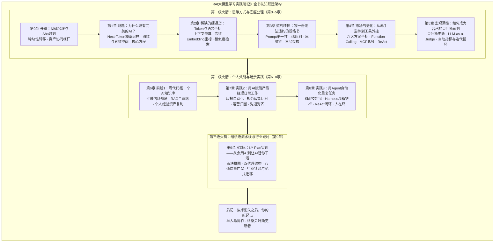

# 《AI大模型学习实践笔记》全书全量内容大纲与重构规范

> **方案模式**：选项 B（每章聚合为独立完整长篇大作，消除零散切片）  
> **制定日期**：2026-10-11  
> **状态**：待用户确认（待审核确认后启动 Phase 1）  
> **目标文件结构**：每章由目录下的 `README.md` 承载整章完整内容，与第9章长篇结构保持一致，同时保持 `SUMMARY.md` 索引清晰。

---

## 一、 全局架构演进图（三级火箭模型）

---

## 二、 物理文件组织规范（选项B：聚合整章落地）

按选项 B 规范，将原来分散在各个子目录下的极短文件（15~30行）**融会贯通合并至该章的 `README.md` 中**，保留章内的小节层级标题（H2/H3），删除零散碎文件，实现“一章一文、一气呵成、深度充实”的沉浸阅读体验：

| 章节路径 | 原文件状态 | 目标形态（选项B） | 规划行数 | 规划核心图表（Mermaid） |
| :--- | :--- | :--- | :--- | :--- |
| `00_axioms/README.md` | 5个碎文件（共90行） | 完整开篇大作 | ~250行 | 稀缺性转移曲线、私有产权杠杆模型 |
| `01_puzzle/README.md` | 8个碎文件（共194行）| 完整第一章 | ~350行 | 采样概率树与温度控制、五维vs四维映射图 |
| `02_token/README.md` | 5个碎文件（共178行）| 完整第二章 | ~300行 | 上下文窗口预算漏斗、高维空间聚类图 |
| `03_contract/README.md` | 7个碎文件（共405行）| 完整第三章 | ~450行 | 4S结构化模型图、三层契约交互时序图 |
| `04_market/README.md` | 7个碎文件（共283行）| 完整第四章 | ~400行 | 六大方案P与成本坐标系、MCP总线协议流 |
| `05_governance/README.md`| 6个碎文件（共390行）| 完整第五章 | ~380行 | 贝叶斯后验迭代环、自动化评测流水线 |
| `06_personal_knowledge_base/README.md` | 7个碎文件（共352行）| 完整第六章 | ~420行 | RAG混合检索与重排全流程、复利工作流 |
| `07_product_work/README.md` | 7个碎文件（共286行）| 完整第七章 | ~400行 | 产品日常高频场景矩阵、规范智能差分流 |
| `08_agent_automation/README.md` | 7个碎文件（共388行）| 完整第八章 | ~450行 | Skill与Harness架构图、人机在环状态机 |
| `09_ly_plan/README.md` | 1个完整文件（464行） | 保持现状（已优化） | 464行 | 已具备 8 处高质量 Mermaid 架构图 |
| `10_epilogue/README.md` | 1个短文件（20行） | 完整后记收束 | ~100行 | 全书闭环逻辑总结图 |
| `appendix_glossary/README.md` | 1个残缺文件（25行） | 完整核心词汇表 | ~260行 | 包含 50+ 个全书术语与反向索引 |
| `appendix_aws_aif/README.md` | 1个文件（158行） | 补充映射与速查表 | ~220行 | AWS AIF 考点与全书章节对应表 |

---

## 三、 逐章详细内容大纲与重构规格

### 【开篇】基础公理与Aha时刻 (`00_axioms/README.md`)
- **本章心法**：AI 时代懂与不懂的差距，不是“效率快慢”，而是“有无杠杆与支点”的结构性差距。
- **详细小节大纲**：
  - **引子：顿悟的两个瞬间**
  - **故事一：Steven的两周**（从单打独斗熬夜一个月崩溃，到借助 Claude Code 两周重构代码库）
  - **公理一：稀缺性与极限替代公理**
    - 什么是稀缺的变了：体力型编码时间边际成本趋于0；
    - 真正的稀缺转移到“精准定义问题、挑选模型、设定护栏”的架构能力；
    - *【Mermaid图：稀缺性转移曲线（体力时间成本下降 vs 框架判断价值上升）】*
  - **故事二：十五年的投资笔记**（同一份笔记，普通聊天给出“一锅糊”，顶级模型配合逻辑引导给出完整体系）
  - **公理二：产权与资产协同公理**
    - 私有独特资产（你的真金白银经验）+ 顶级通用资产（前沿大模型推理能力）= 超额回报；
    - 没有支点的杠杆什么都撬不动；
    - *【Mermaid图：私有产权资产与顶级大模型杠杆协同模型】*
  - **双公理的终极推论**：为顶级模型付费是投资而非消费；建立半人马协作姿态。
  - **本章小结与思维检查清单**

---

### 【第1章】谜题：为什么世界上没有完美的AI？ (`01_puzzle/README.md`)
- **本章心法**：AI 不是严谨的逻辑计算机，它是一台算概率的语言采样机。理解它的不确定性，是给它立规矩的前提。
- **详细小节大纲**：
  - **1.1 两个怪现象**：能解高难代码却算错简单乘除；满嘴荒唐言却语气笃定（幻觉的底色）。
  - **1.2 第一性原理：AI在算概率**
    - Next-Token 预测机制的本质；
    - 概率空间采样：从词表（Vocab）中掷骰子；
    - 控制骰子的旋钮：Temperature（温度）与 Top-p 的物理意义；
    - *【Mermaid图：Next-Token 概率分布与采样分支树】*
  - **1.3 人类活在五维，AI死在四维**
    - 人类的五维体验：物理世界、时空历史、因果规律、情绪动机、交互反馈；
    - 语言模型的四维切片：符号、语义向量、统计相关、文本映射；
    - 为什么它没有“杯子掉在地上会碎”的原生痛觉；
    - *【Mermaid图：人类五维经验空间 $\to$ 大模型高维文本投影映射示意】*
  - **1.4 非确定性的实践含义**：既然每次输出都不同，工程上如何构建确定性（降温、单测、采样多选一）。
  - **1.5 结果正确 ≠ 行为正确**：
    - 撞大运的正确与逻辑健壮的正确；
    - 为什么必须约束推理路径（CoT）而不能只看最终答案。
  - **1.6 概率工具箱与全书核心方程**：
    $$\text{行为 (Prompt/Harness)} \times \text{概率 (Sampling)} = \text{结果 (Output)}$$
  - **本章小结与行动自检**

---

### 【第2章】稀缺的硬通货：Token与语义坐标 (`02_token/README.md`)
- **本章心法**：上下文是你的资金预算，Embedding 是你的导航罗盘。在 AI 世界里，每一分注意力都有标价。
- **详细小节大纲**：
  - **2.1 Token的双重面孔**：
    - 它是算力消耗与商业计费的基本货币；
    - 它是模型注意力和记忆容量的物理上限。
  - **2.2 值不值？AI任务的经济学账本**：
    - 上下文窗口预算分配漏斗（System Prompt / Background / User Input / Generation）；
    - 压缩与精炼策略：为什么“把所有资料全塞进去”往往适得其反；
    - *【Mermaid图：上下文窗口预算分配与注意力衰减漏斗】*
  - **2.3 Embedding：AI世界的“地理坐标”**：
    - 高维向量空间：词语与句子的经纬度；
    - 语义相似度与余弦夹角计算（Cosine Similarity）；
    - 向量聚类与近邻检索（KNN）在知识召回中的底座作用；
    - *【Mermaid图：高维向量空间中的语义距离与聚类示意】*
  - **2.4 实践推论**：长文本模型时代，为什么我们依然需要向量检索？
  - **本章小结与经济账速算表**

---

### 【第3章】契约精神：如何写一份无法违约的“交付规格书” (`03_contract/README.md`)
- **本章心法**：提示词不是闲聊指令，而是一份严肃的业务交付合同。合同越缜密，AI越靠谱。
- **详细小节大纲**：
  - **3.1 Prompt 的第一性：从自然语言到软件契约**
  - **3.2 4S 原则：一份好契约的黄金标准**
    - Single（单一目标）、Specific（边界具体）、Short（表述精炼）、Structured（结构化呈现）；
    - *【Mermaid图：4S 契约结构化模型脑图】*
  - **3.3 思维链（CoT）：合同的“分期付款”机制**
    - 强制模型“打草稿再回答”；
    - 慢思考如何将单步失败率从指数级累积降为线性受控。
  - **3.4 Few-shot 示例驱动：以案说法**
    - 为什么三条优质样例胜过一千字抽象描述；
    - Bad Case 样例的防沉迷用法。
  - **3.5 三层架构：Spec $\to$ Verifier $\to$ Environment**
    - Spec（规格书定义要求） $\to$ Verifier（验证器负责找茬） $\to$ Environment（执行环境提供反馈）；
    - *【Mermaid图：Spec-Verifier-Environment 三层交互时序图】*
    - （横向呼应第9章的六要素任务书与双代理）。
  - **本章小结与标准契约模板库**

---

### 【第4章】市场的进化：从赤手空拳到工具外挂 (`04_market/README.md`)
- **本章心法**：你选的不是技术方案，是不同的基础成功率 P 与成本风险组合。
- **详细小节大纲**：
  - **4.1 六个方案能力坐标对比**：
    - Prompt $\to$ CoT $\to$ RAG $\to$ Function Calling $\to$ MCP $\to$ Fine-tuning；
    - *【Mermaid图：六大方案成功率 P vs 落地工程成本坐标系】*
  - **4.2 Function Calling：给AI签发授权委托书**
    - 从“动嘴生成文本”到“决定调哪个函数”；
    - 参数抽取与结构化 JSON Schema 契约。
  - **4.3 MCP（Model Context Protocol）：AI世界的统一接口总线**
    - 为什么说 MCP 是 AI 领域的 USB-C / WTO 协议；
    - Client-Host-Server 三层拓扑架构；
    - *【Mermaid图：MCP Client-Server 通信协议时序与工具挂载流】*
  - **4.4 MCP vs CLI：工具链演进的暗线竞争**
    - CLI 的通用性与 MCP 的结构化治理对比。
  - **4.5 ReAct 与 PAL：Agent 的两大核心执行范式**
    - ReAct（Thought-Action-Observation 循环）；
    - PAL（程序辅助语言：让大模型写代码调解释器算数学）。
  - **4.6 概率选型决策树**：回答三个关键问题，秒定技术栈。
  - **本章小结与选型决策指南**

---

### 【第5章】技术世界的宏观调控：如何成为合格的贝叶斯裁判 (`05_governance/README.md`)
- **本章心法**：不要凭直觉相信大模型，也不要凭偶发报错全盘否定。用证据更新认知，做理性的贝叶斯裁判。
- **详细小节大纲**：
  - **5.1 概率思维的核心方程与贝叶斯推断本义**
    - 先验概率 $P(H)$、似然度 $P(E|H)$ 与后验概率 $P(H|E)$ 的直观通俗解读。
  - **5.2 评估的本质：用真实证据做贝叶斯更新**
    - 摆脱“拍脑袋试跑一次”的随机性陷阱；
    - *【Mermaid图：先验假设 $\to$ 测试集验证 $\to$ 证据吸收 $\to$ 后验校准飞轮】*
  - **5.3 闭环迭代循环：评估 $\to$ 归因 $\to$ 修复 $\to$ 再验证**
  - **5.4 自动化指标 vs 人工评测（Eval 工程化体系）**
    - 传统 NLP 指标（BLEU / ROUGE）的致命局限；
    - LLM-as-a-Judge（大模型充当裁判）的落地准则与偏见消除；
    - *【Mermaid图：企业级双轨评测流水线（规则基线 + LLM打分 + 人工抽检）】*
  - **5.5 延伸深潜：贝叶斯推断在日常业务决策中的落地**
  - **本章小结与评测自检清单**

---

### 【第6章】实践1：零代码搭一个AI知识库——让笔记自己来找你 (`06_personal_knowledge_base/README.md`)
- **本章心法**：散落的文件是债务，沉淀的知识是资产。RAG 不是黑科技，是一套让经验自动产生复利的检索流水线。
- **详细小节大纲**：
  - **6.1 为什么散落的知识没有复利？**（信息孤岛、记得看过但检索不到的规模诅咒）。
  - **6.2 RAG 零代码搭建全景拆解**：
    - 文档切分（Chunking）：固定窗口 vs 语义切分的抉择；
    - 向量存储与索引构建；
    - 混合检索（Keyword BM25 + Vector Embedding）；
    - 重排机制（Rerank）：找准最后的 3 篇黄金参考资料；
    - *【Mermaid图：企业与个人级 RAG 混合检索重排端到端流水线】*
  - **6.3 知识连接 × AI：跨领域的顿悟时刻**
    - 把 15 年不同维度的散点笔记串成决策网络。
  - **6.4 每周知识整理工作流（SOP）**
    - 输入、清洗、打标、归档四步自运转飞轮。
  - **6.5 成本分析与经济账（开源 vs 商业托管）**
  - **6.6 开箱即用模板库**（支持 Obsidian、Dify、飞书多维表格）。
  - **本章小结与落地实战指引**

---

### 【第7章】实践2：用AI赋能产品工作——周报、规范、分析与日常提效 (`07_product_work/README.md`)
- **本章心法**：优秀的 AI 产品经理不应该被重复材料淹没，把重复劳动做成标准件，才能把精力留给定义价值。
- **详细小节大纲**：
  - **7.1 产品经理的高频日常武器库矩阵**
    - 文档起草、规范对照、数据异动归因、跨团队对齐四象限；
    - *【Mermaid图：产品经理日常 AI 标准件流水线架构】*
  - **7.2 周报自动化的四步萃取法**
    - 原始提交/工单采集 $\to$ 业务价值分类 $\to$ 进展与风险提炼 $\to$ 向上汇报格式生成。
  - **7.3 规范对比的结构化差分方法**
    - 面对上百页 PRD/国标更新，如何让 AI 做“语义级 Diff”；
    - 输出三列矩阵：新增条款、变更影响、产品应对建议。
  - **7.4 运营与用户反馈的自动化归因分析**
    - 几千条应用商店评价/工单快速聚类；
    - 用 5Why 模板驱动根因分析报告生成。
  - **7.5 向上沟通与横向对齐的提效框架**
  - **本章小结与产品经理专属 Prompt 套件**

---

### 【第8章】实践3：用Agent自动化重复任务——从ReAct到放手 (`08_agent_automation/README.md`)
- **本章心法**：给 AI 写 SOP，让它在沙箱里跑流程，你在关键卡点做审批——这就是半人马协作的终极形态。
- **详细小节大纲**：
  - **8.1 Skill：Agent的“技能包”标准化定义**
    - 技能的输入、执行逻辑与输出 Schema。
  - **8.2 Harness：Agent的“运行时容器与护栏”**
    - 为什么没有 Harness 的 Agent 会把项目跑乱；
    - 目录沙箱、网络权限与执行超时的工程护栏；
    - *【Mermaid图：Agent 运行时 Harness 护栏与上下文注入架构】*
  - **8.3 ReAct：Agent的核心动力学**
    - 观察（Observe） $\to$ 规划（Plan） $\to$ 行动（Act） $\to$ 反思（Reflect）企业级实战详解。
  - **8.4 动手跑通你的第一个自动化 Agent 任务**
    - 抓取行业早报 $\to$ 过滤清洗 $\to$ 生成飞书/邮件汇总推送。
  - **8.5 人在环（Human-in-the-Loop）：安全底线**
    - 哪些环节放手给 AI 跑，哪些环节必须人工点击确认；
    - *【Mermaid图：人在环（HITL）审批决策树与权限升级流程】*
  - **8.6 通向第9章的跨越**：从个人单兵 Agent 到企业级多智能体流水线。
  - **本章小结与 SOP 模板**

---

### 【第9章】实践4：LY Plan实训——从会用AI到让AI替你干活 (`09_ly_plan/README.md`)
- **状态**：**已于此前全量优化完成，作为压轴大作完美承接前文！**
- **核心骨架**：
  - 9.1 看趋势：产品经理的宏观视野（三次浪潮、四代范式、工作流vs自主式）
  - 9.2 定义价值：产品思维是第一性原理（金字塔、七大修炼、感知云分级与密信解耦）
  - 9.3 写需求：把产品意图变成AI听得懂的契约（六要素任务书、五步闭环、Claude Code五件套）
  - 9.4 建流程：企业级AI研发的产品化交付（双代理、八道质量门禁、智能体六步SOP、低空实战）
  - 9.5 看行业：跨界视野与行业映射（AlphaFold双十定律、物联网语义巴别塔、合规边界）
  - 9.6 本章小结与 8 条落地行动清单

---

### 【后记】焦虑消失之后，你的新起点 (`10_epilogue/README.md`)
- **本章心法**：AI 是你的幽灵伙伴，概率思维是你的指南针，半人马协作是你的战斗方式。
- **详细内容大纲**：
  - **三层认知的全面贯通**：
    1. 认知底座（第1~5章）：理解了概率本质，不再被神秘感或错误迷惑；
    2. 个人战力（第6~8章）：掌握了知识库、产品标准件与 Agent 自动化武器；
    3. 组织格局（第9章）：学会了定义价值、搭建交付流水线、跨界寻找行业锁芯。
  - *【Mermaid图：全书三级火箭与能力内化飞轮全景收束图】*
  - **给未来读者的三句话**：
    1. 守住你的独特产权；
    2. 控制行为，迭代概率；
    3. 成为流水线的设计者，而非被流水线替代的人。

---

### 【附录 A】核心词汇表（AI-First Dictionary）(`appendix_glossary/README.md`)
全面重构为 4 大分类、50+ 个核心词汇的权威速查表（包含**中英对照、一句话定义、通俗比喻、全书关联章节超链接**）：
1. **底座认知类**：Next-Token Prediction、概率采样、Temperature、Top-p、Hallucination（幻觉）、System 1 & System 2、高维向量空间；
2. **提示与规格类**：Prompt Engineering、4S原则、Chain of Thought（思维链）、Few-Shot、Context Window、Spec Mode、Vibe Coding；
3. **系统与工具类**：Embedding、Cosine Similarity、RAG、Chunking、Rerank、Function Calling、Model Context Protocol（MCP）、ReAct、PAL；
4. **Agent与工程类**：Harness、Skill、Subagent、Human-in-the-Loop、Orchestrator、双主代理、六要素任务书、LLM-as-a-Judge、Bayesian Update。

---

### 【附录 B】AWS AIF-C01 核心知识速查与全书映射 (`appendix_aws_aif/README.md`)
在保留原有用高频考点速查（Bedrock、SageMaker、Guardrails、成本考量）的基础上，**新增一节“AWS AIF 考点与本书章节映射指南”**，实现证书考点与实战第一性原理的无缝贯通。

---

## 四、 首页与目录联动规格

### 1. `README.md`
- 首页大纲由原来的“第6-8章”正式更名为：
  `第二部分：AI实践笔记（第6-9章 + 后记 + 附录）`
- 补全第6章和第9章的核心导读；
- 学习路线图增设“产品经理/架构师落地路线（重点标注第9章）”。

### 2. `SUMMARY.md`
按选项 B 规范，将原来大量碎片小文件的目录索引，优雅整合为：**每个大章节作为一个独立阅读单元，其下二级目录精确链接至章内锚点或主模块**，保持目录整洁、逻辑层次清晰。

---

## 五、 下一步行动计划（待确认后执行）

用户确认本大纲规范后，我们将立即按照**分批推进**原则实施：

1. **第一阶段（P0 紧急）：修补骨架断层**
   - 更新并对齐 `README.md`
   - 更新并对齐 `SUMMARY.md`
   - 更新并对齐 `part2_practice/README.md`
   - 更新并对齐 `10_epilogue/README.md`
   - *（完成后向您汇报并提交 Git 记录）*
2. **第二阶段（P1 重点）：第一部分思维篇聚合与重塑（第0~5章）**
   - 逐章将碎文件深度融合扩写为包含 Mermaid 图的完整长篇大作；
3. **第三阶段（P1 重点）：第二部分实践篇聚合与重塑（第6~8章）**
   - 逐章扩写充实第6、7、8章，衔接第9章；
4. **第四阶段（P2 完善）：附录重构与清理收尾**
   - 全面扩写附录 A（50+词汇表）与附录 B，清理过时的碎文件。
