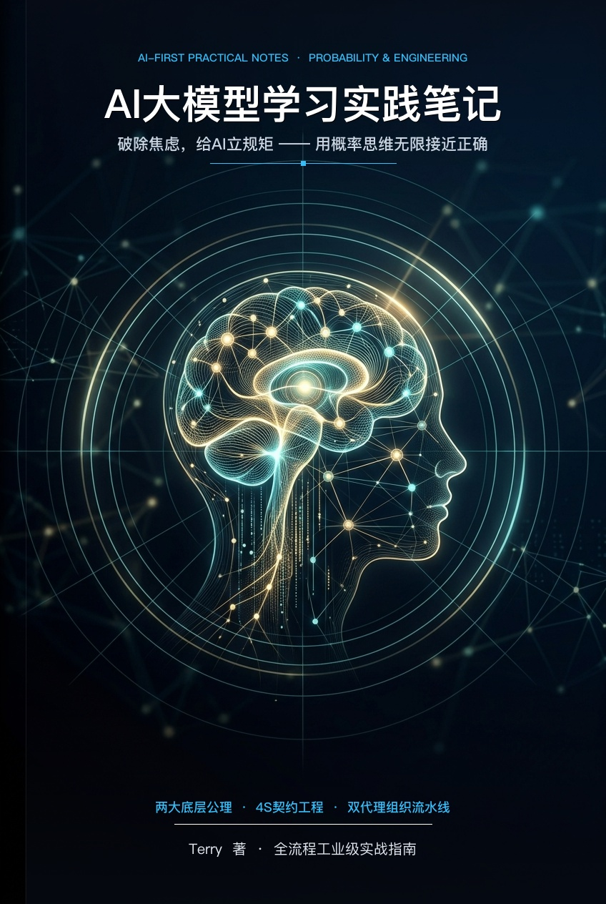
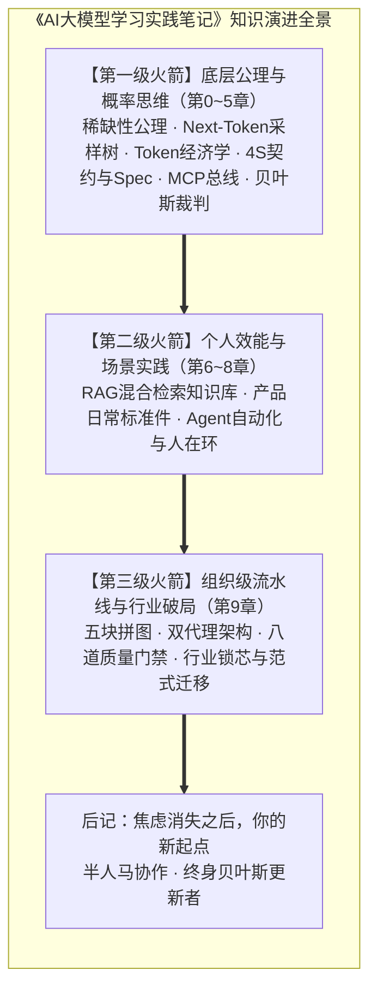
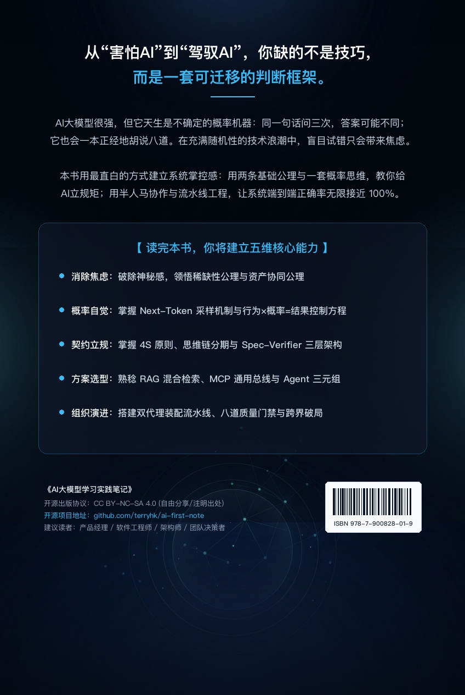

# AI大模型学习实践笔记

> 破除焦虑，给AI立规矩——用概率思维无限接近正确

---

## 封面

  
   
  <em>《AI大模型学习实践笔记》封面</em>

## 关于本书

AI大模型很强。但对大多数人而言，真正的问题不是“这东西怎么用”——聊两句谁都会。真正的问题是：**怎么从“害怕AI被替代”变成“驾驭AI造流水线”。**

本书不设玄学公式，不堆生硬术语。开篇用两个真实顿悟故事引出两条底层经济学公理——**稀缺性与极限替代公理**、**产权与资产协同公理**，让你从“看不懂”变成“看得透”。

全书贯穿一条由第一性原理驱动的核心方程式：

$$\text{行为 (Prompt/Harness)} \times \text{概率 (Sampling)} = \text{结果 (Output)}$$

你写的是一份交付契约（行为），AI返回的是从海量参数概率空间中抽样的输出（结果）。结果不完全由你单次控制——但你能控制的是：**每次都让行为更清晰一点，让工程护栏更坚固一点，让概率持续偏向正确，通过系统迭代让端到端交付成功率无限逼近 100%。**

---

## 适合谁读

- **AI初学者与职场人**：破除对AI的神秘感与替代焦虑，建立科学的概率思维；
- **产品经理与业务专家**：从“接需求画原型”升级为“定义价值、编写AI契约、构建业务流水线”；
- **研发工程师与架构师**：掌握从 Prompt、MCP、Agent 到 Spec Mode 企业级质量门禁的工程化方法论；
- **团队管理者与决策者**：洞察技术代际演进与组织级提效杠杆，识别行业瓶颈中的“技术锁芯”与“制度锁芯”。

---

## 学习路线

本书采用多轨针对性学习路线：

- **快速入门路线**：开篇 $\to$ 第1-2章 $\to$ 第6-7章（先理解概率本质与Token经济学，再快速上手知识库与日常提效）；
- **系统精读路线**：开篇 $\to$ 第1-5章 $\to$ 第6-9章 $\to$ 后记（自底向上完整通关思维方式、个人实战与组织流水线）；
- **产品经理与架构师路线**：开篇 $\to$ 第3章（契约精神） $\to$ 第4章（工具生态与MCP） $\to$ 第7章（产品工作标准件） $\to$ 第8章（Agent自动化） $\to$ 第9章（LY Plan实训——组织级交付流水线）；
- **决策者与管理路线**：开篇 $\to$ 第1章（概率第一性） $\to$ 第5章（贝叶斯裁判与评估调控） $\to$ 第9章（范式分治与行业锁芯） $\to$ 后记。

---

## 全书架构（三级火箭模型）

### 开篇：基础公理与Aha时刻
- 两个顿悟时刻引出两条经济学底层公理：稀缺性与极限替代公理、产权与资产协同公理。

### 第一部分：AI大模型的思维方式（第1~5章）
- **第1章 谜题：为什么世界上没有完美的AI？**——Next-Token概率采样、四维文本空间与五维现实的折叠、核心方程；
- **第2章 稀缺的硬通货：Token与语义坐标**——上下文预算经济学、高维Embedding空间、余弦相似度检索；
- **第3章 契约精神：如何写一份无法违约的“交付规格书”**——Prompt第一性、4S原则、思维链分期付款、Spec-Verifier-Env三层架构；
- **第4章 市场的进化：从赤手空拳到工具外挂**——六大方案成功率与成本坐标系、Function Calling、MCP统一接口、ReAct范式；
- **第5章 技术世界的宏观调控：如何成为合格的贝叶斯裁判**——贝叶斯更新闭环、Eval自动化评测流水线、LLM-as-a-Judge。

### 第二部分：AI大模型的实践笔记（第6~9章 + 后记 + 附录）
- **第6章 实践1：零代码搭一个AI知识库**——打破信息孤岛、RAG分块与混合检索重排、个人经验资产复利；
- **第7章 实践2：用AI赋能产品工作**——周报自动化四步法、规范结构化Diff比对、运营异动归因、沟通对齐标准件；
- **第8章 实践3：用Agent自动化重复任务**——Skill技能包、Harness运行时沙箱护栏、ReAct执行闭环、人在环（HITL）审批；
- **第9章 实践4：LY Plan实训——从会用AI到让AI替你干活**——五块能力拼图、双代理契约、八道工程质量门禁、智能体六步SOP、行业锁芯与跨界映射；
- **后记：焦虑消失之后，你的新起点**——半人马协作的终身进化姿态；
- **附录A：核心词汇表（AI-First Dictionary）**——50+ 核心概念系统速查；
- **附录B：AWS AIF-C01 Core Knowledge Quick Reference**——认证考点与本书知识横向映射。

---

## 背面

  
   
  <em>《AI大模型学习实践笔记》背面</em>

## 许可证

本书内容采用 [CC BY-NC-SA 4.0](https://creativecommons.org/licenses/by-nc-sa/4.0/) 许可证发布。
