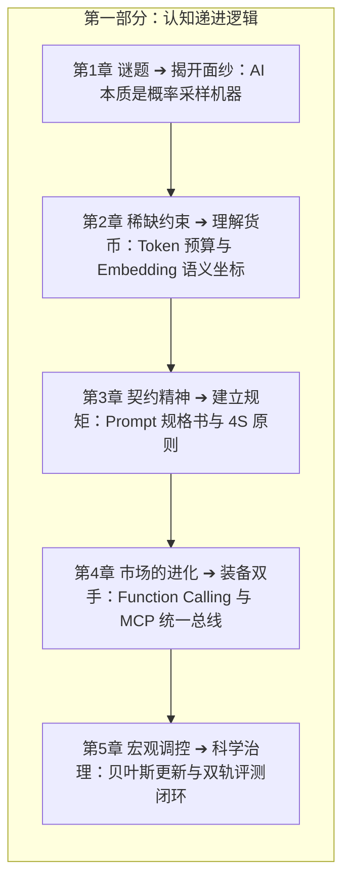

# 第一部分：AI大模型的思维方式

> 理解AI的概率本质，建立判断框架

---

第一部分解决一个核心问题：**AI 到底是什么？**

不是“它有多厉害”——那是营销噱头；而是：它的本质数学机制是什么？它的能力边界在哪里？它为什么会出错？你怎么控制它？

这一部分的逻辑线，对应经济学的层层递进：

- **谜题（第1章）**：为什么 AI 不完美？$\to$ 因为它本质是概率机器；
- **稀缺约束（第2章）**：AI 理解世界的最小单位是什么？$\to$ Token 预算与语义坐标；
- **契约（第3章）**：怎么让 AI 按你的意思办事？$\to$ Prompt 就是规格合同；
- **市场（第4章）**：AI 的工具生态怎么用？$\to$ 从赤手空拳到 MCP 工具外挂；
- **宏观调控（第5章）**：怎么评估 AI 做得好不好？$\to$ 做理性的贝叶斯裁判。

读完第一部分，你将彻底建立起一套高维判断框架——面对任何大模型的输出，你清楚知道它在概率分布的什么位置，该信多少，该在什么关键卡点构筑护栏。这是全书也是驾驭 AI 的绝对根基。
