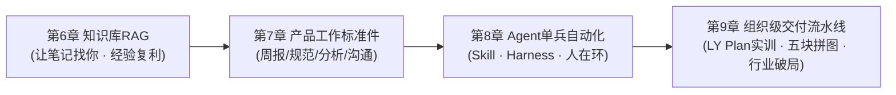

# 第二部分：AI大模型的实践笔记

> 核心哲学：**半人马协作——人类做判断，AI做执行。**
> 每完成一次实践 = 一次概率迭代。
> 技术武器随实践需要逐个登场：RAG在知识库搭建时自然出现，思维链在规范推演时自然出现，ReAct在Agent自动化时自然出现，双主代理与质量门禁在企业级流水线中自然出现。
> 从个人单兵提效，跨越到组织级研发流水线。

---

如果你从第一部分一路读到这里，你已经建立了完整的底层思维框架：

- 你知道 AI 的本质是**概率采样系统**——它像幽灵不像狗，你要驾驭它而不是驯服它；
- 你懂 **Token 的经济学**——上下文是稀缺预算，你要把注意力花在回报最高的位置；
- 你学会了写 **Prompt 合同**——激励约束、4S 原则、思维链分期付款、Spec-Verifier-Env 三层架构；
- 你了解了**工具生态**——从赤手空拳到 Function Calling 与 MCP 统一总线，学会按 $P$ 和成本组合选型；
- 你掌握了**贝叶斯裁判法**——不凭直觉，用真实证据做后验更新与闭环迭代。

这些第一性原理很强大，但面临最现实的一步考验：**你必须真正用它在泥泞的业务里打胜仗。**

第二部分就是来完成这一跃迁的。它不再抽象讲概念，而是带你逐级攻克真实的实战场景：

### 实践进阶阶梯

- **第6章 个人知识库搭建**：告别“记得看过但找不到”——零代码搭一个 AI 知识库，让笔记自己来找你，让个人资产产生复利；
- **第7章 AI赋能产品工作**：周报、规范比对、运营归因与沟通对齐——把产品经理的重复工作做成标准件；
- **第8章 Agent自动化重复任务**：从 ReAct 到放手——给 AI 写 SOP，让它在 Harness 护栏中跑流程，你在关键节点做人在环（HITL）审批；
- **第9章 实践4：LY Plan实训——从会用AI到让AI替你干活**：五块能力拼图（看趋势、定义价值、写需求、建流程、看行业），四大实战战场（感知云、量子密信、智能体平台、低空经济），双主代理与八道工程质量门禁，从个人挥锤子跨越到组织建流水线。

每一章都配有概率工具箱、边际成本与机会成本分析、开箱即用的 Prompt 契约与 SOP 模板。用到哪章翻到哪章，把这本书当作你的实战武器库。

在实践篇章之后，本书以一篇**后记**收拢——焦虑消失之后，你的新起点。两篇**附录**分别提供核心词汇体系速查和 AWS AIF-C01 认证知识要点，方便随时翻阅查证。

**记住：你每次完成一次实践，就是在做一次概率迭代。你立契约、设护栏（行为）$\to$ 跑任务（概率采样）$\to$ 评估归因 $\to$ 修正再跑。循环往复，整体成功率必将无限逼近 100%。**
